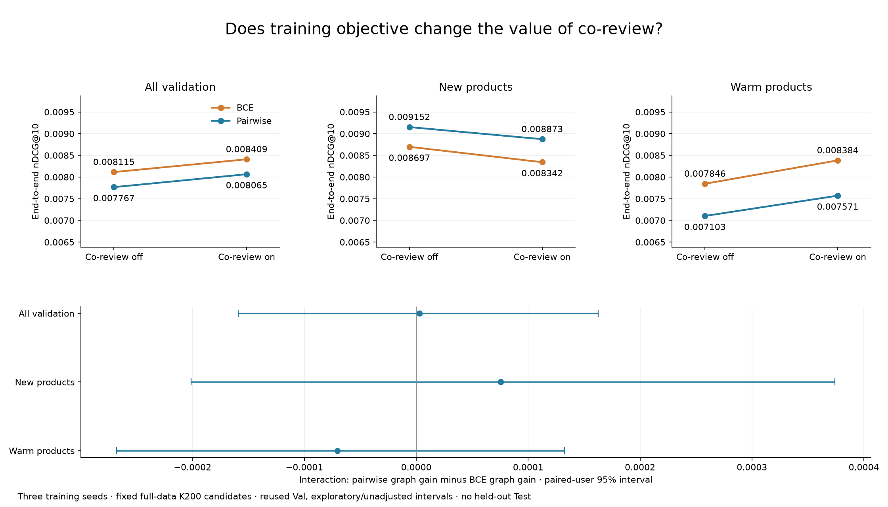
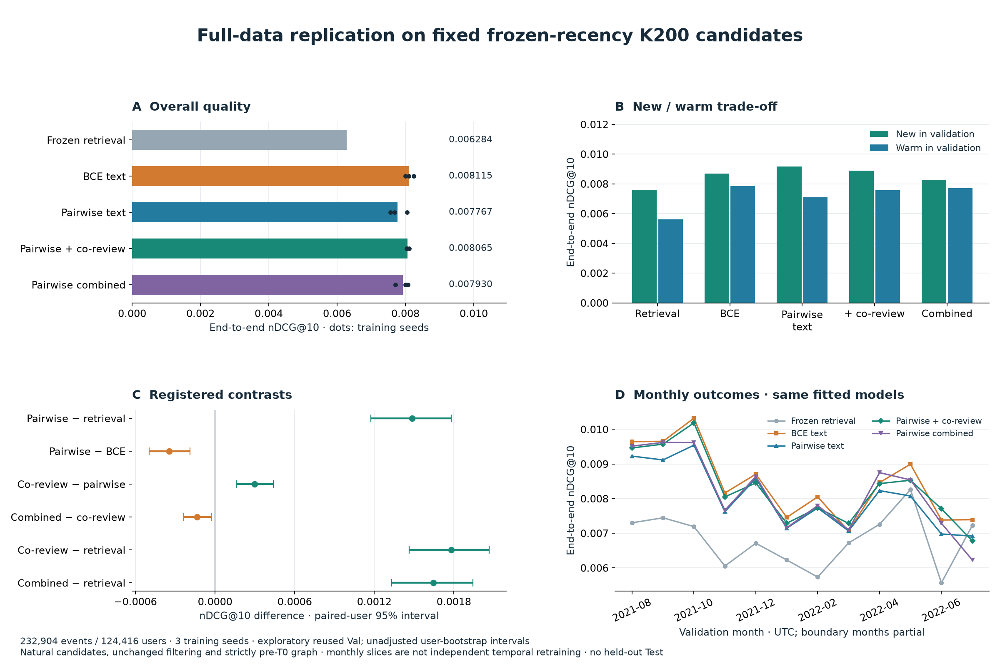
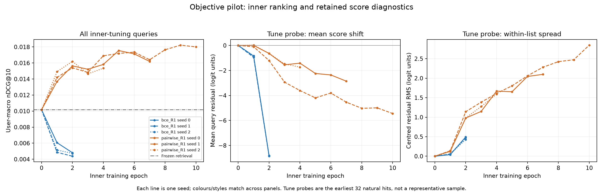
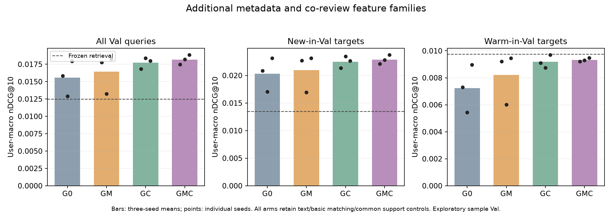

# Retrieve, Then Rank — cascade recommender study (CP4285)

Start with [docs/evaluations.md](docs/evaluations.md) for all evaluation findings, current progress, limitations and follow-up commands. `CLAUDE.md` covers implementation conventions; `docs/decisions.md` preserves historical decisions.

**Latest execution status (4 November 2026):** root plan §15 items are complete: locked full Test, popularity/composition, inference K sensitivity and bounded FAISS/cascade timing. [Numerical tables and audit metadata](results/steps_final/20261104/) and four checked figures are saved; **243 tests pass / 4 legacy skips**. The user deferred the narrative report. Earlier Test/index deferrals below are historical.

## Objective x co-review: completed controlled comparison

Three new full-data BCE+co-review fits complete the factorial alongside nine immutable controls, on **232,904 Val events / 124,416 users** and the same frozen K200 candidates. The switches affect four additional co-review features; basic matching/common support inputs remain present.

| Objective | Co-review | nDCG@10 | New | Warm |
|---|---|---:|---:|---:|
| BCE | Off | 0.008115 | 0.008697 | 0.007846 |
| BCE | On | **0.008409** | 0.008342 | **0.008384** |
| Pairwise | Off | 0.007767 | **0.009152** | 0.007103 |
| Pairwise | On | 0.008065 | 0.008873 | 0.007571 |

Co-review improves BCE overall by **+0.000295 [0.000169, 0.000425]**, or **3.6%**, but lowers new-item quality while improving warm items. The same trade-off appears under pairwise. The direct difference between their graph gains is **+0.000003 [−0.000159, 0.000163]**: objective dependence is inconclusive. Its new-minus-warm contrast is also inconclusive (**+0.000146 [−0.000162, 0.000511]**), using joint user-cluster resampling. These reused-Val intervals are exploratory/unadjusted and conditional on the trained seeds; no equivalence or final system is established.



[Detailed assessment](docs/evaluations.md#objective-x-co-review-factorial-completion-4-november-2026), [compact report/tables](results/full_data_replication/20261104-objective-coreview/report.md), root plan §14 and `configs/ranker/objective_coreview.yaml` record the protocol. Run `python -m cascade.pipelines.objective_coreview --phase prepare`, then `--phase fit --seed 0/1/2 --device mps`, `evaluate`, `report`, `audit`, and `publish` in the project environment. Fitting reads the immutable full-data parent; no candidate/feature regeneration or old-control retraining is required. Use a fresh study name for a rerun and a separate `--sample` technical preparation; existing destinations are refused.

The sample off-feature control reproduces the old BCE first epoch. **233 tests pass / 4 legacy skips**; all 33 new inner score sets, three outer outputs, twelve factorial locks, 675 metric rows, eighteen main intervals and the joint novelty interval pass independent checks. Graph retrieval, new graph encoders, index/serving work and held-out Test remain later decisions.

## Full-data replication results (4 November 2026)

After assessing the sample studies, twelve fresh ranker fits completed on the **111,480-product catalogue**, with **232,904 validation events / 124,416 users**. All methods share frozen MiniLM/90-day-recency natural K200 candidates, strictly pre-T0 graph inputs, chronological B tuning and paired initial states/negatives across seeds 0/1/2. Selected weights were locked before full-Val scoring. This is exploratory evidence on reused Val; no held-out Test prediction was generated.

| Full-data method | nDCG@10 | Recall@10 | New nDCG@10 | Warm nDCG@10 |
|---|---:|---:|---:|---:|
| Frozen recency retrieval | 0.006284 | 0.011506 | 0.007611 | 0.005606 |
| BCE text/common control | **0.008115** | **0.015399** | 0.008697 | **0.007846** |
| Pairwise text/common control | 0.007767 | 0.014865 | **0.009152** | 0.007103 |
| Pairwise + co-review | 0.008065 | 0.015290 | 0.008873 | 0.007571 |
| Pairwise + co-review/category/store-history | 0.007930 | 0.015129 | 0.008261 | 0.007707 |

The sample's overall objective advantage **does not replicate**: pairwise-minus-BCE nDCG@10 is **−0.000347 [−0.000497, −0.000188]**. Pairwise still helps new products versus BCE (**+0.000455 [0.000191, 0.000704]**) while losing on warm products. Co-review improves the pairwise control overall (**+0.000298 [0.000161, 0.000439]**) through warm gains, with a new-item loss. Extra category/store-history fractions reduce overall/new quality versus co-review. BCE now selects trained epochs **10/6/6**, rather than the sample's epoch zero; this qualifies the earlier sample diagnosis without isolating data quantity as its cause.

Every method retains **Recall@200 0.054746** and **217,988 raw retrieval misses**. Controls already contain text/basic category-store matching and nine support features; the optional switches are additional families. Intervals are unadjusted paired-user 95% bootstrap intervals conditional on these three fits and candidates. No final production system is selected.

In secondary exploratory comparisons, BCE improves retrieval by **+0.001831 [0.001519, 0.002117]**, or **29.1%**, with positive new/warm intervals. Co-review does not clearly beat BCE (**−0.000049 [−0.000208, 0.000103]**). BCE beats the archived K200 MLP empirically, but not the historical K100 validation maximum: **0.008115 versus 0.008363**, difference **−0.000248 [−0.000655, 0.000169]**, inconclusive. These historical comparisons use different pipelines and do not isolate a mechanism or select a final K.



Read [the full evaluation](docs/evaluations.md#full-data-promising-ranker-replication-4-november-2026), [compact report and tables](results/full_data_replication/20261103-promising/report.md), and [historical pipeline context](results/full_data_replication/20261103-promising/historical_context.md). The canonical historical policy/dropout studies, final Test and index/serving work retain their separate status.

To reproduce in the project Python environment, use fresh study/output names and the immutable frozen-text parent:

```bash
python -m cascade.pipelines.full_data_ranking --study YOUR_FRESH_ID --phase prepare --device mps
python -m cascade.pipelines.full_data_ranking --study YOUR_FRESH_ID --phase fit --method bce_text --seed 0 --device mps
# Fit all four configured methods at seeds 0/1/2 before evaluation.
python -m cascade.pipelines.full_data_ranking --study YOUR_FRESH_ID --phase evaluate --device mps
python -m cascade.pipelines.full_data_ranking --study YOUR_FRESH_ID --phase report
python -m cascade.pipelines.full_data_ranking_audit --study YOUR_FRESH_ID
python -m cascade.pipelines.full_data_ranking_publish --study YOUR_FRESH_ID --destination results/full_data_replication/YOUR_FRESH_ID
```

The runner rejects existing fit/report destinations and source/input drift. A separate sample end-to-end check reproduced all twelve first-epoch controls before full fitting. Final checks: **229 tests passed / 4 legacy embedding skips**; all **104 inner score sets**, twelve outer outputs, twelve model locks, **675 metric rows** and eighteen main nDCG intervals independently replay. Bulk arrays/weights/logits remain local/ignored; compact numerical evidence and source hashes are shared.

## Historical pipeline analysis and proposed changes

The saved-validation evaluation covers **232,904 events / 124,416 users**. The [expanded graph report](results/evaluation_completion/20261101-kg-expanded-final/report.md) adds witness multiplicity/age, full-window category continuity and store interactions, with paired-user intervals. These are exploratory target outcomes. Original candidate matrices/text vectors and the locked device audit still block candidate overlays and device-based evaluation.

[Architecture proposals](docs/architecture_proposals.md) distinguish hypotheses from measured results. Existing full-data score-policy A/B/C/D and ID-dropout p=0.5 studies retain their own status; canonical graph integration or routing/merging require a separate decision. The independent local track below is separately authorised. Target-conditioned oracle estimates are not deployed router results. Final Test/index/full-cascade timing remain paused.

Reproduce the graph expansion from the verified local source artifacts (it verifies historical source hashes before analysing). Unlike the training sample flag, this pipeline's development replay selects **512 users**:

```bash
.venv/bin/python -m cascade.pipelines.expand_kg_evaluation --sample
.venv/bin/python -m cascade.pipelines.expand_kg_evaluation
```

Each invocation uses a fresh timestamped output directory; explicit `--output` destinations must not exist. Compact full-data CSVs/report/provenance are shared; the per-event expanded Parquet remains local.

## Independent local experiments

Root [plan.md](plan.md) records our sample experiments and follow-up analyses. These are exploratory contributions alongside teammates' work, using isolated outputs and three training seeds. They preserve the original full-data pipeline and its results. The sample has **30,389 products / 7,619 users**, with **4,825 Val events / 2,534 users**; sample T0 is **1596679591746**, distinct from the full-data cutoff. Metrics below are per-user macro means over seeds 0/1/2; frozen controls are deterministic.

| Sample retrieval method | Recall@200 | nDCG@10 | New-in-Val nDCG@10 |
|---|---:|---:|---:|
| Original local content-SASRec, dot scoring | 0.056750 | 0.001836 | 0.001112 |
| Same weights, frozen cosine scoring | 0.060244 | 0.002575 | 0.001396 |
| Matched candidate-normalised training/scoring | 0.075097 | 0.003978 | 0.002548 |
| Frozen MiniLM text + fixed 90-day recency | **0.100990** | **0.012489** | **0.013470** |

Candidate normalisation improves the matched learned control, including new items, but leaves a large gap to frozen text/recency. Frozen diagnostics identify projection changes and candidate-norm effects without establishing a single cause. Metadata-neighbour retrieval, multiple interests and candidate fusion do not clearly beat their stronger matched controls. See [the evaluation record](docs/evaluations.md#independent-local-experiments-2-november-2026) for paired intervals, temporal/history analyses and limitations.

On **full-catalogue Val**, the frozen-recency control has nDCG@10 **0.006284** versus archived two-tower **0.005695**, but Recall@200 **0.054746 versus 0.068630**. This comparison uses different encoder/architecture artifacts and overlapping development Val; it is not a causal ablation or untouched holdout. New-item gains coexist with warm-item losses.

The completed **Phase 2 ranking** study added graph scalars, frozen BPR64/PCA-text64 factors and matched learned self/neighbour encoders to a common residual ranker on frozen-recency K200 candidates. All seven arms × three seeds selected **epoch 0** after two unsuccessful trained epochs. Their selected Val scores/lists equal retrieval: no graph/latent gain was established by that short BCE recipe. This does not show that those signals cannot help. Graph/factor inputs are strictly pre-T0; all features cover every candidate, with no target insertion. Root plan §10 records the full protocol and outcome.

The subsequent **objective ablation** compared fresh BCE with pairwise `softplus(negative_score - positive_score)`, keeping the same candidates, negatives, starting weights and selector. All three BCE learning curves reproduced Phase 2 exactly. Pairwise R1 passed the predeclared inner-only gate, so graph/latent variants were replicated before any outer-Val scoring. All **24 fits** and the scheduled comparison are complete. Each feature addition below is relative to R1:

| Sample ranking method, same K200 pool | nDCG@10 | Recall@10 | New-in-Val nDCG@10 | Warm-in-Val nDCG@10 |
|---|---:|---:|---:|---:|
| Frozen retrieval / selected BCE text control | 0.012489 | 0.022309 | 0.013470 | 0.009736 |
| Pairwise text residual (R1) | 0.015566 | 0.027348 | 0.020344 | 0.007234 |
| + graph/history scalars (R2) | 0.018174 | 0.033548 | 0.022890 | 0.009333 |
| + BPR64 (R3) | 0.016279 | 0.027682 | 0.020977 | 0.008060 |
| + graph/history scalars and BPR64 (R4) | 0.018337 | 0.033238 | 0.023190 | 0.009350 |
| + PCA-text64 (R5) | 0.016195 | 0.029285 | 0.020864 | 0.008098 |
| + learned self-only encoder (R6) | 0.016336 | 0.028904 | 0.020770 | 0.007392 |
| + learned neighbour encoder (R7) | 0.013304 | 0.024214 | 0.016372 | 0.008164 |

Pairwise-minus-BCE nDCG@10 is **+0.003078 [0.000501, 0.005719]**. R2-minus-R1 is **+0.002608 [0.001028, 0.004108]**, with gains for both new and warm items versus R1. R2 combines co-review statistics and category/store-history shares; this does not isolate which relations help. BPR adds no clear gain on top of R2 (**+0.000163 [-0.000204, 0.000516]**). R7 underperforms its matched R6 control (**-0.003033 [-0.004759, -0.001200]**). PCA and the extra self-only transformation have inconclusive gains over R1. BPR alone has a small exploratory overall gain whose lower bound is near zero.

These are exploratory, unadjusted paired-user 95% intervals (1,000 draws, seed 0 after event-metric seed averaging). Warm performance is not established as improved over retrieval; R2's warm point estimate remains slightly below it. All methods retain the same **Recall@200 ceiling of 0.100990**. No final system is selected from this table. See [the detailed evaluation](docs/evaluations.md#ranking-objective-ablation-and-graphlatent-replication-3-november-2026) and root plan §11 for supports, contrasts, failure funnels and reproducibility.



Every inner epoch now retains its weights and tuning/probe predictions. A common score shift cannot change ordering; these diagnostics separate it from candidate-dependent residuals. The loss comparison changes the objective and its gradients, rather than identifying a calibration mechanism. The objective-study suite passed **207 tests, with 4 legacy conventional-path embedding skips**; isolated study embeddings and all score replays pass separately.

The final **graph-family decomposition** completed twelve matched fits. Every arm retains text/basic matching/common support controls; the switches affect only the six additional graph/history columns:

| Arm | Additional family | Overall nDCG@10 | New-in-Val | Warm-in-Val |
|---|---|---:|---:|---:|
| G0 | Neither | 0.015566 | 0.020344 | 0.007234 |
| GM | Category/store-history fractions | 0.016444 | 0.020946 | 0.008222 |
| GC | Co-review features | 0.017728 | 0.022505 | 0.009181 |
| GMC | Both | 0.018174 | 0.022890 | 0.009333 |

GC−G0 is **+0.002162 [0.000851, 0.003486]** overall, with positive new/warm intervals. GC−GM is **+0.001284 [0.000277, 0.002243]** overall. Adding metadata-history fractions on top of co-review, GMC−GC, is inconclusive: **+0.000446 [-0.000282, 0.001193]**; the factorial interaction also includes zero. GM alone has a small overall gain with a near-zero lower bound and inconclusive new/warm effects. These are additional-family recipe effects on exploratory sample Val; they do not isolate individual co-review inputs or imply that new items have pre-T0 review edges. G0/GMC exactly reproduce the earlier R1/R2 controls, including final logits.



Frozen R6/R7 diagnostics also completed twelve saved-checkpoint loads over all **5,044 prefix queries**, reusing tuning/Val predictions without training. The neighbour model fits the inner cohorts but retains its poorer final Val result; inner checkpoints and full-B refits are different weights, so this does not isolate a cause. Input geometry, gradients, margins and residuals are saved for the deeper assessment.

**Graph work is complete and experiment execution is paused for assessment.** Latest suite: **226 passed, 4 legacy skips**; control, score, checkpoint and provenance audits pass. See root plan §12 and [the graph completion record](docs/evaluations.md#graph-family-completion-and-frozen-encoder-diagnostics-3-november-2026). No additional model, full-data fit or Test evaluation follows automatically.

Bulk local weights, vectors, checkpoints and generated reports remain ignored under `results/local_experiments/`; compact findings are documented here and in `docs/evaluations.md`. No new Test predictions were evaluated in this local track.

## Names used everywhere

Data: Amazon Reviews 2023, Cell Phones & Accessories (5-core), split by time:

| Name (in code) | Time range | Used for |
|---|---|---|
| retriever-training period (`retriever_train`) | before 26 Jul 2020 | training the retriever and the baselines |
| ranker-training period (`ranker_train`) | 26 Jul 2020 – 11 Aug 2021 | training the rankers (on the retriever's candidate lists) |
| all training data (`all_train`) | both of the above | the baselines' main setting |
| validation (`val`) | 11 Aug 2021 – 16 Jul 2022 | early stopping and every choice we make |
| test (`test`) | from 16 Jul 2022 | final numbers only |

| Name | Meaning |
|---|---|
| Two-tower (text) (`two_tower_text`) | Main retriever: each product is described by its text (title, categories, store) |
| Two-tower (text + ID) (`two_tower_text_id`) | Same, plus a learned vector per product seen in the retriever-training period |
| sample (`--sample`) | A fixed ~2% of users for development/local exploration; label sample evidence explicitly and never present it as full-data performance |

## Setup

```bash
uv venv --python 3.11 .venv
uv pip install --python .venv/bin/python -r requirements.txt -e .
```
`requirements.txt` pins exact versions: RecBole 1.2.1 needs numpy < 2 and pandas < 3, and pyarrow > 25 needs numpy >= 2.
The text-encoder dependency pins also retain compatibility with the environment used for the saved ranker runs;
upgrading that stack is a separate environment change, not part of reproducing those results.

## Phase 0 — data + baselines

```bash
scripts/prepare_data.sh --sample    # ~2% of users of the same data, for debugging (outputs in data/processed/sample)
scripts/prepare_data.sh             # download (+MANIFEST with SHA-256), preprocess, split, instances, stats
.venv/bin/python -m pytest -q       # must be green before any experiment
scripts/run_baselines.sh --sample   # Pop, ItemKNN, BPR, SASRec (RecBole) evaluated by our harness
scripts/run_baselines.sh            # full data, sequential   (add --device cuda on a GPU machine)
scripts/launch_full_baselines.sh    # full data, 4 parallel CPU queues (what was used locally)
.venv/bin/python -m cascade.eval.report   # -> results/baselines/summary.{md,json}
```

Outputs:
- `data/processed/`: `interactions.parquet`, `items.parquet`, `item_segments.parquet`, `instances.parquet`,
  `sequences.npz`, `split.json`, logs; `recbole/` holds the RecBole atomic-file export of our split.
- `results/stats/stats.json` + figures (dataset statistics, §4.8).
- `results/baselines/<model>/<all_train|retriever_train>/seed<k>/`: `metrics.json`, `config.yaml`, `git_hash.txt`, `recbole.log`,
  per-instance ranks (`val_ranks.npz`, `test_ranks.npz`) for bootstrap tests.

Single-run example:
```bash
.venv/bin/python -m cascade.pipelines.train_baseline --config configs/baselines/sasrec.yaml --seed 0 --train-on all_train [--sample] [--device cuda]
```

## RQ1 — retriever vs baseline retrieval

After the two-tower runs (text, text + ID) and the baseline runs on the retriever-training period (seeds 0–2), with their `{val,test}_ranks.npz` in `results/`:
```bash
.venv/bin/python -m cascade.eval.report_rq1   # -> results/rq1/summary.{md,json}
```
Recall@{10, 50, 100, 200, 500} and nDCG@10 (mean ± std over seeds), Recall@10/@200 by segment, and the
frozen-retriever check ((text + ID) − (text) on Val Recall@200, overall and new-in-period, paired bootstrap CI).

Val, all trained on the retriever-training period, per-user macro, mean over seeds 0–2 (full table: `results/rq1/summary.md`):

| Retriever | Recall@10 | Recall@200 | Recall@200, new-in-period products |
|---|---|---|---|
| Popularity | 0.0042 | 0.0270 | 0 |
| ItemKNN | 0.0012 | 0.0083 | 0 |
| BPR-MF | 0.0036 | 0.0273 | 0.0001 |
| SASRec | 0.0062 | 0.0402 | 0 |
| **Two-tower (text)** | 0.0105 | 0.0686 | **0.0263** |
| Two-tower (text + ID) | 0.0121 | 0.0724 | 0.0190 |

**Frozen retriever (21 Oct): Two-tower (text), seed 0**, `results/retriever/two_tower_text/seed0` (weights in git).
Text + ID is 5% better overall but 28% worse on new products; reasons in `docs/decisions.md`.

## Candidate lists for the rankers

Built once on the cluster from the frozen retriever (step 3 below), then shared from there: about 2 GB, too big
for git. Output: `data/processed/candidates/two_tower_text_seed0/`

| File | Contents | Used for |
|---|---|---|
| `ranker_train.npz` | 315,114 ranker-training cases × top 200 (+ the target as column 201 when missed) | ranker training |
| `val.npz`, `val_target_score.npz` | 232,904 Val cases × top 500, target never added | early stopping (target added back at load time) and Val results |
| `test.npz`, `test_target_score.npz` | 297,390 Test cases × top 500 | final evaluation only |
| `meta.json` | source run, git hash, recall per split, share of lists with an added target | checks |

```python
from cascade.pipelines.build_candidates import load_candidates
train = load_candidates(cand_dir, "ranker_train")              # labels: 1 = target, 0 = other candidates
val   = load_candidates(cand_dir, "val", k1=200, force=True)   # bookkeeping; checkpoint metric uses natural retrieval hits only
```

For debugging, the sample lists (~40 MB) are built with
`.venv/bin/python -m cascade.pipelines.build_candidates --run-dir results/retriever/two_tower_text_sample/seed0 --sample`
(needs the sample retriever, which is not in git). The ranker runs below retain the recorded target/unobserved-alternative
labels and force-insertion policy. Their limitations and diagnostics are recorded in `docs/decisions.md`.

## Ranker draft — MLP, DIN and validation experiments

This draft implements the ranker feature ladder, three-seed MLP/DIN comparisons, group analysis, CPU ranking
latency, a frozen-MLP candidate-count sweep and retrieval-score diagnostics. All ranker findings below use
**validation**, with the same frozen text retriever seed 0. Training seeds vary the ranker only. They are not final
Test results. See [artifact scope and checkpoint inventory](docs/ranker_artifacts.md),
[feature interface](docs/ranker_feature_contract.md) and the chronological [experiment record](docs/ranker_experiment.md).

| System, identical top-200 candidates | End-to-end per-user macro nDCG@10, mean ± sample seed SD |
|---|---:|
| Retrieval order | 0.005642 |
| **MLP, retrieval + matching features** | **0.006843 ± 0.000233** |
| DIN, retrieval + matching features | 0.006436 ± 0.000499 |

The MLP has the higher overall validation mean. DIN improves new-in-period and warm-tail targets relative to MLP
while losing on warm-head targets; it does not establish the proposed benefit for long mixed histories. DIN also
introduces candidate item/category identity inside attention and changes averaging to an unnormalised weighted
sum, so this comparison cannot attribute differences to attention alone.

Checkpoint selection uses the user-approved **conditional per-user macro nDCG@10** on naturally retrieved targets;
GAUC is secondary. End-to-end scores count retrieval misses as zero. Sample/development scores are excluded.
Seed SD and exploratory paired-user bootstrap intervals describe different sources of uncertainty.

### Read the shared results

Reading these files requires no local data or model execution:

- [Consolidated evaluation findings, failure analysis and progress](docs/evaluations.md)
- [Shared artifact inventory](docs/ranker_artifacts.md)

The historical sweep applied a CI-overlap heuristic that suggested K1=50. **That is not a final setting selection.**
The current evaluation protocol requires a predeclared acceptable-loss margin δ and cost/tie-break rule; none was
recorded before this sweep. Retain its measurements as exploratory trade-offs, then establish the required rule
before a new selection study. Diagnostics support a retrieval-score mismatch hypothesis; they do not prove that
force-inserting training targets caused the learned behaviour. Index/full-cascade timing and the final ranker
Test comparison remain separate work.

### Load the six selected checkpoints and rerun their comparison

To evaluate the **already saved validation predictions**, use the separate saved-results evaluator instead.
It needs no files under `data/`, downloads, checkpoint execution or new Test predictions:

```bash
.venv/bin/python -m cascade.eval.saved_results --run-id my-saved-evaluation-dev --sample
.venv/bin/python -m cascade.eval.saved_results --run-id my-saved-evaluation-full
```

Choose fresh IDs. `configs/evaluation/saved_results.yaml` names every source explicitly; sample mode selects a
fixed 2% of saved validation users and is only an analysis check. Outputs under `results/saved_evaluation/`
include the report, per-seed/group/funnel/uncertainty tables, outcome archives, figures, reproduction checks,
source hashes and a completion matrix. Historical results stay unchanged. Full runs follow
`docs/evaluations.md`. Target/history profiles are complete; candidate-slot/device analyses need original inputs/audits. Final Test remains deferred.

The commands below execute the selected checkpoints and therefore have additional prerequisites.

`configs/ranker/comparison.yaml` names the three selected matching-only MLP checkpoints and three DIN checkpoints,
including their companion configs, metrics and validation ranks. Their inventory and exclusions are listed in
[ranker_artifacts.md](docs/ranker_artifacts.md). The comparison loads them with strict parameter, selected-epoch,
feature-normalisation and case-alignment checks; it does not retrain them.

Execution requires **local full processed data**, the matching catalogue/ID mappings, frozen MiniLM text vectors,
and frozen-retriever candidate files. `data/` and candidate lists are external prerequisites and are not supplied
by the ranker PR. Prepare or obtain the exact artefacts described above. If candidates must be regenerated, use
the frozen retriever and restrict this stage to training/validation:

```bash
.venv/bin/python -m cascade.pipelines.build_candidates \
  --run-dir results/retriever/two_tower_text/seed0 \
  --k-train 200 --k-eval 500 --splits ranker_train val
```

Run from the repository root. Choose unused run IDs for every invocation; the pipelines reject collisions.
First run the fixed-user development subset, then the full validation comparison:

```bash
.venv/bin/python -m cascade.pipelines.ranker_comparison --run-id ranker-review-dev --sample
.venv/bin/python -m cascade.pipelines.ranker_comparison --run-id ranker-review-full
.venv/bin/python -m cascade.eval.plot_ranker_comparison --run-id ranker-review-full
```

These write new result directories. The comparison measures CPU ranking latency on the current machine;
its values need not equal the saved Apple M1 Max timings. Retrieval time is excluded.

### Fresh training uses fresh IDs

Fresh training is separate from loading the saved checkpoints. For the selected MLP recipe, first run one
development epoch, then a full seed-0 run:

Direct ranker training refuses existing run directories to protect saved evidence. CLI `--resume` is rejected:
exact optimizer/random-state resumption and selected-artifact carryover are not implemented.

```bash
.venv/bin/python -m cascade.pipelines.ranker_training \
  --config configs/ranker/ladder_1_matching.yaml \
  --candidate-dir data/processed/candidates/two_tower_text_seed0 \
  --run-id my-mlp-matching-dev --device cpu --sample
.venv/bin/python -m cascade.pipelines.ranker_training \
  --config configs/ranker/ladder_1_matching.yaml \
  --candidate-dir data/processed/candidates/two_tower_text_seed0 \
  --run-id my-mlp-matching-seed0 --device cpu
```

Use `--device cuda` on a CUDA machine or `--device mps` on a compatible Mac. For a three-seed rerun, copy the YAML
for each seed, set its `seed` to 0, 1 or 2, and give each full run a distinct ID. The training CLI has no `--seed`
override. Ranker `--sample` uses a fixed 2% of full-data users, retains full catalogue IDs, and runs one epoch; it
still needs full processed data/candidates and does not use the separately remapped `data/processed/sample/` files.

For DIN, complete its own development run, then launch the three-seed study against the shared MLP references:

```bash
.venv/bin/python -m cascade.pipelines.ranker_training \
  --config configs/ranker/din_matching.yaml \
  --candidate-dir data/processed/candidates/two_tower_text_seed0 \
  --run-id my-din-matching-dev --device cpu --sample
.venv/bin/python -u -m cascade.pipelines.ranker_din_study \
  --candidate-dir data/processed/candidates/two_tower_text_seed0 \
  --run-id my-din-study --development-run my-din-matching-dev --device cpu
```

The feature ladder runner supports fresh `--run-id` and `--seed` values. However, `ranker_meso` and
`plot_ranker_results` currently hard-code the original seed-0 discovery ID `20261024-feature-ladder-seed0`.
`ranker_repeat` and the DIN study's automatic reports therefore reuse that shared discovery reference. Renaming a
fresh ladder does not redirect these reports. To compare entirely fresh models, explicitly update the relevant
run paths/configs and analysis references in a separate reproduction setup; do not interpret a report mixing shared
and fresh runs as a complete retraining replication.

## Baseline results (Phase 0)

Test set, trained on all training data, per-user macro average, mean ± std over seeds 0–2 (Pop / ItemKNN are deterministic).
Full table incl. Val and segments: `results/baselines/summary.md`.

| Model | nDCG@10 | Recall@10 | Recall@100 |
|---|---|---|---|
| Popularity | 0.0010 | 0.0022 | 0.0166 |
| ItemKNN | 0.0008 | 0.0014 | 0.0052 |
| BPR-MF | 0.0013 ± 0.0001 | 0.0027 ± 0.0002 | 0.0154 ± 0.0003 |
| **SASRec** | **0.0026 ± 0.0003** | **0.0053 ± 0.0006** | **0.0248 ± 0.0011** |

- Evaluated on 297,390 Test cases (Test reviews with ≥ 1 earlier review by the same user); full ranking over all
  111,480 products, excluding products the user already reviewed and products not yet released at that time.
- BPR counts the 74,437 cases from users with no training interactions as misses, so all rows use the same cases.
- 44% of Test targets are products with no reviews before the Test period; all four ID-based baselines score ≈ 0 on them.

## Running on the NUS SoC compute cluster (Slurm)

Submit every job **from the repository root** (job logs go to `results/logs/slurm-*.out`).

```bash
# once, on the login node
git clone https://github.com/brand0nnn/cascade-rec.git && cd cascade-rec
bash scripts/slurm/setup_env.sh                      # uv + Python 3.11 venv + requirements
# torch cannot be imported on the login node (memory cap), so test the venv on a GPU node:
srun -p gpu --gres=gpu:1 -c 2 --mem=8G -t 00:10:00 .venv/bin/python -c "import torch; print(torch.cuda.is_available())"

# 1. data (download ~0.9 GB, preprocess, encode item texts, run tests)
sbatch scripts/slurm/prepare_data.sbatch

# 2. RQ1 runs (after job 1 finished): two-tower (text, text + ID) x seeds 0-2, and SASRec/BPR on the retriever-training period x seeds 0-2
sbatch scripts/slurm/train_retriever.sbatch
sbatch scripts/slurm/train_baselines_retriever_train.sbatch
squeue -u $USER                                      # monitor; one array task per run

# 3. candidate lists from the frozen retriever (Two-tower (text), seed 0)
sbatch --export=ALL,RUN_DIR=results/retriever/two_tower_text/seed0 scripts/slurm/build_candidates.sbatch
```

Or chain them: `jid=$(sbatch --parsable scripts/slurm/prepare_data.sbatch); sbatch --dependency=afterok:$jid scripts/slurm/train_retriever.sbatch`.

**Partitions** (checked 2026-10-15 with `sinfo`): the default `normal` partition has no GPUs, so every script names
one. Short jobs (data, candidates; < 3 h) use `gpu` with any GPU type. Training jobs use `gpu-long` (3-day limit) and
pin `a100-40`, so all seeds of a model run on the same GPU type. The account (`allusers`) and QoS (`normal`) are
defaults and need no flag.

**Getting results back:** metrics, configs, git hashes and per-case ranks under `results/` are tracked by git;
copy them to your machine with `rsync -avz --exclude 'checkpoint/' '<user>@xlogin.comp.nus.edu.sg:~/cascade-rec/results/' results/` and
commit them there. The trained two-tower weights (`results/retriever/*/seed*/model.pth`, ~87 MB) are in git; the
RecBole baseline checkpoints (BPR is 352 MB), job logs (`results/logs/`) and `data/` are not. Candidate lists stay on
the cluster.
