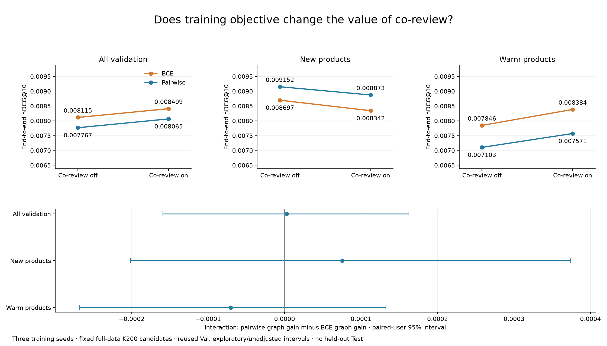
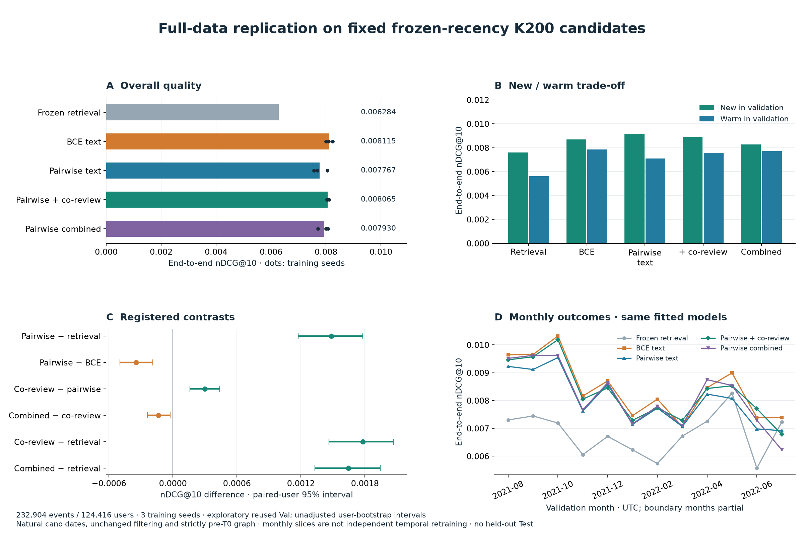

# Evaluation findings, protocol and next experiments

Updated **4 November 2026** (the objective x co-review factorial is complete; the earlier full-data replication, sample studies and historical pipeline findings are retained). This is the single current evaluation record for teammates and agents. Read this document for results, interpretation, progress, limitations and the authorised follow-up. Append future findings here. Other experiment notes and generated reports are historical evidence, not separate instructions.

**Restoration execution status:** root plan §16 items are complete in a separate [data and audit collection](../results/steps_restoration/20261104/): T1 graph refresh, the full 14-setting FAISS/budget grid and per-seed K funnels. All independent checks pass; 252 tests pass / 4 skips. The §15 collection is unchanged, and narrative synthesis remains explicitly deferred.

**Latest execution status:** the user authorised root plan §15 and subsequently deferred narrative reporting. The full Test, popularity/composition, frozen-model K sensitivity and bounded FAISS/latency items are complete, with numerical evidence and checked figures in [results/steps_final/20261104](../results/steps_final/20261104/). 243 tests pass / 4 skips; the independent Test audit reconstructs twelve exports, 54 metrics and 27 intervals. Earlier Test/index deferrals and forced-list tables below are historical; final synthesis is intentionally pending.

## Current progress

The archived full-data evaluation is complete: **232,904 validation events / 124,416 users**, using archived predictions and restored histories. The saved-validation replay reproduced the historical comparisons and checked source identities; it is analysis verification, not independent training replication. That completion used no new training, Test predictions, SSH or cluster jobs. The separate sample programme and subsequently authorised twelve-fit full-data ranking replication are also complete; their fresh MPS fits and outcomes are recorded below.

| Work | State |
|---|---|
| Objective x co-review factorial, root plan §14 | Complete: three new BCE+co-review fits plus nine frozen controls. Co-review improves overall/warm and loses new-item quality under both objectives; direct objective and novelty interaction intervals include zero |
| Full-data replication of promising rankers, root plan §13 | Complete: twelve fresh fits and full-Val scoring; BCE leads overall, pairwise text leads new-item quality, and co-review trades new-item quality for warm-item gains. See the full-data section below Local regeneration, 5 Nov: BCE lead reproduces; co-review overall gain and pairwise new-item lead do not survive a changed refit draw (see "Overnight rebuild and analysis loop") |
| RQ1 retrieval comparisons and text/ID trade-off | Complete from saved evidence; existing retrieval Test exposure disclosed |
| RQ3 rankers, uncertainty and five-way failure funnel | Complete on Val, frozen text seed-0 candidates |
| RQ2 exact-search K sweep, popularity-segment curve and expansion losses | Complete on Val (`warm-head` peaks at K50, `new`/`tail` peak at K200, aggregate peaks at K100); no final K selected |
| Item/history/diversity/time groups; secondary metrics | Core group analysis complete; HR@3/MRR@10 now computed reproducibly (5 Nov) for archived pipelines and the regenerated current pipeline, with saved nDCG reproduced first; same ordering as nDCG@10 |
| Graph target/history relations and 12 joint warm-target cells | Complete on Val; descriptive, not causal |
| Graph witness multiplicity/recency, full-window category continuity and store interactions | Expanded on 1 Nov across all 232,904 Val events; exploratory, with paired-user intervals |
| Microscopic case study | Five source-bound cases complete; 5 Nov: traceable 28-event Step-5 study on the regenerated current pipeline (frozen buckets, seeded draw, ranker top three), model-assisted coding awaiting human review |
| Candidate-pool/top-ten profile amplification and device/text analysis | Blocked by original candidates/vectors and locked manual device audit |
| Controlled policy retraining (A/B/C/D: all/natural-only × enabled/masked score) and ID dropout | Policy study complete on Val (29 Oct, laptop run with rebuilt candidates; no fix qualifies under the pass rule, see "Controlled ranker-policy study"); ID dropout not run |
| Approximate-index study, full-cascade timing and final F0/F1/F2 Test | Deferred by user |
| Independent local track, root `plan.md` | Sample programme complete: 18 strict-pool retriever and six natural-only ranker fits, including the subsequently approved candidate-normalisation trial; frozen diagnosis, fusion, reports and audits complete |
| Full-catalogue frozen-text check | Complete on all Val events: recency improves top-ten quality over archived retrieval but lowers Recall@200; strong new/warm trade-off |
| Local plan evidence/report closure | Complete: monthly/history tables, exact ranker funnel, both-source fusion CIs, missing scores and consolidated report; 168 tests pass / 4 legacy skips |
| Phase 2 graph/latent residual ranking, root `plan.md` §10 | Complete: seven arms × three seeds; every fit selected epoch 0; scheduled outer-Val scores/lists exactly equal frozen recency retrieval; no graph/latent gain established |
| Ranking objective ablation and conditional feature replication, root `plan.md` §11 | Complete: 24 fits; pairwise text beats matched BCE; explicit graph/history inputs add value; extra BPR over graph is inconclusive; neighbour encoder loses to its self-only control; 207 tests pass / 4 legacy skips |
| Final graph-family decomposition and frozen encoder diagnosis, root `plan.md` §12 | Complete: 12 matched fits, six exact controls, 12 frozen checkpoint loads/full-prefix score sets; 226 tests pass / 4 legacy skips. Execution paused for deeper assessment |

**Historical pipeline working conclusion:** retrieval misses remain the largest ceiling, while reranking also displaces strong retrieved targets. Forced-positive training and the inverted score response motivate the authorised policy experiment; controlled retraining is still needed for a causal claim. New products supply about two-thirds of MLP's net gain. The expanded graph localises substantial losses to dense co-reviewed targets and shows gains for same-store co-reviewed head targets. These target associations motivate [architecture proposals](architecture_proposals.md); integration into the canonical full-data pipeline remains unapproved. The separate sample and full-data residual-ranker experiments below are authorised through root `plan.md`. Target-conditioned oracle estimates do not establish deployable routing gains.

## Objective x co-review factorial completion (4 November 2026)

The user authorised completing the missing cell after discussing the original controlled-comparison design. Root plan §14 / `configs/ranker/objective_coreview.yaml` register the question: **does the incremental value of co-review depend on training objective, and does that interaction differ for new versus warm products?** Three fresh BCE+co-review fits reuse all §13 candidates, features, prefix scalers, split, negative plans and initial parameters. The nine existing BCE-off/pairwise-off/pairwise-on fits remain unchanged. All twelve factorial weights were locked before scoring the new cell. The new study is `results/local_experiments/20261104-objective-coreview/`; [compact evidence](../results/full_data_replication/20261104-objective-coreview/report.md) includes all four cells and their direct contrasts.

This is the same **111,480-product / 232,904-event / 124,416-user** full-Val population. The graph remains strictly pre-T0 and all methods retain basic metadata matching plus nine common support/degree features. “Co-review off/on” switches only the four additional relational columns, after standardisation. BCE, Adam .001, batch32, fifty alternatives, max10/patience2, epoch-zero earliest-tie chronological inner selector and selected-fixed-epoch all-B refit match the parent. New selected epochs are **8/9/8**. No graph retrieval, new graph encoder, candidate-source change or Test prediction was introduced.

| Objective | Additional co-review | Overall nDCG@10 | Recall@10 | New nDCG@10 | Warm nDCG@10 |
|---|---|---:|---:|---:|---:|
| BCE | Off | 0.008115 | 0.015399 | 0.008697 | 0.007846 |
| BCE | On | **0.008409** | **0.015845** | 0.008342 | **0.008384** |
| Pairwise | Off | 0.007767 | 0.014865 | **0.009152** | 0.007103 |
| Pairwise | On | 0.008065 | 0.015290 | 0.008873 | 0.007571 |

**Co-review helps BCE overall, with a novelty trade-off.** BCE-on minus BCE-off nDCG is **+0.000295 [0.000169, 0.000425]**, approximately **3.6%** relative. New-item quality changes by **−0.000354 [−0.000542, −0.000166]**; warm quality by **+0.000538 [0.000375, 0.000706]**. The pattern matches the pairwise graph gain: overall **+0.000298 [0.000161, 0.000439]**, new **−0.000279 [−0.000498, −0.000039]**, warm **+0.000468 [0.000308, 0.000623]**. Thus additional co-review evidence has a supported incremental benefit under both recipes, accompanied by a supported new-item loss. This is a family intervention beyond existing degree/knownness controls, not proof of a particular graph mechanism.

**The objective-dependence hypothesis is inconclusive.** The direct interaction is `(PW_on−PW_off)−(BCE_on−BCE_off)`; positive values favour a larger incremental graph gain under pairwise. Its overall estimate is **+0.000003 [−0.000159, 0.000163]**, new **+0.000076 [−0.000201, 0.000374]**, warm **−0.000070 [−0.000268, 0.000132]**. These intervals do not establish an objective-dependent gain or equivalence between gains. Do not infer an interaction from significance in one cell and not another.

The direct **new-minus-warm difference in that interaction** is **+0.000146 [−0.000162, 0.000511]**, also inconclusive. It jointly resamples the union of users and preserves each novelty group's own qualifying-user macro denominator, including the covariance from users in both groups. This describes effects in different target populations rather than a causal novelty intervention.

BCE+co-review exceeds pairwise+co-review overall by **+0.000344 [0.000184, 0.000509]**, while losing on new items. Against frozen retrieval its overall gain is **+0.002126 [0.001819, 0.002414]**. It has the highest overall point estimate within this matched factorial; pairwise without co-review retains the highest new-item point estimate. This study does not select a final system or establish superiority over every historical pipeline.

All four cells retain **Recall@200 0.054746** and **217,988 raw retrieval misses**. BCE+co-review averages **2,505.67 rescues / 1,515.67 demotions / 1,621.33 retained hits**, giving **4,127 top-ten target events**, versus BCE-off's **4,015** and retrieval's **3,137**. Counts are per-seed raw-event means, not user-macro contributions or ensemble outputs. Monthly/history tables and conditional metrics preserve their supports.

Intervals use 1,000 paired-user draws, seed0, after event-metric averaging across the three seeds. They remain exploratory/unadjusted on reused Val and conditional on these runs/candidates. Old cells were already inspected before this completion; the new fit is not untouched holdout confirmation. The selector rule is matched while selected update counts differ, so the objective contrast covers the objective/selection/refit recipe. New targets have no pre-T0 review edges; the observed loss does not establish how individual graph inputs or competing candidates caused it.

The separate sample technical path reproduced the original off-feature BCE first-epoch control. Final checks: **233 tests pass / 4 legacy embedding skips**; **33 new inner score sets**, three new outer outputs, all twelve locked factorial states, **675 metric rows**, eighteen main nDCG intervals and the joint-user novelty interval independently pass. The shared numerical-analysis source snapshot preserves the exact code used to generate the tables before plot-label formatting. Bulk arrays/logits/weights remain local. The registered work is complete; graph retrieval, new GNNs, index/serving work, canonical integration and final Test remain separate decisions.



Reproduce with `cascade.pipelines.objective_coreview`: **prepare → fit (seeds 0/1/2) → evaluate → report → audit → publish**. Use a fresh study name and the immutable §13 parent; `--sample` applies to a separate technical preparation, and `--control` adds the sample off-feature reproduction. Fitting/evaluation use `--device mps`; reporting/auditing use CPU. `--phase publish --preview` renders the figure before the first compact publication. Existing fit/report/publication destinations are refused.

## Full-data promising-ranker replication (4 November 2026)

After the assessment, the user authorised full-data testing, integration of findings and a commit. This resumes only the bounded study in root `plan.md` §13 and supersedes the earlier pause for that scope. The registered configuration is `configs/ranker/full_promising.yaml`; fresh local artifacts are under `results/local_experiments/20261103-full-promising-ranking/`. Compact evidence is shared in [results/full_data_replication/20261103-promising](../results/full_data_replication/20261103-promising/report.md).

All **twelve fits** completed on MPS, seeds 0/1/2. The study uses **111,480 products**, **315,114 B training queries**, and **232,904 Val events / 124,416 users**. Candidates are natural frozen MiniLM/90-day-recency K200 lists, with no target insertion and unchanged event-time/full-history filters. The canonical full-data graph cutoff is **T0=1595800947930**; the graph contains **1,877,548** earlier review edges. A chronological split at **1621702301175** yields **252,091 prefix / 63,023 tuning queries**, with **16,818 / 3,857 natural positives**; all-B refitting uses **20,675 natural positives**. Val contains **14,916 naturally retrieved targets**, including **6,053 new / 8,863 warm** events.

Preprocessing is fitted on all prefix candidate slots before positive eligibility filtering. Methods share parameter shapes, initial states and fifty-alternative sampling plans within seed. BCE versus pairwise `mean softplus(negative-positive)` retains Adam .001, batch32, max10/patience2, epoch-zero eligibility, earliest-tie all-inner-query user-macro nDCG selection and all-B refitting for the selected fixed epoch count. All twelve final weights/epochs were locked before outer scoring. No historical checkpoint was modified or held-out Test prediction generated.

| Full-data method, three-seed mean | Selected epochs 0/1/2 | nDCG@10 | Recall@10 | New-in-Val nDCG@10 | Warm-in-Val nDCG@10 |
|---|---|---:|---:|---:|---:|
| Frozen recency retrieval | — | 0.006284 | 0.011506 | 0.007611 | 0.005606 |
| BCE text/common control | 10 / 6 / 6 | **0.008115** | **0.015399** | 0.008697 | **0.007846** |
| Pairwise text/common control | 2 / 3 / 3 | 0.007767 | 0.014865 | **0.009152** | 0.007103 |
| Pairwise + co-review | 10 / 8 / 5 | 0.008065 | 0.015290 | 0.008873 | 0.007571 |
| Pairwise + co-review/category/store-history | 10 / 6 / 5 | 0.007930 | 0.015129 | 0.008261 | 0.007707 |

All methods retain **Recall@200 0.054746**. Text/common controls already contain basic category/store matching and nine support/knownness features; these switches do not remove all metadata or graph information. The optional co-review family comprises four relational statistics, with the combined arm adding two category/store-history fractions after standardisation.

**The sample objective advantage reverses overall.** Pairwise-minus-BCE nDCG@10 is **−0.000347 [−0.000497, −0.000188]**, while its new-item change is **+0.000455 [0.000191, 0.000704]** and warm change **−0.000743 [−0.000936, −0.000558]**. Full BCE selects trained checkpoints rather than epoch zero. This qualifies the sample diagnosis: the original short sample BCE failure does not establish a generally inferior objective. Population, catalogue, cutoff and optimiser-update exposure differ between sample and full data; their contrast does not isolate data quantity as the cause. The within-full comparison concerns the whole objective/selection/refit recipe, with different selected update counts.

**Co-review adds a smaller, redistributed gain.** Co-review-minus-pairwise-control is **+0.000298 [0.000161, 0.000439]** overall, **−0.000279 [−0.000498, −0.000039]** new, and **+0.000468 [0.000308, 0.000623]** warm. The sample's positive new-item incremental effect does not replicate. New items still have no pre-T0 review edges; outcomes can change through the learned function and competing candidates without implying direct new-item graph support.

**Extra metadata loses overall/new quality.** Combined-minus-co-review is **−0.000135 [−0.000239, −0.000026]** overall and **−0.000612 [−0.000820, −0.000408]** new. The warm change is **+0.000136 [0.000002, 0.000261]**, with a near-zero lower bound. This bounds this additional feature family under this recipe rather than establishing that metadata is generally harmful.

The full-Val funnel retains **217,988 retrieval misses** for every method. Mean-per-seed rescues/demotions are **2,414.33 / 1,536.33 BCE**, **2,261 / 1,551 pairwise text**, **2,392.33 / 1,585.33 co-review**, and **2,383.33 / 1,610.33 combined**. Final top-ten target counts average **4,015 / 3,847 / 3,944 / 3,910**, versus retrieval's **3,137**. These are raw event-count means, not ensemble predictions or user-macro metric contributions.

All intervals use **1,000 paired-user bootstrap draws, seed0**, after event-metric averaging across training seeds. They are exploratory, unadjusted, and conditional on the fixed candidates and trained runs. Val has been reused throughout development and includes sample users. Monthly/history/new-warm tables retain supports and conditional populations; monthly slices are descriptive, not independent temporal retraining. No final system, acceptable-loss margin, serving advantage or causal mechanism is selected.

**Secondary comparisons and historical context.** Missing arm-pair comparisons were completed as explicitly secondary exploratory analyses in `secondary_differences.csv`, separate from the six registered primary contrasts. BCE-minus-retrieval is **+0.001831 [0.001519, 0.002117]** overall (**29.1%** relative), **+0.001086 [0.000570, 0.001588]** new and **+0.002240 [0.001868, 0.002599]** warm. Co-review-minus-BCE overall is **−0.000049 [−0.000208, 0.000103]**: the co-review model does not clearly beat the stronger BCE control. Combined-minus-BCE is **−0.000184 [−0.000340, −0.000027]** overall.

The [aligned historical context](../results/full_data_replication/20261103-promising/historical_context.md) compares every new arm with archived MLP K100/K200 and all-training SASRec. BCE-minus-archived-MLP-K200 is **+0.001272 [0.000924, 0.001653]**; BCE-minus-SASRec is **+0.003323 [0.002965, 0.003690]**. However, archived MLP K100 retains the higher overall point estimate **0.008363 versus 0.008115**; BCE-minus-K100 is **−0.000248 [−0.000655, 0.000169]**, inconclusive. No new method establishes superiority over that observed historical validation maximum. These empirical pipeline comparisons change candidates, encoder artifacts, architecture and training policy; they are not causal objective ablations or a final K choice.

The partial July 2022 slice contains **10,149 events / 7,748 users**. Pairwise variants have negative point differences versus retrieval there, but each corresponding interval includes zero. Aggregate gains therefore do not establish uniform temporal improvement. Boundary months, turnover, elapsed-time novelty and history mix remain confounded.

**Verification and closure.** The complete sample technical path reproduced all twelve first-epoch controls before full fitting. Full sparse-feature preparation matches the reference on 48 fixed queries, with maximum raw-feature error **7.45e-9**. The independent completion audit checks all **548,018 B/Val candidate lists**, 96 further feature-reference queries, **104 retained inner score sets**, twelve outer score outputs, twelve selected model locks, **675 metric rows** and eighteen main nDCG intervals. All checks pass; **229 tests pass / 4 legacy conventional-path embedding skips**. Compact configs, seed metrics, monthly/history tables, funnels, contrasts, selected-weight/source hashes, environment versions and audit/provenance manifests are shared. The checked figure below contains overall seed values, new/warm quality, primary intervals and monthly outcomes. The bounded full-data study is complete; no additional fit or Test evaluation follows automatically.



Reproduction uses the project Python environment and a **fresh** study name. Preserve the existing configuration/parents and run `cascade.pipelines.full_data_ranking` phases **prepare → fit (four methods × three seeds) → evaluate → report**, then `cascade.pipelines.full_data_ranking_audit` and `cascade.pipelines.full_data_ranking_publish`. Fit/evaluate use `--device mps`; reporting/auditing use CPU. The runner refuses existing fit/report destinations and rejects input/source drift. Bulk candidates, features, weights and logits remain local/ignored. The historical A/B/C/D and ID-dropout controls, canonical integration, index/serving work and final held-out Test retain their separate status.

## Local original RecBole sample weights (2 November 2026)

Fresh original `SASRecBCE` seed-0 fits completed on Apple MPS, after a separate one-epoch functionality check. This is local development on **30,389 products / 7,619 sampled users**, evaluated on **4,825 validation events / 2,534 users**. These newly trained sample models are not comparable numerically with the full-catalogue tables below and do not recover the missing historical checkpoints. Their original sample cutoff **T0=1596679591746** is retained, distinct from full-data T0; T1/T2 are unchanged.

| Training period | Selected epoch (one-based) | Training/selection seconds | Val Recall@200 | Val Recall@10 | Val nDCG@10 |
|---|---:|---:|---:|---:|---:|
| Retriever-training only | 8 | 24.318 | 0.024158 | 0.003393 | 0.001421 |
| All training data | 13 | 38.729 | 0.032763 | 0.002470 | 0.001187 |

These are single-seed descriptive levels, not a claimed significant comparison. The original RecBole validation Recall@100 selects the checkpoint; the table uses the shared filtered user-macro harness. The runner now defaults to validation-only evaluation, rejects existing destinations and creates fresh per-run atomic exports. No held-out Test prediction was generated or loaded.

Reusable selected weights are `results/baselines/local/20261102-sasrec-retriever-sample-seed0/model.pth` and `results/baselines/local/20261102-sasrec-all-train-sample-seed0/model.pth`, approximately 8 MB each. Each run records config, ID mappings, selected checkpoint, input/source hashes and `weights_verification.json`. Both standalone states load strictly and produce exactly the selected checkpoint's CPU scores on **32 validation histories × 30,389 items**, with maximum difference **0**. RecBole ID mappings must accompany the weights. Local weights/exports remain ignored by Git; the original baseline results remain unchanged. The independent experimental track is documented in root `plan.md`.

## Independent local experiments (2 November 2026)

The user authorised an independent experiment track, including fresh controls with **pre-T0-only negatives** after the original RecBole catalogue-wide negative pool was explained. The strict sample pool has **20,740 products**, excluding **9,649 future products**. The original fits above remain historical references. All new learned retrievers retain the original BCE, sequence backbone, training pairs and RecBole unfiltered Recall@100 selector; final metrics use the shared full-catalogue event-time availability/full-history filters. These fresh models do not change teammates' checkpoints or constitute the full-data policy ablation.

All **15 retriever fits** and **six natural-only ranker fits** completed on MPS, seeds 0/1/2. Sample evaluation covers **4,825 Val events / 2,534 users**, with **30,389 products** and the original sample split. The frozen MiniLM revision is `1110a243fdf4706b3f48f1d95db1a4f5529b4d41`; vectors were generated with the recorded encoder library pins. Text is a crawl-time snapshot and first review is an availability proxy.

### Retrieval findings

| Method | Recall@200 | Recall@10 | nDCG@10 |
|---|---:|---:|---:|
| ID SASRec, strict pool | 0.023005 | 0.002401 | 0.001298 |
| Content SASRec | 0.056750 | 0.003862 | 0.001836 |
| Content + warm-item ID residual | 0.043602 | 0.004994 | 0.002225 |
| Content + metadata neighbours | 0.053690 | 0.003040 | 0.001248 |
| Two-interest pooling | 0.052636 | 0.003269 | 0.001727 |
| Actual content/graph RRF, budget 200 | 0.057858 | 0.004006 | 0.001931 |
| Pre-T0 popularity | 0.022277 | 0.002494 | 0.000842 |
| Frozen text mean | 0.071513 | 0.013313 | 0.006961 |
| Frozen text, fixed 90-day recency | **0.100990** | **0.022309** | **0.012489** |

These are **retrieval scores/order**, including the top-ten metrics; no reranker is applied in this table. Learned entries are three-seed means; deterministic controls have no task-specific recommender training. All differences below use unadjusted paired-user 95% intervals, B=1000, seed 0, after averaging event metrics across training seeds.

- Content minus matched ID: Recall@200 **+0.033746 [0.026206, 0.041296]**; nDCG@10 **+0.000538 [-0.000521, 0.001606]**. New-in-Val retrieval improves, while seen-before-T0 retrieval decreases. This is a trade-off, not a universal improvement.
- Content+ID minus content: Recall@200 **-0.013148 [-0.020393, -0.006511]**; nDCG@10 **+0.000389 [-0.000631, 0.001379]**. The unseen-item ID residual is masked at training and inference.
- Graph, two-interest and fusion differences versus content include zero for Recall@200 and nDCG@10. Graph also changes encoder capacity. Two-interest heads have mean cosine **0.958** despite both winning recommendation slots; distinct learned interests are not established. Fusion uses actual source candidates under a unique 200-item budget, rather than target-conditioned oracle ranks.
- Fixed recency minus uniform frozen text: Recall@200 **+0.029476 [0.021533, 0.038459]**, nDCG@10 **+0.005527 [0.003225, 0.008073]**. The 90-day half-life was specified before these outcomes. Independent CPU float64 reconstruction on 100 fixed queries matches top-10/top-200 hits, with one rank differing by one; strictly prior histories and target exclusion pass.

The sample has **3,240 new-in-Val events (67.2%)**, versus approximately 33% in full data, and a different catalogue/first-observation process. Do not compare these absolute scores with full-data tables or extrapolate the gain.

### Natural-only ranking and other analyses

The matched mean and candidate-conditioned semantic-attention rankers train on **458/6,306 naturally retrieved training positives**, excluding 5,848 misses, with identical content-seed-0 candidate lists, inputs, common initial weights and scoring head. No insertion, target-only feature or retrieval-score input. This attention model is DIN-inspired; it is not the historical DIN implementation.

End-to-end nDCG@10 is approximately **0.000827 mean / 0.000858 attention**, versus **0.001557 retrieval order**. Neither improves clearly over retrieval. Attention-minus-mean is only about **+0.000031** under an unadjusted interval; it supplies little practical support for additional ranker complexity here. Training support is small, so this does not settle the value of DIN on the full dataset. Frozen learned-history truncation to 5/10 items is inconclusive.

All 232,904 archived full-data Val events were also partitioned into **12 UTC months**, with warm/new metrics and category/store mix. Retrieval Recall@200 is **0.089171** in partial August 2021 and **0.052947** in partial July 2022; new-in-Val event share rises from **4.6% to 47.3%**. These are descriptive endpoints, not evidence of an annual causal effect. New-in-Val is fixed relative to T1, so its share also reflects elapsed time; product ageing, turnover and calendar effects remain confounded. Review timestamps lag purchases. No split was changed.

Artifacts: `results/local_experiments/20261102-sasrec-pre-t0/summary-final/` contains combined metric/group/composition tables and twenty query examples fixed before outcomes. Run directories retain selected standalone weights, mappings, configs and source/input hashes. `final_audit.json` verifies portable weights/snapshots, shared initial backbones and initial negative traces, graph temporal validity, archive alignment and unique/available/history-free lists. Monthly evidence is in `results/local_experiments/20261102-full-val-calendar/`. Generated artifacts remain local/ignored. The post-sample suite passed **154 tests, with four legacy sample-embedding tests skipped**.

### Full-catalogue frozen-control check

After pausing, the user resumed following the recommendation to check the strongest simple control before further model training. `cascade.pipelines.frozen_text_study` completed on the restored **111,480-item catalogue / 232,904 Val events / 124,416 users**, canonical T0, identical frozen encoder revision, unchanged uniform/90-day pooling and pre-T0 popularity. This full Val population includes pilot users; it is follow-up validation, not an untouched independent holdout. No recommender training, half-life tuning or new Test evaluation.

| Full-catalogue retrieval | Recall@200 | Recall@10 | nDCG@10 |
|---|---:|---:|---:|
| Pre-T0 popularity | 0.026985 | 0.004155 | 0.001655 |
| Frozen text mean | 0.034183 | 0.005675 | 0.002920 |
| Frozen text, 90-day recency | 0.054746 | **0.011506** | **0.006284** |
| Archived two-tower text, three-seed mean | **0.068630** | 0.010550 | 0.005695 |

Recency minus uniform text: **+0.020564 [0.019682, 0.021512] Recall@200**, **+0.003363 [0.003096, 0.003623] nDCG@10**. Recency minus archived two-tower text: **-0.013883 [-0.015333, -0.012485] Recall@200**, **+0.000956 [0.000318, 0.001643] Recall@10**, **+0.000589 [0.000166, 0.000992] nDCG@10**. Intervals remain unadjusted paired-user bootstrap, B=1000, seed 0. Archived entries average event metrics across existing seeds 0/1/2 before bootstrapping. Architecture, objective and encoder artifacts differ, so the archived comparison does not isolate a causal recency effect on the trained model.

The novelty split explains the aggregate trade-off:

| Target group | Method | Recall@200 | nDCG@10 |
|---|---|---:|---:|
| New in Val | Frozen recency | 0.065043 | 0.007611 |
| New in Val | Archived two-tower text | 0.026315 | 0.000352 |
| Warm in Val | Frozen recency | 0.050574 | 0.005606 |
| Warm in Val | Archived two-tower text | 0.087112 | 0.008098 |

For new targets, recency-minus-archive nDCG@10 is **+0.007259 [0.006751, 0.007769]**; for warm targets it is **-0.002491 [-0.002975, -0.001997]**. These are target-conditioned diagnostic groups, not an inference-time router. Merging the methods would require actual candidate identities/scores under one budget; separate target ranks cannot establish fusion gains. Results justify investigating generalisation and objective/history choices, rather than assuming a more complex retriever is better.

All 100 independent float64 query reconstructions match target ranks exactly, and top-10/top-200 hits agree. The full audit verifies all 232,904 histories are strictly prior and target-free, all saved top-ten lists respect availability/full-history exclusion, and source/input/vector/rank hashes match. Encoder parameter hashes are unchanged. Catalogue encoding took **84.6 s** on MPS; complete validation evaluation took **22.1 s popularity / 40.2 s uniform / 41.4 s recency**, including batch work and metric aggregation. These are offline timings, not single-query serving latency or a complete cascade benchmark.

Fresh output: `results/local_experiments/20261102-full-frozen-text/`; use `report-final/report.md`, `report-final/comparison.csv` (including months/groups), `report-final/cases.json` (20 fixed-before-results examples), `evaluation/benchmark.json`, `evaluation/independent_recency_check.json` and `final_audit.json`. The first report attempt stopped during example export; its partial CSV is retained under `report/`, with final findings sourced from `report-final/`. Saved scores were unaffected. Final suite: **156 passed, 4 skipped**. Full-data learned-model training remains a separate decision.

### Frozen diagnosis of lost new-item signal

The user selected this follow-up after the full-catalogue check. `cascade.pipelines.content_signal_diagnostic` evaluates the **saved sample content-only seeds 0/1/2**, with seven fixed probes per seed. The probe manifest, geometry samples and neighbourhood queries were written before scoring. No training, checkpoint reselection, half-life tuning or Test evaluation. Inference substitutions locate signal loss in saved functions; they do not isolate the causal effect of a loss, optimiser or training policy.

| Frozen function | Overall nDCG@10 | New-in-Val nDCG@10 |
|---|---:|---:|
| Raw text + recency/cosine | 0.012489 | 0.013470 |
| Initial shared projection + recency/cosine | 0.009796 | 0.010108 |
| Trained shared projection + recency/cosine | 0.006607 | 0.007400 |
| Trained shared projection + recency/dot | 0.001310 | 0.001172 |
| Trained sequence/dot (original content model) | 0.001836 | 0.001112 |
| Trained sequence/cosine | 0.002575 | 0.001396 |

**The learned item space retains less of the transferable raw-text signal in the pooling control.** With recency/cosine pooling fixed, final-minus-initial projection nDCG@10 is **-0.003190 [-0.005300, -0.001180]** overall and **-0.002708 [-0.005145, -0.000342]** on new-in-Val events. Initial projection versus raw text also loses **-0.002692 [-0.004107, -0.001287]** overall. Initialisation is recreated deterministically from the recorded projection seed; both projected spaces have width 64. This is a contrast between two frozen representations inside identical pooling, not the performance of an untrained versus trained sequence model.

Geometry corroborates a change in structure: mean raw top-20 neighbour preservation for fixed post-T0 probes falls from **42.3% initial to 16.6% trained**. References are pre-T0 products only, with self excluded. In the fixed pre-T0 geometry sample, centred covariance effective rank falls from **38.1 to 10.5** out of 64 dimensions. Random-pair cosine falls rather than rising, so do not describe every product vector as collapsing to one common direction. Neighbour overlap measures preservation of MiniLM structure, not known item relevance or a requirement that all training preserve it.

**Dot scoring makes candidate norm a strong preference.** For the same final projected recency query, cosine-minus-dot nDCG@10 is **+0.005296 [0.003596, 0.007206]**, or **+0.006228 [0.004050, 0.008636]** for new-in-Val events. Query normalisation is a positive per-query scale and does not change ordering; candidate normalisation removes item-specific magnitude effects. Global top-1%-norm products occupy **17.0%** of dot-product recommendation slots versus **0.25%** with cosine. Dot/cosine lists cover approximately **3,398 / 15,483 distinct products**, respectively. These slot measures describe concentration, not relevance of alternatives. Norm/pre-T0-review-count Spearman is approximately **-0.05**, so simple popularity amplification is not established as the cause.

**The sequence model is useful relative to a matched uniform-pooling control.** Native sequence/dot beats projected-mean/dot by **+0.001053 [0.000280, 0.001930] nDCG@10** overall. Sequence/cosine minus projected-mean/cosine is inconclusive (**+0.000182 [-0.001232, 0.001530]**). It is therefore unsupported to assign the entire raw-text gap to the transformer. Recency pooling and sequence output are different query representations, and bypassing the learned sequence changes its inference distribution.

**Normalising at inference is insufficient as a new-item remedy.** Native sequence cosine improves overall nDCG@10 by **+0.000739 [0.000049, 0.001464]**, but the new-in-Val difference is **+0.000284 [-0.000293, 0.000834]**. Normalising each history item before projected recency pooling has no clear gain (**-0.000206 [-0.000659, 0.000135]** overall). Preserve these negative/inconclusive outcomes.

All intervals use 1,000 paired-user draws, seed 0, unadjusted after training-seed event averaging. All 21 archives align on 4,825 events and pass availability, uniqueness and full-history filtering. Source/input/weight hashes and unchanged parameters pass. Native ranks/top-ten lists reconstruct exactly on 128 queries per seed. **159 tests passed, 4 legacy sample-embedding tests skipped.** No model was retrained. Artifacts: `results/local_experiments/20261102-sasrec-pre-t0/diagnostics/20261102-frozen-decomposition/`, including `report/`, geometry/neighbour CSVs, `audit/verification.json`, norm-slot evidence and `figures/frozen_diagnosis.png`.

These findings motivated the candidate-normalised content-SASRec pilot subsequently approved and completed below: normalise candidate vectors consistently inside BCE and final scoring, leave query/history normalisation unchanged, and match the existing sampler, pairs, seeds, backbone and selector. A separate geometry-preservation intervention still needs its own design. The frozen results do not establish whether BCE, optimisation or the selector caused the learned geometry change.

### Approved candidate-normalised training: completed sample result

The user subsequently approved the matched sample training trial. Opt-in `UnitCandidateSASRec` / `content_unit` uses `q · (e / max(||e||, 1e-12))` in **BCE, native prediction/checkpoint selection and shared final retrieval**. Query magnitude and raw history inputs remain unchanged; there is no new temperature or parameter. The strict sampler, seed-specific initial backbone, first negative traces, atomic exports, mappings, pairs, native recipe and selector rule match the original content controls. No full-data learned-model fit or Test evaluation.

| Method, three-seed means unless deterministic | Recall@200 | Recall@10 | nDCG@10 | New-in-Val nDCG@10 |
|---|---:|---:|---:|---:|
| Original dot-trained/scored content model | 0.056750 | 0.003862 | 0.001836 | 0.001112 |
| Original weights, frozen cosine scoring | 0.060244 | 0.005415 | 0.002575 | 0.001396 |
| Candidate-normalised training and scoring | **0.075097** | **0.008298** | **0.003978** | **0.002548** |
| Frozen text + 90-day recency reference | 0.100990 | 0.022309 | 0.012489 | 0.013470 |

Treatment minus original dot: overall nDCG@10 **+0.002142 [0.000814, 0.003608]**, Recall@200 **+0.018347 [0.011714, 0.024630]**. New-in-Val nDCG@10 **+0.001436 [0.000356, 0.002610]**, Recall@200 **+0.015421 [0.008113, 0.022083]**. It also beats changing the original model's scoring only: nDCG@10 **+0.001403 [0.000153, 0.002757]** overall and **+0.001152 [0.000050, 0.002325]** on new-in-Val events. These are unadjusted exploratory paired-user 95% intervals (B=1000, seed 0, event metrics averaged over seeds); the last comparison has a small positive lower bound and is not a final confirmatory result.

The pipeline intervention provides evidence that consistent candidate normalisation can improve this sample model, including new-item retrieval. It does not isolate the effect of the loss from checkpoint selection or number of updates. Selected epochs **33/38/24** versus **12/14/24** and training times **77.0/86.6/58.7 s** versus **32.4/37.2/55.9 s** are retained. All fits use MPS and the same stopping rule, not equal update counts. No serving latency was measured in this trial.

Geometry is partly preserved: post-T0 raw top-20 neighbour overlap averages **26.2%**, versus **16.6%** in the original trained projection and **42.3%** initially. Pre-T0 centred effective rank rises to **17.4**, versus **10.5** in the original trained projection. Geometry describes projected vectors before candidate output normalisation; neighbour comparisons use cosine. These observations do not establish geometry as a causal mediator.

Frozen recency remains substantially better: treatment-minus-recency nDCG@10 **-0.008511 [-0.011727, -0.005760]** overall and **-0.010922 [-0.014650, -0.007698]** for new-in-Val events. Candidate normalisation addresses part of the observed gap; it is not a complete future-item solution or an automatic full-data launch decision.

Artifacts: `results/local_experiments/20261102-sasrec-pre-t0/unit_candidate_report/`, plus selected weights under `runs/content_unit/seed<seed>/` and actual top-200 IDs/scores under `retrieved/content_unit/seed<seed>/`. Matched-input/recipe/initialisation checks, source/weight hashes, exact standalone reload on 128 queries per seed, unchanged analysis-time parameters and all saved list filters pass. Actual top-200 target membership has zero differences from pessimistic rank-based hit@200 in all seeds. Latest suite: **162 passed, 4 skipped**. Historical controls and the frozen diagnosis remain unchanged.

### Local plan completion: all remaining evidence tasks closed

The user requested completion of all remaining `plan.md` work. The five outstanding reporting/evidence items are now complete, using frozen selected models and saved Val predictions. **No training, split change, Test predictions or overwriting original outputs.** Final bundle: `results/local_experiments/20261102-plan-completion/`; read **`report-final/report.md`** and `report-final/completion_audit.json`. The earlier `report/` is retained as a review version.

- **Temporal/history reporting:** 5,400 local metric rows across ten retrieval methods and 1,620 full archived retrieval/MLP/DIN metric rows, with monthly/history/new-warm support and paired-user intervals. Each population has 180 support strata; overall-month and disjoint history partitions exactly cover 4,825 / 232,904 events. Prior full all-history monthly nDCG reproduces within 1e-12. History buckets are 1–2 / 3–5 / 6–10 / 11+ interactions. Monthly population/mix tables additionally count unique targets and catalogue introductions clipped to the observed Val portion of boundary months, excluding later Test-period introductions.
- **Local ranker funnel:** the fixed content-seed-0 pool has **257 natural Val hits and 4,568 retrieval misses**. Retrieval order has **14 top-ten hits**. Mean reranking averages **8.67 rescues, 13 demotions, 1 retained hit**, leaving 9.67 hits; attention averages **9 rescues, 13 demotions, 1 retained hit**, leaving 10 hits. These are means of per-seed event counts; seed-event occurrences are not independent unique events. Per-seed/group tables and all transitions are retained. Retrieval-miss / ranking-miss / hit partitions and rescue/demotion identities pass exactly.
- **Both-source fusion comparison:** with actual source candidate IDs/scores and a deduplicated 200-item budget, fusion-minus-graph Recall@200 is **+0.004167 [0.000728, 0.007860]**, nDCG@10 **+0.000682 [0.000112, 0.001318]**. Fusion-minus-content remains inconclusive: Recall@200 **+0.001107 [-0.002628, 0.004783]**, nDCG@10 **+0.000095 [-0.000461, 0.000645]**. Thus fusion improves the weaker graph source but does not clearly improve the stronger content source. All intervals remain exploratory/unadjusted, B=1000, seed 0 after seed averaging.
- **Missing score evidence:** six sample/full frozen-control top-200 ID/score archives and twelve selected-ranker full-logit archives (two models × three seeds × ranker-training/Val) recovered on MPS. Every regenerated Val target rank and native top-ten list is exact. Parameters and source/input hashes remain unchanged; candidate identity, availability, uniqueness and full-history checks pass. `topk(200)` versus `topk(10)` can order tied products differently, so native display replay is separate. Popularity has **12 sample / 17 full** actual-membership versus pessimistic-full-rank boundary differences; text controls have zero. Original headline metrics are retained.
- **One consolidated report:** includes all original experiments, original RecBole references, the frozen diagnosis, normalisation trial, earlier paired-comparison tables, category/store HHI and dominant shares with unknown/support handling, popularity concentration, twenty fixed queries across all methods and rankers, training/weight costs, two checked figures and source/hash audits. Composition describes lists, not relevance of unobserved alternatives. Both earlier sample and normalisation point estimates reconcile exactly.

The completed history breakdown qualifies the positive normalisation result. Its nDCG@10 change versus content is **+0.003624 [0.001615, 0.005795]** for histories 3–5 and **+0.001987 [0.000171, 0.004270]** for 11+; 1–2 (**-0.000834 [-0.002976, 0.000857]**) and 6–10 (**+0.000321 [-0.001603, 0.002050]**) are inconclusive. These are exploratory subgroups, not universal gains. The monthly full rankers retain their historical forced-positive policy; these new tables are analysis of archived models, not a remedy fit. A single Val year cannot identify recurring seasonality or separate time, product ageing, turnover and history mix.

Code: `cascade.pipelines.local_evidence_export`, `local_plan_completion` and `local_completion_report`, all refusing existing phase/report destinations. Generated evidence remains local/ignored. **168 tests passed, 4 legacy conventional-path sample-embedding tests skipped.** Completion audits pass all seven checklist checks. The independent local plan is closed; this does not imply completion of the canonical full-data cascade project.

For a later matched full-data training decision, nominate native content-SASRec and candidate-normalised content as the two learned configurations, retaining fixed-recency frozen text as the already-evaluated reference. Additional geometry/pooling experiments, changed-pool ranking, serving/cascade timing, final selection and held-out Test remain separate later decisions.

### Phase 2: graph/latent ranking completed (3 November 2026)

The user approved an independent sample ranking study in root `plan.md` §10, including one learned neighbour encoder and chronological inner tuning. Artifacts: **`results/local_experiments/20261102-graph-latent-ranking/report/`**. All R0–R7 comparisons use the same frozen MiniLM/90-day-recency top-200 lists, with no target insertion. The pre-T0 banks use the **sample cutoff 1596679591746**, not the full-data graph cutoff. BPR64 is collaborative/transductive; PCA-text64 and the content-aware metadata branch can encode future products without refitting item IDs. No device-title features are used.

R1 is text residual plus common support controls; R2 adds graph scalars; R3 BPR64; R4 graph+BPR; R5 PCA-text64; R6 an additional self-only learned encoder; R7 the matched neighbour encoder. Modules/parameter keys, per-seed initial weights, candidate inputs and sampling plans match across arms. Retrieval scores enter as a skip with a zero-initialised final residual layer. Graph features cover every candidate and exclude query-user/self paths. Collaborative inputs and preprocessing remain frozen throughout B training and Val; B labels never enter the feature banks.

The chronological split was fixed on all **6,306 B queries** before eligibility filtering: **5,044 prefix / 1,262 tune**, containing **619 / 141 natural positives**, at timestamp **1621231348495**. Three fixed 300-epoch BPR fits completed on MPS from **37,506 pre-T0 interactions**; PCA fit 20,740 pre-T0 item texts on CPU. All 21 ranker fits actually trained two epochs before patience stopped them, then selected **epoch 0**. Tuning nDCG@10 baseline is **0.010169**; trained epoch-1 results range **0.000891–0.006426**, epoch-2 results **0.003407–0.006943**, while BCE decreases markedly. Every full-B refit consequently used zero epochs.

| Selected systems | End-to-end nDCG@10 | Recall@10 | Fixed Recall@200 | Conditional nDCG@10 | New-in-Val nDCG@10 |
|---|---:|---:|---:|---:|---:|
| R0 and all selected R1–R7 arms | 0.012489 | 0.022309 | 0.100990 | 0.122542 | 0.013470 |

Weights/epochs were locked before one scheduled outer-Val evaluation. Every saved score/rank/top ten is exactly retrieval; tiny floating-point aggregation noise aside, paired differences and seed variation are zero. The **4,825-event** funnel is **4,260 retrieval misses / 434 ranking misses / 131 top-ten hits**, with zero rescues/demotions. These are unchanged selected functions, **not an equivalence result for trained architectures** or evidence that graph/latent information cannot help. There were only about 40 optimiser updates per fit. Sparse support, sampled pointwise BCE, residual scale and optimisation remain plausible explanations. Nonselected trained weights/logits were not retained, limiting retrospective diagnosis. A missing BPR candidate has zero candidate factors but can still receive known-history latent context.

The report retains all seeds, inner learning curves and selection replays, registered contrasts plus the factorial graph/BPR contrast, all/new/warm/history/degree/graph/category groups, conditional populations, full logits, failure transitions, list composition, twenty original fixed cases, factor/ranker costs and source/input/output hashes. Intervals use 1,000 paired-user draws, seed 0, after seed-mean event metrics. Identical selected outputs yield degenerate zero contrasts; they provide no architectural discrimination. Each model reserves **214,273 parameters** including disabled slots. BPR fits took **18.52/17.49/16.82 s**, PCA fit/export **0.178 s**, outer scoring/export **29.454 s** including checks/loading/writing; these are offline costs, not serving latency.

Final suite: **192 passed, 4 legacy conventional-path embedding skips**; isolated study embeddings and score replays pass separately. `completion_audit.json` verifies 192 report-input hashes, 15 report-output hashes, all 21 model/selection locks, 1,200 group-metric rows and 2,100 paired-comparison rows.

The registered Phase 2 work is complete. The subsequently authorised objective pilot and conditional graph/latent replication are completed below. Further temporal replication, changed retrieval pools, full-data fits, canonical integration, serving measurements and final Test remain separate decisions. Existing full-data A/B/C/D and ID-dropout studies retain their own status.

### Ranking objective ablation and graph/latent replication (3 November 2026)

The user authorised continued ablation/evaluation and README/Markdown updates. This supersedes the objective-proposal status at Phase 2 closure. Fresh study **`results/local_experiments/20261103-ranking-objective/`**, report **`report/report.md`**, root plan §11. All inputs retain Phase 2's fixed frozen-text/90-day-recency K200 lists, pre-T0 graph/factor banks and chronological 619-positive prefix / 141-positive tuning holdout. No target insertion, retriever/factor refitting, full-data fits or Test predictions.

Fresh R1 **pointwise BCE versus mean pairwise `softplus(negative-positive)`** shares seeds, initial weights, fifty sampled alternatives, Adam .001, batch 32, maximum ten epochs, patience two and the epoch-zero/earlier-tie end-to-end inner selector. All three BCE learning curves exactly reproduce the parent and select zero. Pairwise selects epochs **5/9/2**. Before any outer-Val scoring, its registered gate passed on all three seeds: mean selected inner nDCG **0.017324 versus 0.010169**, and post-T0-introduced targets **0.024287 versus 0.007983**. These inner cold targets differ from new-in-Val targets. Consequently pairwise R2–R7 were each replicated at all three seeds; all **24 selected epochs/refit weights** were then locked for the scheduled outer report.

| Method | nDCG@10 | Recall@10 | New-in-Val nDCG@10 | Warm-in-Val nDCG@10 |
|---|---:|---:|---:|---:|
| R0 / selected BCE R1 | 0.012489 | 0.022309 | 0.013470 | 0.009736 |
| Pairwise text R1 | 0.015566 | 0.027348 | 0.020344 | 0.007234 |
| Graph/history R2 | 0.018174 | 0.033548 | 0.022890 | 0.009333 |
| BPR64 R3 | 0.016279 | 0.027682 | 0.020977 | 0.008060 |
| Graph/history+BPR64 R4 | 0.018337 | 0.033238 | 0.023190 | 0.009350 |
| PCA-text64 R5 | 0.016195 | 0.029285 | 0.020864 | 0.008098 |
| Self-only encoder R6 | 0.016336 | 0.028904 | 0.020770 | 0.007392 |
| Neighbour encoder R7 | 0.013304 | 0.024214 | 0.016372 | 0.008164 |

All values are per-user macro, learned methods averaged across seeds 0/1/2; every method has the same **Recall@200 ceiling 0.100990**, on 565 natural targets among 4,825 Val events. Registered differences use 1,000 paired-user draws, seed 0 after event-metric seed averaging; intervals are exploratory/unadjusted on reused Val.

- **Objective:** pairwise−BCE nDCG **+0.003078 [0.000501, 0.005719]**, new-in-Val **+0.006874 [0.003580, 0.010510]**. Warm **-0.002502 [-0.006700, 0.001523]** is an inconclusive loss. This compares the whole objective/training/selection/refit recipe; selected epoch counts differ and it does not isolate calibration.
- **Explicit graph/history family:** R2−R1 **+0.002608 [0.001028, 0.004108]**, new **+0.002546 [0.000541, 0.004580]**, warm **+0.002099 [0.000238, 0.004063]**. It combines co-review statistics with category/store-history shares; the gain cannot be assigned to co-review alone. Warm R2 remains slightly below retrieval in point estimate, so warm restoration is not established.
- **Latents/compression:** BPR-only R3−R1 **+0.000712 [0.000004, 0.001390]** has a near-zero lower bound; its new/warm intervals cross zero. Extra BPR on graph/history, R4−R2 **+0.000163 [-0.000204, 0.000516]**, is inconclusive. The interaction **-0.000549 [-0.001348, 0.000259]** establishes no complementarity. PCA R5 and extra self-only R6 also have inconclusive gains over R1.
- **Neighbour aggregation:** R7−R6 **-0.003033 [-0.004759, -0.001200]** overall and **-0.004398 [-0.006660, -0.002171]** new-in-Val; warm effects are inconclusive. This does not prove oversmoothing or failure for every subgroup.

Mean per-seed R2 funnel: **99.33 rescues, 53 demotions, 78 retained hits**, yielding **177.33 top-ten hits** versus retrieval's 131; R4 yields 179.33. Every method retains 4,260 retrieval misses. These are averages of event counts, not unique-event totals. The twenty original fixed queries, list composition and all group/conditional tables remain in the report.

Every inner epoch now saves weights and full tuning logits: **152 retained epoch sets**, including epoch zero, plus fixed chronological 32-prefix/32-tune natural-query probes and per-module gradient records. Text/head gradients are active, deliberately unused branches remain inactive, and residual decomposition distinguishes per-query mean from candidate-dependent spread/margins. Pairwise also produces mean score shifts through the network; a common shift alone cannot change ranking. These descriptive probes cannot identify a calibration mechanism or represent the whole population. The [checked diagnostic figure](figures/20261103-ranking-objective.png) is also in the README. Fit times include checkpoint/prediction retention and diagnostics and are not directly comparable with lean Phase 2 timings; outer evaluation/export took **30.601 s**, not serving latency.

Final verification: **207 tests pass / 4 legacy conventional-path embedding skips**. The completion audit and an independent read-only audit verify **761 report-input hashes, 18 report-output hashes, 552 retained artifact hashes**, all 24 checkpoint locks, gate/metric/probe replays and funnel identities. Independent all/new/warm nDCG reconstruction agrees within 1e-16. Original studies remain unchanged. Nominate simpler pairwise R2 for further robustness analysis, without declaring a final deployed system; category/store versus co-review decomposition and temporal/full-data replication remain future work. No automatic additional sweep, changed-pool integration or Test launch.

### Graph-family completion and frozen encoder diagnostics (3 November 2026)

The user approved a final bounded graph study and then a stop for deeper assessment. Fresh bundle **`results/local_experiments/20261103-graph-family-decomposition/`**: read **`report/report.md`** and **`encoder_diagnostic/report.md`**. Two technical smokes and all **12 fixed factorial fits** completed on MPS. Existing text/basic matching/nine support controls, frozen K200 lists, split, pairwise loss, negatives, parameter shapes and per-seed initial weights remain fixed. G0 masks all six optional columns; GM enables category/store-history fractions; GC enables four co-review features; GMC enables both, always masking after standardisation.

| Arm | Overall nDCG@10 | Recall@10 | New-in-Val nDCG@10 | Warm-in-Val nDCG@10 |
|---|---:|---:|---:|---:|
| G0 | 0.015566 | 0.027348 | 0.020344 | 0.007234 |
| GM | 0.016444 | 0.030213 | 0.020946 | 0.008222 |
| GC | 0.017728 | 0.032578 | 0.022505 | 0.009181 |
| GMC | 0.018174 | 0.033548 | 0.022890 | 0.009333 |

All six G0/GMC controls reproduce the earlier R1/R2 selected epochs and inner ranking curves, with losses within rtol=1e-6/atol=1e-8; final logits/ranks/top tens also match exactly. All twelve refit weights were locked before the one outer comparison. Coverage remains **Recall@200 0.100990**, on 565 natural targets / 4,825 Val events. Learned metrics average seeds 0/1/2; intervals below use 1,000 paired-user draws, seed0 after event-metric seed averaging, and are exploratory/unadjusted on reused Val.

- GC−G0 overall **+0.002162 [0.000851, 0.003486]**, new **+0.002161 [0.000329, 0.003990]**, warm **+0.001947 [0.000340, 0.003613]**.
- GM−G0 overall **+0.000877 [0.000033, 0.001793]** has a near-zero lower bound; new/warm intervals cross zero. GC−GM is **+0.001284 [0.000277, 0.002243]** overall and positive for new items; its warm difference is inconclusive.
- GMC−GC **+0.000446 [-0.000282, 0.001193]** provides no clear extra metadata gain. The interaction **-0.000431 [-0.001357, 0.000462]** establishes no complementarity. GMC−GM **+0.001730 [0.000729, 0.002682]** and GMC−G0 **+0.002608 [0.001028, 0.004108]** are retained alongside all other outcomes.

This isolates additional families under the fixed recipe, not individual co-review features or all metadata/graph information. New items have no pre-T0 review edges; their improved outcomes do not imply otherwise. Mean top-ten hits are **149.33 / 160.33 / 176.00 / 177.33** for G0/GM/GC/GMC, retaining 4,260 retrieval misses. GC averages 98.67 rescues / 53.67 demotions; GMC 99.33 / 53.00. Counts are per-seed means, not unique-event totals. Warm GMC remains slightly below retrieval's 0.009736 in point estimate.

Frozen R6/R7 diagnostics completed **12 saved-checkpoint loads** at epoch2 and the original selected epochs, scoring all **5,044 prefix queries** and reusing **1,262 tuning-query** and final Val predictions. At matched epoch2, mean prefix/tune nDCG is **0.031686/0.014638 R6**, **0.032823/0.016024 R7**. Selected inner states give **0.035038/0.017119 R6**, **0.038007/0.018435 R7**. Final full-B-refit Val remains **0.016336 R6 / 0.013304 R7**. The neighbour branch learns on inner cohorts; the loss on later refitted models does not isolate refitting, time transfer, oversmoothing or optimisation as its cause. Prefix/tune metrics and final Val also use different populations and, for the final refits, different weights.

All full-prefix logits, target margins, residuals, input-block norms/cosines, layer changes, active gradients and subgroup funnels are retained. Unavailable neighbour cosines stay missing. Weight-block norms are not feature importance. The metadata-unavailable Val contrast has only 30 events / two natural targets and cannot establish encoder equivalence. The [checked family figure](figures/20261103-graph-family-decomposition.png) is shared in the README.

Final suite **226 passed / 4 legacy conventional-path embedding skips**. Completion and independent audits verify **75 retained inner epoch sets / 273 retained artifact hashes**, twelve final and twelve frozen-prefix replays, six control reproductions, all locks and funnels. Family-report provenance binds **836 inputs / 18 outputs**; diagnostic provenance binds **280 inputs / 23 outputs**. All 21 all/new/warm paired/factorial nDCG intervals were independently reproduced. No Test predictions, new GNN fit or full-data training occurred; old studies remain unchanged.

**Stopping point:** graph work and the documentation/commit handoff are complete. Experiment execution is paused for the deeper assessment. Do not start another model, feature sweep, temporal replication, changed-pool integration or Test evaluation automatically.

## Working picture (historical full-data pipeline)

The two-tower retrievers improve candidate retrieval over matched-period baselines, and the matching MLP improves the final top ten. However, increasing candidate coverage eventually makes the frozen ranker's output worse. The main issue to investigate is the interaction between training-list construction, retrieval score and candidate expansion.

The current reference is the frozen text seed-0 retriever with matching MLP. K100 has the highest observed validation quality; K50 is cheaper and nearly tied overall. Neither is a final selected configuration. More elaborate rankers/features change which products benefit without improving overall nDCG@10.

## Evidence and interpretation

### 1. Retrieval improves, but coverage remains the largest constraint

All four rows use the same retriever-training period. Values are per-user macro means; stochastic models average three training seeds.

| Retriever | Val Recall@200 | Existing Test Recall@200 | Val nDCG@10 |
|---|---:|---:|---:|
| Popularity | 0.026985 | 0.0162 | 0.001655 |
| SASRec | 0.040180 | 0.0235 | 0.003138 |
| Two-tower text | 0.068630 | 0.0438 | 0.005695 |
| Two-tower text + ID | 0.072370 | 0.0438 | 0.006445 |

Text improves Val Recall@200 by about 71% over matched-period SASRec. However, SASRec trained on all training data reaches Val Recall@200 of 0.066174 and nDCG@10 of 0.004791. Its extra training period closes most of the coverage gap. Keep the matched-training RQ1 comparison separate from the stronger full-data baseline used in the final comparison. Complete models and objectives differ; this is not an isolated text-feature ablation.

Text + ID improves overall Val Recall@200 by 0.003740, paired-user 95% CI [0.002731, 0.004751], but reduces new-in-period Recall@200 by 0.007363, CI [-0.008591, -0.006134]. The frozen text choice reflects a new-product priority, rather than the highest overall Val score. Do not infer how a text + ID cascade would perform: the ranker experiments use text seed-0 candidates.

About 33% of Val events and 44.4% of Test events target products new in that period. Existing retrieval Test results are substantially worse than Val. Product turnover is consistent with this difficulty, but does not establish the cause of the entire decline. Canonical Val cold=0 follows from defining cold using pre-Test counts; Val still contains new-in-period products.


### 2. Matching MLP improves @10; GAUC alone would select poorly

All systems below rank identical natural K200 candidates from the frozen text seed-0 retriever. Retrieval misses receive zero end-to-end credit.

| Ranker/order | Val nDCG@10 | Val Recall@10 | Natural-hit GAUC |
|---|---:|---:|---:|
| Popularity order | 0.003281 | 0.007270 | 0.586998 |
| Retrieval order | 0.005642 | 0.010446 | 0.625756 |
| Matching MLP | 0.006843 | 0.013868 | 0.711995 |
| MLP + attributes | 0.006551 | 0.014099 | 0.750953 |
| DIN matching | 0.006436 | 0.013629 | 0.743015 |

Matching MLP improves nDCG by 21.3% over retrieval order; the absolute improvement is 0.001201, CI [0.000902, 0.001494]. Attributes and DIN improve pairwise GAUC but reduce nDCG relative to matching MLP. Ordering a target above more alternatives does not guarantee better placement in the top ten. The attributes Recall@10 advantage over matching is inconclusive.

DIN-minus-MLP nDCG is -0.000406, CI [-0.000578, -0.000227]. DIN takes about 7.324 ms versus MLP's 1.591 ms in the original local CPU ranking benchmark, approximately 4.6 times as long. These timings exclude retrieval and are specific to this implementation and hardware.

Score-only and statistics feature-ladder results are single-seed discovery evidence. Their poor results do not establish that those features are universally harmful. DIN also changes candidate identity interactions and pooling scale; the comparison does not isolate attention alone.


### 3. Aggregate gains hide item-group trade-offs

| Target group | Retrieval nDCG@10 | Matching MLP | DIN |
|---|---:|---:|---:|
| New in Val period | 0.000361 | 0.002820 | 0.004074 |
| Warm head | 0.011290 | 0.011538 | 0.009865 |
| Warm tail | 0.000166 | 0.001175 | 0.001398 |

MLP substantially improves the placement of retrieved new/tail targets. DIN improves these groups further, but loses on warm-head products; the head loss outweighs the gains under the overall metric. The strongest observed DIN distinction is this item-group redistribution. A benefit for long, mixed histories is not established. The homogeneous long-history group has only 248 events / 138 users, limiting that comparison.

The analysis tests the mixed-minus-homogeneous contrast in the actual DIN-minus-MLP effect: -0.001106, 95% CI [-0.003928, 0.001753]. This does not establish that DIN helps mixed histories more. Comparing significance in the two groups separately would not answer that question.

Performance also declines across the validation timeline itself. Comparing days 0-89 with days 270+, retrieval-order nDCG falls from 0.007170 to 0.004273, matching MLP from 0.008360 to 0.005304, and DIN from 0.008426 to 0.004600. MLP remains above retrieval order in each reported window. Temporal robustness therefore deserves follow-up alongside the item-group trade-off. These windows contain different events/users and potentially different target mixes; the comparison does not isolate model ageing or product turnover as a cause.

Each group averages its own qualifying events within user and then its qualifying users. Group means cannot be added or simply weighted by event shares to recover the headline metric. Group intervals are exploratory and unadjusted.

### 4. The ranker rescues targets and destroys existing successes

At K200, 216,232 of 232,904 events miss retrieval entirely. The matching MLP averages 2,476 rescued targets, 1,747 demoted targets and 866 retained hits across seeds. These are means of raw event counts, not ensemble predictions or user-macro shares.

The net improvement is real, but reranking replaces many successful retrieval-order hits. DIN rescues more and demotes more. Rescue counts alone cannot explain nDCG: demotions and movement within the top ten also matter. The five-way funnel uses additive user-macro contributions: rescues +0.004898, demotions −0.003284 and retained-hit movement −0.000413, summing to +0.001201. DIN averages 2,672.7 rescues, 1,977 demotions and 636 retained hits.

### 5. Larger candidate pools expose the central failure

| K1 | Membership Recall@K1 | Final nDCG@10 | Final Recall@10 | CPU ranking median, ms |
|---|---:|---:|---:|---:|
| 50 | 0.029751 | 0.008315 | 0.014825 | 0.662 |
| 100 | 0.045741 | 0.008363 | 0.015519 | 0.941 |
| 200 | 0.068714 | 0.006843 | 0.013868 | 1.594 |
| 500 | 0.117544 | 0.002210 | 0.004894 | 3.730 |

From K200 to K500, 11,903 additional target events become retrievable, yet final nDCG falls about 68%. Additive contributions retain the same full-population user weights: +0.001757 from newly retrieved targets and -0.006389 from competition against previously retrieved targets, giving -0.004633 overall. This is measurable displacement, not just a change in the conditional metric's denominator.

K100 is the observed nDCG winner in all three seeds. K100-minus-K50 is only 0.000047, CI [-0.000145, 0.000241]; this is inconclusive, not equivalence. K50 is about 30% cheaper in ranking. Their similar aggregate quality hides opposing effects: K100 improves new/tail results while K50 favours warm-head products.

The sweep freezes weights and training preprocessing. K500 extends beyond the K200 training pool. This diagnoses the current pipeline, not an inherent disadvantage of larger candidate sets. No final K or cost-optimality claim follows: the historical CI-containment heuristic was superseded, and no acceptable-loss margin was recorded before these outcomes were seen.

### 6. The score mismatch is the leading explanation, with a causal gap

- 276,321 of 315,114 training targets (87.69%) were force-added after retrieval missed them.
- Raw retrieval-score target-versus-alternative AUC is 0.080370 over constructed training lists, 0.652839 on naturally retrieved training positives and 0.628975 on naturally retrieved Val targets. Forced positives have approximately zero AUC. The dominant constructed training population associates the positive label with lower scores, opposite the natural-hit relationship.
- In 1,000 uniform Val events, raw retrieval score and MLP logit have mean within-query correlations of about -0.4. Candidates added at positions 201-500 occupy 94.7-95.6% of final top-ten slots.
- Holding product/history fixed and varying only the retrieval-score input confirms strong low-score preference over the studied range. The response is not globally monotonic; artificial inputs may be off the natural feature distribution.

Together these support a training-score mismatch hypothesis and show the frozen network's sensitivity to that input. They do not prove that force-insertion caused the learned response. Establishing that requires a controlled retraining comparison. Added products are unobserved alternatives, not known dislikes or proven irrelevant recommendations.

Sources for sections 3-6: [saved evaluation and funnel](../results/saved_evaluation/20261027-saved-validation/report.md), [original K1 sweep](../results/ranker_k1_sweep/20261025-k1/report.md), [score diagnostics and representative examples](../results/saved_evaluation/20261027-saved-validation/saved_diagnostic_report.md).


### Historical failures and feature discovery

The first valid full-feature MLP (`20261021-causal-age-v2`, epoch 1) lowered end-to-end nDCG from 0.00564 to 0.00263 while increasing conditional GAUC from 0.62577 to 0.71725. Earlier runs with future-derived item age or a checkpoint-initialisation defect were invalid and are excluded. The subsequent seed-0 feature ladder gave end-to-end nDCG 0.001600 (score only), 0.007105 (+history/text matching), 0.006522 (+attributes), and 0.003914 (+statistics). These are cumulative feature additions, not isolated feature effects. Three-seed replication established matching as the overall reference. The early failed model therefore does not show that reranking always fails.

All-training baseline context (nDCG@10 / Recall@200): Popularity 0.001990 / 0.037444; ItemKNN 0.001328 / 0.015147; BPR 0.002614 / 0.041678; SASRec 0.004791 / 0.066174. Matched-period ItemKNN is 0.000615 / 0.008296; BPR is 0.001678 / 0.027263. These complete the baseline comparison without confusing training periods.

Unseen ID residuals are already zeroed. Random unseen-ID embeddings do not explain the text+ID new-item loss; co-adaptation to the ID signal is a hypothesis for the dropout study.

## Graph: target/history relationships


User-macro metrics; matching/DIN average archived seeds 0/1/2. Each slice has its own user denominator.

| Axis | Group | Events | Users | R@200 | Retrieval nDCG@10 | MLP nDCG@10 | DIN nDCG@10 |
|---|---|---:|---:|---:|---:|---:|---:|
| overall | all | 232904 | 124416 | 0.068714 | 0.005642 | 0.006843 | 0.006436 |
| canonical_segment | head | 138699 | 90160 | 0.103605 | 0.009099 | 0.010191 | 0.009353 |
| canonical_segment | tail | 94205 | 66116 | 0.015143 | 0.000218 | 0.001550 | 0.001937 |
| item_type | new-in-period | 76768 | 52420 | 0.026113 | 0.000361 | 0.002820 | 0.004074 |
| item_type | warm-head | 109765 | 75877 | 0.117994 | 0.011290 | 0.011538 | 0.009865 |
| item_type | warm-tail | 46371 | 37944 | 0.015294 | 0.000166 | 0.001175 | 0.001398 |
| seen_retriever_train | false | 152195 | 93332 | 0.027314 | 0.000612 | 0.003287 | 0.003881 |
| seen_retriever_train | true | 80709 | 58710 | 0.143379 | 0.014841 | 0.012942 | 0.010721 |
| seen_all_train | false | 76768 | 52420 | 0.026113 | 0.000361 | 0.002820 | 0.004074 |
| seen_all_train | true | 156136 | 96764 | 0.087426 | 0.007983 | 0.008488 | 0.007336 |
| same_leaf_last | false | 179834 | 106661 | 0.063384 | 0.005312 | 0.006131 | 0.005662 |
| same_leaf_last | true | 44157 | 34704 | 0.100768 | 0.008144 | 0.010895 | 0.010655 |
| same_leaf_last | unknown | 8913 | 7249 | 0.045334 | 0.004312 | 0.004339 | 0.004804 |
| same_store_history | false | 211804 | 118502 | 0.059457 | 0.004892 | 0.004814 | 0.004191 |
| same_store_history | true | 21037 | 17115 | 0.170828 | 0.014117 | 0.029559 | 0.031422 |
| same_store_history | unknown | 63 | 63 | 0.031746 | 0.000000 | 0.000000 | 0.000000 |
| co_review_retriever_train | false | 212022 | 117079 | 0.037596 | 0.001333 | 0.003677 | 0.004014 |
| co_review_retriever_train | true | 20882 | 17609 | 0.383501 | 0.050884 | 0.038107 | 0.030495 |
| co_review_all_train | false | 192341 | 110112 | 0.031024 | 0.000947 | 0.002521 | 0.003006 |
| co_review_all_train | true | 40563 | 32081 | 0.248766 | 0.028548 | 0.027057 | 0.022679 |

## Selected exploratory differences

These overlapping profiles were highlighted after the first profile report; intervals are unadjusted, not independent confirmations.

| Profile | Group | MLP minus retrieval nDCG@10 | Paired-user 95% CI |
|---|---|---:|---|
| seen_retriever_train | false | 0.002676 | [0.002457, 0.002906] |
| seen_retriever_train | true | -0.001898 | [-0.002583, -0.001168] |
| same_leaf_last | false | 0.000818 | [0.000516, 0.001126] |
| same_leaf_last | true | 0.002751 | [0.001937, 0.003584] |
| same_leaf_last | unknown | 0.000026 | [-0.001249, 0.001266] |
| same_store_history | false | -0.000078 | [-0.000362, 0.000178] |
| same_store_history | true | 0.015443 | [0.013608, 0.017219] |
| same_store_history | unknown | 0.000000 | [0.000000, 0.000000] |
| co_review_retriever_train | false | 0.002344 | [0.002132, 0.002557] |
| co_review_retriever_train | true | -0.012776 | [-0.015236, -0.010371] |
| co_review_all_train | false | 0.001574 | [0.001391, 0.001783] |
| co_review_all_train | true | -0.001491 | [-0.003041, -0.000107] |

## Joint warm-target profiles


Training-head means the top 20% of positive-count products **before T1**, with item-ID tie breaking. It is distinct from the canonical pre-T2 head/tail labels. Co-review requires another reviewer linking a history item and the target before T1. These rows restrict to targets already present before validation.

| Training-head | Co-review | Same leaf as last item | Events | Retrieval nDCG | MLP nDCG | DIN nDCG | MLP change interval |
|---|---|---|---:|---:|---:|---:|---|
| No | Yes | No | 3,431 | 0.000667 | 0.003326 | 0.003484 | [0.001360, 0.004141] |
| No | Yes | Yes | 1,215 | 0.001010 | 0.011029 | 0.012111 | [0.006040, 0.014610] |
| Yes | Yes | No | 28,149 | 0.030451 | 0.027776 | 0.022595 | [-0.004378, -0.001052] |
| Yes | Yes | Yes | 6,625 | 0.044928 | 0.042607 | 0.036329 | [-0.006588, 0.002004] |

All 12 known/unknown cells and their supports are in [warm_joint_target_profiles.csv](../results/evaluation_completion/20261028-final/warm_joint_target_profiles.csv), with seed-specific funnel/at-risk rates in [warm_joint_funnel.csv](../results/evaluation_completion/20261028-final/warm_joint_funnel.csv). They partition all 156,136 warm events. This completes the available **target-outcome** part of Step 4B; candidate slot amplification is still unavailable.

Each slice has its own user denominator. Its mean difference is not its contribution to the overall difference: `overall_mlp_contribution` keeps the full-population user weights, and can even have a different sign. Warm contributions plus the new-target contribution reconcile exactly. Intervals use 1,000 paired-user draws, seed 0; all profile comparisons are exploratory and unadjusted.

Stage-1 target ranks here use the reconciled pessimistic full-catalogue convention, capped to K200 for actual members. The earlier graph report uses historical returned positions; the saved reconciliation identifies two nDCG-event differences and no top-ten hit-count change. No candidate membership was changed.

### Expanded graph target evaluation (1 November 2026)

The [expanded report](../results/evaluation_completion/20261101-kg-expanded-final/report.md) and its CSVs replay **232,904 events / 124,416 users**, including **156,136 warm events**, from the same verified archived predictions. Every new model difference uses **1,000 paired user-clustered bootstrap resamples, seed 20261027**, after averaging per-event metrics over training seeds 0/1/2. This explicitly requested bootstrap seed differs from the historical tables' seed 0; historical estimates/intervals above remain unchanged. All intervals are exploratory, unadjusted and conditional on those trained runs. Each slice has its own user denominator; do not infer an interaction from significance in one slice and not another.

**Witness multiplicity.** Distinct other-reviewer counts use only pre-T1 edges and exclude the query user's links. The four buckets partition all warm targets:

| Other reviewers | Events | Entered@200 | Retrieval nDCG@10 | MLP nDCG@10 | DIN nDCG@10 | MLP change [95% CI] | DIN change [95% CI] |
|---|---:|---:|---:|---:|---:|---|---|
| 0 | 115,573 | 4,191 | 0.001378 | 0.002355 | 0.002313 | +0.000977 [0.000748, 0.001227] | +0.000935 [0.000692, 0.001176] |
| 1 | 17,836 | 1,932 | 0.005509 | 0.008250 | 0.007921 | +0.002741 [0.001636, 0.003813] | +0.002412 [0.001269, 0.003570] |
| 2–5 | 14,643 | 3,488 | 0.019081 | 0.021691 | 0.019272 | +0.002610 [0.000474, 0.004583] | +0.000191 [-0.001923, 0.002207] |
| 6+ | 8,084 | 4,837 | 0.106920 | 0.084446 | 0.065543 | -0.022474 [-0.027760, -0.017029] | -0.041376 [-0.046950, -0.035703] |

The dense group has high retrieval coverage and loses under both rankers. Within **training-head / different known last leaf**, the 6+ group contains **6,195 events**: retrieval 0.100146, MLP 0.078015, DIN 0.059986; MLP change **-0.022132 [-0.028932, -0.015792]**, DIN change **-0.040161 [-0.047145, -0.033665]**. This localises the association further without establishing a causal score penalty or a monotonic degree effect. Raw retrieval scores are unavailable in these target archives.

The separate path-count buckets contain **115,573 / 17,681 / 14,698 / 8,184** warm events for 0 / 1 / 2–5 / 6+. In the 6+ path group, MLP changes nDCG by **-0.021981 [-0.027377, -0.015657]**. All 23 nonempty head × last-leaf × degree cells, and the analogous 23 path-count cells, are saved in [warm_joint_other_reviewers.csv](../results/evaluation_completion/20261101-kg-expanded-final/warm_joint_other_reviewers.csv) and [warm_joint_witness_paths.csv](../results/evaluation_completion/20261101-kg-expanded-final/warm_joint_witness_paths.csv). Known/unknown last-leaf values are retained. Each row also gives users, natural membership, exact per-seed rescue/demotion counts, seed-mean counts and at-risk macro rates. `net_rescue_ratio = (rescued−demoted)/(rescued+demoted)` uses seed-mean raw event counts; it is undefined without churn and is not a user-macro metric contribution.

**Saved-witness age and era.** The profile archive retains the lexicographically first reviewer/history-item witness, not the newest witness or an age distribution. The era below refers to its **target edge**; both witness legs strictly satisfy the snapshot cutoff. These rows therefore cannot establish that recent collaborative evidence itself protects an item.

| Saved witness target edge | Events | MLP change in nDCG@10 [95% CI] |
|---|---:|---|
| Pre-T0 | 18,298 | -0.018049 [-0.020463, -0.015714] |
| [T0,T1) | 22,265 | +0.011463 [0.009951, 0.013232] |
| No witness | 192,341 | +0.001574 [0.001382, 0.001765] |
| Less than 365 days before event | 14,497 | +0.014749 [0.012809, 0.016844] |
| 365–729 days before event | 13,660 | -0.000720 [-0.003145, 0.001767] |
| 730+ days before event | 12,406 | -0.022559 [-0.025321, -0.019642] |

Era and age are separate overlapping partitions, not six mutually exclusive groups. The CSVs include retrieval/MLP/DIN levels, both model intervals and churn counts.

**Full-window category continuity.** `same_leaf_any_history` compares the target with all non-padding items in the model-visible last 50 interactions. A known match establishes true. Without a match, any missing target/history category leaves the flag unknown; false requires a known target and a fully known nonempty window. This conservative treatment prevents missing categories from becoming evidence of novelty. “Novel category for user” means absent from that observed window, not lifetime novelty. Returning requires a known different last category; an unknown last category stays in the unknown continuity group even if an earlier match is observed.

Across all validation events there are **44,157 immediate**, **61,068 returning**, **95,793 novel-in-window**, and **31,886 unknown** events. The original **28,149-event training-head / co-reviewed / different-last-leaf** problem cell partitions exactly as follows:

| Continuity within problem cell | Events | Retrieval nDCG@10 | MLP nDCG@10 | DIN nDCG@10 | MLP change [95% CI] | DIN change [95% CI] |
|---|---:|---:|---:|---:|---|---|
| Returning category | 10,701 | 0.033141 | 0.030913 | 0.026531 | -0.002228 [-0.004934, 0.000616] | -0.006610 [-0.009533, -0.003774] |
| Novel category for user | 13,980 | 0.030794 | 0.027112 | 0.021430 | -0.003681 [-0.006172, -0.001140] | -0.009363 [-0.011696, -0.006875] |
| Unknown metadata | 3,468 | 0.022887 | 0.021958 | 0.015552 | -0.000929 [-0.005147, 0.003078] | -0.007335 [-0.011427, -0.003593] |

The MLP point estimate is negative in both known continuity groups; its returning-category interval includes zero. DIN loses in both. These estimates do not establish a returning-versus-novel interaction. Per-event flags and IDs are saved in `expanded_target_profiles.parquet`; the all/warm/problem-cell CSVs retain supports and both intervals.

**Store × co-review × training-head.** The full joint tables retain the eight Boolean cells and two nonempty unknown-store cells, separately for all events and warm targets. Among warm co-reviewed training-head targets:

| Same store in history | Events | Retrieval nDCG@10 | MLP nDCG@10 | DIN nDCG@10 | MLP change [95% CI] | DIN change [95% CI] |
|---|---:|---:|---:|---:|---|---|
| No | 30,525 | 0.029973 | 0.023520 | 0.018519 | -0.006453 [-0.008211, -0.004790] | -0.011454 [-0.013217, -0.009806] |
| Yes | 5,186 | 0.050207 | 0.072233 | 0.065689 | +0.022026 [0.016451, 0.027591] | +0.015481 [0.009524, 0.021227] |

Same-store continuity accompanies gains even within co-reviewed head targets, while the no-store group loses. This is an exploratory conditional association, not evidence that a store feature causally protects a recommendation. Full supports, churn and intervals are in [warm_store_joint.csv](../results/evaluation_completion/20261101-kg-expanded-final/warm_store_joint.csv) and [all_store_joint.csv](../results/evaluation_completion/20261101-kg-expanded-final/all_store_joint.csv).

## Retrieval-side profile comparison

Both retrievers use the same training period, three seeds and exact catalogue evaluation. Co-review below uses the earlier retriever-training cutoff, so later evidence is not attributed to the retriever.

| Target profile | Text Recall@200 | Text + ID | Difference | Paired-user 95% CI |
|---|---:|---:|---:|---|
| Co-reviewed before retriever cutoff | 0.385771 | 0.427421 | +0.041650 | [0.036650, 0.046658] |
| No co-review before retriever cutoff | 0.037265 | 0.037273 | +0.000008 | [-0.000819, 0.000865] |
| Seen in retriever training | 0.144203 | 0.164591 | +0.020388 | [0.018392, 0.022273] |
| Unseen in retriever training | 0.026653 | 0.021166 | -0.005488 | [-0.006412, -0.004523] |
| Store occurs in history | 0.168174 | 0.130217 | -0.037957 | [-0.042232, -0.033478] |
| New in validation | 0.026315 | 0.018952 | -0.007363 | [-0.008591, -0.006134] |

Full nDCG/Recall values, supports and uncertainties: [retriever_target_profiles.csv](../results/evaluation_completion/20261028-final/retriever_target_profiles.csv). Marginal groups overlap and are not independent confirmations.

### Expanded retriever co-review gradations (1 November 2026)

The [new retriever table](../results/evaluation_completion/20261101-kg-expanded-final/retriever_gradations.csv) uses **pre-T0** witness counts, not the ranker graph. Seed-mean Text+ID-minus-Text differences use 1,000 paired-user resamples with bootstrap seed **20261027**. The following four rows partition all 232,904 validation events:

| Other reviewers before T0 | Events | Text R@200 | Text+ID R@200 | R@200 change [95% CI] | Text nDCG@10 | Text+ID nDCG@10 | nDCG@10 change [95% CI] |
|---|---:|---:|---:|---|---:|---:|---|
| 0 | 212,022 | 0.037265 | 0.037273 | +0.000008 [-0.000869, 0.000849] | 0.001343 | 0.001214 | -0.000129 [-0.000244, -0.000015] |
| 1 | 8,663 | 0.207662 | 0.255254 | +0.047592 [0.040887, 0.055124] | 0.014007 | 0.019692 | +0.005685 [0.003862, 0.007273] |
| 2–5 | 7,446 | 0.396569 | 0.451804 | +0.055235 [0.047109, 0.063359] | 0.040842 | 0.053371 | +0.012529 [0.009778, 0.015286] |
| 6+ | 4,773 | 0.718867 | 0.729307 | +0.010441 [0.000601, 0.019824] | 0.148279 | 0.164287 | +0.016008 [0.010421, 0.020868] |

The Text+ID recall gain is positive in each nonzero witness bucket, with a smaller point gain at 6+ where Text already has high recall. Without a witness, the Recall@200 interval includes zero, while nDCG@10 decreases slightly. This is a target-profile association, not evidence that the retriever internally traverses these graph paths. The separate pre-T0 path-count partition contains **212,022 / 8,594 / 7,471 / 4,817** events; all Recall@200 and nDCG@10 estimates/intervals are in the same CSV.

## Five representative cases

The five cases below record target identity, last 3–5 prior products, full-catalogue retrieval rank, actual K200 membership, seed-specific MLP/DIN target ranks, known profiles and the available retrieval top three. First three cases retain their earlier seeded selection; the last two use stated buckets, sorted IDs and seed 0. No extreme titles were selected manually.

| Case | Retrieval target rank | MLP seed 0 | DIN seed 0 | What it illustrates |
|---|---:|---:|---:|---|
| SUPCASE Galaxy A71 case | 29 | 3 | 5 | A co-reviewed target can be rescued; history includes the same store. |
| Yootech wireless charger | 9 | 26 | 18 | Strong collaborative evidence does not prevent demotion. |
| TOPGO cup-holder mount | 1,146 | Not retrieved | Not retrieved | A co-review path does not ensure retrieval; reranking cannot repair this miss. |
| New Anker charger | 74 | 10 | 26 | A new target can benefit, but the hit is seed-dependent. |
| New i-Blason case | 6 | 34 | 12 | Same store/category do not guarantee preservation of an existing hit. |

**Step 5 limitation:** MLP/DIN top-three product identities are unavailable without original candidate-level inputs/outputs. The report says so rather than reconstructing products from target ranks. Titles are crawl-time metadata, and compatibility is not independently established. The historical score-diagnostic examples retain actual added overtakers for their separately selected demotion cohort.


**Contribution to the overall gain:** new targets +0.0007941783; warm targets +0.0004065793; total +0.0012007576. These retain full-population user weights, unlike group means.

Case details (all rank lists are seeds 0/1/2; target IDs make each example traceable):

- Instance **2241582**, SUPCASE Galaxy A71 case `B08H8HZ3J3`: prior SUPCASE Tab 4, HTC One M9 and Galaxy S7 cases. Retrieval 29; MLP 3/5/12; DIN 5/13/9. Same store and pre-T1 co-review, different leaf: a rescue counterexample.
- Instance **1777200**, Yootech charger `B07P9S6R9Y`: history includes Fitbit protectors/bands, an Apple Watch band and an iPhone 11 case. Retrieval 9; MLP 26/32/32; DIN 18/37/47. A hit demoted by every ranker seed despite co-review evidence.
- Instance **1405134**, TOPGO mount `B0BTBQ9D9B`: history includes watch accessories, a charging stand and stylus tips. Retrieval 1,146; absent from K200 for every ranker. Retrieval top three are watch-related products. Reranking cannot rescue it.
- Instance **2328439**, new Anker charger `B0B4DN7W4Z`: history includes earlier Anker chargers, with an Apple Watch charger last. Retrieval 74; MLP 10/18/14; DIN 26/16/24. Same-store overlap accompanies a seed-dependent rescue.
- Instance **1814991**, new i-Blason case `B09CTCHDL9`: history includes an older i-Blason case and iPhone 13 Pro Max cases. Retrieval 6; MLP 34/8/38; DIN 12/9/8. Same-store/category overlap does not guarantee hit preservation.

The graph contains 111,480 products, 367,388 pre-T1 reviewers, 2,208,880 pre-T1 review edges (1,877,548 before the retriever cutoff), and 305,632 metadata edges. Title-parser statuses: parsed 51,678; unknown 45,905; ambiguous 9,684; universal 4,189; negated 24. The 200-title audit is split into 100 development and 100 locked titles; gold labels remain blank. Parser coverage is not precision, and no device-compatibility conclusion is established.

## Supervisor consultation follow-up: evidence review (1 November 2026)

The local `20261029-consult/` report, popularity CSV, oracle CSV and 25-item case discussion are **draft synthesis**, not a new independently verified evaluation run. Review found contradictions with the owning saved sources: Text+ID overall Recall@200 is **0.072370**, not 0.068089; DIN nDCG@10 is **0.006436**, not 0.006262. Retriever-training-seen targets number **80,709**, not 117,202; pre-T0 co-reviewed targets number **20,882**, not 29,894. New-in-Val and unseen-before-T0 are different sets. The previous consultation summary's subgroup Recall@10 values also disagreed with the original K-sweep CSV. Use the original source tables and expanded graph evidence above.

The consultation's useful popularity/K₁ pattern is supported by the [original sweep group table](../results/ranker_k1_sweep/20261025-k1/groups.csv). These are descriptive three-seed means on natural lists; training-head in the graph is distinct from the canonical warm-head segmentation below.

| Target segment | Events | Metric | K50 | K100 | K200 | K500 |
|---|---:|---|---:|---:|---:|---:|
| Warm-head | 109,765 | nDCG@10 | 0.015532 | 0.015044 | 0.011538 | 0.002863 |
| Warm-head | 109,765 | Recall@10 | 0.027473 | 0.027670 | 0.023407 | 0.006533 |
| New-in-period | 76,768 | nDCG@10 | 0.001875 | 0.002497 | 0.002820 | 0.001915 |
| New-in-period | 76,768 | Recall@10 | 0.003845 | 0.005161 | 0.005755 | 0.003943 |
| Warm-tail | 46,371 | nDCG@10 | 0.000623 | 0.000992 | 0.001175 | 0.001030 |
| Warm-tail | 46,371 | Recall@10 | 0.001118 | 0.001878 | 0.002371 | 0.002269 |

Warm-head nDCG peaks at K50 while its Recall@10 peaks at K100; new/tail metrics peak at K200. Aggregate nDCG still peaks at K100, without a final K selection. The [archived rank-band scores](../results/ranker_diagnostics/20261025-score-diagnostic/rank_band_scores.csv) support the observed low-score/logit pattern; they do not by themselves establish that forced-list training caused it.

**Oracle and routing status.** The draft values 0.075878 / 0.007442 / 0.00756 and its latency-saving claim lack a reproducible full-list evaluation and paired-user uncertainty. Choosing a scorer from the true target's group is a target-conditioned oracle diagnostic. It cannot choose the scorer for a query before the target is known, or produce a candidate-level mixture by selecting only target ranks. Group means also cannot be weighted by event shares to recover user-macro performance. An oracle diagnostic needs aligned per-event metrics, full-population user weights, paired uncertainty and disclosure that cell choices were made on Val. A practical router additionally needs an inference-valid query gate or a calibrated candidate ordering and actual candidate matrices. No deployable routing gain is established.

**Secondary metrics and cases.** Hit@3/MRR@10 can be computed from archived ranks but were not verified in a saved reproducible output here. The 25-item draft mixes five source-bound validation examples, historical score-diagnostic cases and metadata illustrations; it is not a traceable 25-event audit of ranker overtakers. Retain the five verified cases above. Future expanded cases must satisfy Step 5 and the device gate, without treating parser errors, compatibility or user intent as known.

## Evaluation protocol


#### Step 1 — Which system wins?

**Comparisons.**
- **RQ1, retrieval quality.** Two-tower (text) and Two-tower (text + ID) against Popularity, ItemKNN, BPR-MF and SASRec, all trained on the retriever-training period only, with exact search. The retriever choice is already recorded in `decisions.md`; this is not a new selection exercise.
- **RQ3, ranking skill.** At K₁ = 200, exact search, identical natural candidate lists: R0 = popularity order, R1 = retrieval-score order, R2 = MLP, R3 = DIN.
- **RQ2, cascade trade-off.** Train each ranker once per planned seed and freeze it. The K₁ sweep uses the frozen MLP at K₁ ∈ {50, 100, 200, 500} with exact search. The separate index sweep holds K₁ = 200 and the MLP fixed: exact, two HNSW settings and two IVF settings from `CLAUDE.md` §8–10. This is not a full K₁ × index × ranker grid. Check that HNSW `efSearch` covers the actual number of results requested, including filtering buffer; record effective settings.
- **Final comparison.** F0 = SASRec trained on all training data; F1 = popularity retrieval plus the selected ranker; F2 = frozen two-tower retrieval plus the selected ranker. F1 reuses a ranker trained on two-tower candidates, so report its candidate/feature distribution shift; it is not a separately optimised popularity cascade.

**Metrics and populations.** All systems use the shared harness's filtering and pessimistic score-tie policy. Align by instance ID; cases a model cannot score count as misses in end-to-end comparisons.
- **Headline:** Recall@10 and nDCG@10 over all eligible instances, first averaged within user, then across users. Retrieval misses contribute zero. Also retain micro averages for diagnostics.
- **Ceiling:** Recall@K₁, the maximum attainable Recall@10 for that candidate set under perfect ranking. Verify target membership in saved candidates and report any boundary-tie discrepancy with full-catalogue rank.
- **Conditional nDCG@10:** the same metric restricted to natural candidate lists containing the target; average within user over qualifying instances, then over qualifying users. Report qualifying users/instances and retrieval coverage. R0–R3 share this subset in RQ3. Different retrievers/K₁ settings may select different subsets, so conditional scores alone cannot establish superior ranking across those settings.
- **Natural-list GAUC:** for each list containing its target, compute the fraction of non-target candidates scoring below the target, with ties worth 0.5; average within user, then across users (`eval/metrics.py`). Exclude padding. Lists without a target have no positive and are excluded from GAUC, not from end-to-end metrics. State the pool and coverage. Forced-list loss/GAUC, if retained, is a separately labelled diagnostic, not evidence of end-to-end ranking quality.
- **Cost:** median and p95 of user encoding, search/filtering, feature preparation/ranker scoring and total. Follow `CLAUDE.md` §5: same recorded CPU, single thread, one query at a time, 50 warm-ups and 1,000 fixed random instances. Use Val for selection and a fixed Test sample for final timing; retain query IDs and sampling seed. Time actual candidate processing, including filtering/refill if needed.

**Uncertainty.**
- Report mean ± std over training seeds {0, 1, 2} for stochastic models, with actual seed IDs and per-seed values. Popularity/ItemKNN are deterministic and need one run. For the cascade, ranker seeds vary while retriever seed 0 and its candidates stay fixed: this measures ranker variation conditional on that retriever, not full-pipeline training variation.
- Use the existing paired bootstrap over users: 1,000 resamples, bootstrap seed 0, 95% percentile CI of the difference. For seed-mean comparisons, average each instance's metric over the stated training seeds first, then compute paired user means and resample users. The CI measures user-sampling uncertainty conditional on those trained runs; it does not include retriever retraining uncertainty.
- Report effect sizes and intervals. A CI excluding zero supports a directional difference; a CI including zero is inconclusive, not proof of equivalence or no improvement. Mark Step 3/4 profile tests as exploratory; do not interpret many unadjusted intervals as independent confirmations. Freeze any small confirmatory hypothesis family and its multiplicity treatment on Val before Test.

**MLP checkpoint, not a success requirement.** Compare R2 with R1 on unforced Val nDCG@10 and inspect Recall@10 too. If R2 does not improve it, first check feature/label leakage, alignment, filtering and training. If the result persists, report that reranking did not improve the observed task; the study remains meaningful. The team decides whether expensive sweeps still answer a useful question. No new variants are added merely to obtain a win.

**Final selection (Val only).** Compare MLP/DIN at K₁ = 200 using Val nDCG@10; report uncertainty and any inconclusive choice explicitly. Use the MLP sweeps to shortlist retrieval settings, then validate the actual selected ranker at the shortlisted setting on Val before freezing F2. For a new selection study, the team must record before inspecting its outcomes an acceptable absolute nDCG@10 loss margin δ and the cost/tie-break rule in `decisions.md`. A lower-cost setting is acceptable only if the upper paired-CI bound on its loss relative to the stated reference is ≤ δ. CI overlap alone does not establish acceptable loss. Until δ is recorded, report the quality/latency trade-off without claiming equivalence or a selected cost-optimal setting. Record all selected run IDs, seeds, candidate hashes and settings before final Test reporting.

**Example finding.** “Pipeline X changes nDCG@10 by Δ, CI [a, b].” Or: “The K₁ = 500 gain is inconclusive and latency is higher,” rather than “there is no gain.”

---

### Step 2 — Where is the target lost?

**Method.** Assign every instance to exactly one outcome for each pipeline/K₁. Use actual candidate membership for retrieval; use the shared score-tie policy for Stage-1 and final target ranks. Stage-1 ordering is two-tower score order for F2 and popularity order for F1. Log boundary ties so membership/rank conventions can be checked.

1. **Retrieval miss:** target absent from the K₁ candidates.
2. **Ranking miss, unrescued:** target present, Stage-1 rank >10, final rank >10.
3. **Ranking miss, demoted:** target present, Stage-1 rank ≤10, final rank >10.
4. **Retained hit:** target present, Stage-1 rank ≤10, final rank ≤10.
5. **Rescued hit:** target present, Stage-1 rank >10, final rank ≤10.

**Denominators and interpretation.**
- Report raw counts and user-macro shares over all eligible instances. The five macro shares sum to one. If also reporting percentages of misses, label that different denominator; do not mix it with percentages of all instances.
- With the same instances and user weights, **ΔRecall@10 = macro rescued share − macro demoted share**. Raw rescue counts alone need not explain the headline macro metric.
- For nDCG, compute each instance's final-minus-Stage-1 nDCG@10. Within each outcome, zero out other outcomes but keep the full user/instance denominator; macro-average these contributions so they sum to total ΔnDCG@10. Include retained hits moving within the top 10: rescues outnumbering demotions does not guarantee improved nDCG.
- Also report rescue rate among target-present Stage-1 misses and demotion rate among Stage-1 hits. Use these at-risk denominators when comparing segments.
- Across K₁, show which retrieval misses become available and whether ranking converts them into hits. Rankers trained on top-200 lists face a changed candidate distribution at K₁ = 500; report this caveat.
- For approximate search, report overlap with exact filtered top-K₁, exact-hit/approximate-miss and exact-miss/approximate-hit counts, and final metric changes. Log short candidate lists; separate approximation effects from filtering shortfalls.

**Limits.** This identifies where the observed target is lost, not its cause or the quality of every non-target recommendation.

---

### Step 3 — For whom and for what does it fail?

**Axis A: item type.** Report two distinct breakdowns; do not present them as one partition:
- **New-in-period vs not-new:** first interaction at/after the split start (T1 on Val, T2 on Test). On Test, new-in-period equals the canonical cold group; it is 44.4% of Test targets.
- **Canonical cold/tail/head:** retain the existing labels based on pre-T2 counts (`CLAUDE.md` §4.7). On Val, new-in-period items already belong to tail/head, so these labels overlap with new-in-period. They are retrospective popularity descriptions, not evidence that a model knew those counts. Never feed them into model features or treat them as validation-period feature statistics.
- When comparing new items with head items, use **new-in-period vs not-new-and-head** to avoid overlap. Keep the original labels unchanged. Report whether each target was seen in the compared model's training period as a separate flag: unseen-in-training is not the same as new-in-period.

**Questions.** Do text models retain new-item recall? Does Two-tower (text + ID) trade new-item recall for warm-item performance? Do rankers demote retrieved new targets more often than not-new head targets, after accounting for the different numbers of Stage-1 hits available to demote?

**Axis B: history length and category diversity.** Keep existing full-history length bins: 1–2, 3–5, 6–10, 11+. Within 11+, count distinct known full leaf-category paths in the model-visible last 50 items, strictly before the target. Split into 1–2 known categories (homogeneous), 3+ (mixed), and zero known categories (unknown); report missing-category coverage. Unknown categories are not an extra category. These are descriptive thresholds, not established boundaries of user intent; freeze them before Test.

**Question.** Is DIN's improvement over MLP larger on long, mixed histories? Compare the actual DIN-minus-MLP effect between groups, not “significant in one group, non-significant in another.” Category diversity is a proxy; neither architecture guarantees the predicted result.

**Measurement.** Report metrics, funnel shares/rates, users, instances, retrieved targets and hit counts for each slice. Check Val support before committing to profile intersections; sparse cells get counts and uncertain/descriptive estimates rather than strong claims. No universal minimum instance count guarantees adequate power. Report observed effect sizes/CIs and mark unsupported comparisons. Do not redefine bins after seeing Test.

---

### Step 4 — Which signal profiles accompany the gap?

**Purpose.** Describe which candidate relationships are amplified between the retrieved pool and top 10, and relate that redistribution to observed target outcomes. Concentrate on gaps located in Steps 2–3; do not infer that the model used a particular feature.

**Definitions.** Unless stated otherwise, history means the last 50 items strictly before the target, matching the model input. The last purchase means the most recent such event under the existing deterministic event ordering. Missing category/store values do not match each other.

| Signal | Definition |
|---|---|
| `Co-buy` | At least one other user in the permitted training graph reviewed both candidate and a history item; exclude the current user's own links. All reviews count, matching the interaction protocol. |
| `Same-device` | Parse canonical phone-model sets from titles. True if known sets overlap with a history item's set; false if candidate and at least one history device are known and all known sets are disjoint; otherwise unknown. Generic/universal compatibility needs an explicit parser rule, not an assumed mismatch. |
| `Same-leaf` | Candidate's known full leaf-category path equals the last purchase's known path. |
| `Same-store` | Candidate's known store appears in history; store is not assumed identical to brand. Retain the marginal signal alongside the authorised exploratory store × co-review × training-head target table. |
| `Head item` | Top 20% of positive-count items in the permitted training graph, count descending/item-ID ascending. This training-head signal is separate from canonical pre-T2 head/tail reporting. |
| `Text-similar` | Cosine similarity of frozen candidate MiniLM text to the mean of available history text vectors exceeds a Val-fixed threshold; do not use learned ranker scores to define it. Missing/zero-vector text is unknown. |

**Definition freeze before Test.** Save the parser/rule version, training-graph cutoffs, similarity aggregation and numeric threshold, reference-pool sampling method/seed and artifact hash, and missing-value handling. Evaluation chooses the text-similarity threshold from the Val reference distribution and records its rationale before applying it to Test; it is not yet a measured value. Audit a reproducible Val title sample for device-extraction correctness as well as coverage, by cold/warm status. If device evidence is inadequate, label the device hypothesis untested; text similarity alone cannot establish compatibility.

**1 November target-only expansion.** Witness degree/path bins are fixed at 0, 1, 2–5 and 6+; saved-witness target-edge age is <365 / 365–729 / 730+ days before the event, with a separate no-witness group and pre-T0 / [T0,T1) era view. Do not interpret the retained deterministic witness as the latest witness. Ranker edges must be strictly before **T1=1628643414042**; retriever edges must be strictly before the verified **T0=1595800947930**, as bound by `split.json`, the graph manifest and previous provenance. The task's alternate T0=1598016867874 is not the cutoff used to construct these profiles and is not substituted. This changes no training/evaluation split. Last-50 histories are reconstructed from the verified sequences because the requested standalone `val.npz` is absent; catalogue fields are in `products.parquet`, not `product_attributes.parquet`. New paired intervals use bootstrap seed **20261027** by explicit request; the historical protocol seed 0 remains applicable to historical tables.

Full-window category matches preserve unknowns: no match with incomplete category coverage is unknown, and a “novel” label refers only to the observed window. The warm joint degree/path tables preserve unknown last-leaf cells; the store tables preserve unknown-store cells. These expansions describe target outcomes and do not complete candidate-slot amplification or identify ranker top-three overtakers. **Steps 4A/4B candidate overlays and Step 5 overtaker inspection remain blocked** until `item_text_emb.npy` and `data/processed/candidates/two_tower_text_seed0/val.npz` are restored.

**Device audit gate.** Never tune regexes on `device_audit_locked.csv`. Do not enable `Same-device` in downstream evaluation tables unless `assess_device_audit` passes on **100 locked human-reviewed titles with positive-edge precision ≥0.95**. The 1 November gate is still **blocked: 0/100 reviewed**; neither audit file was edited. Development statuses are **30 unknown / 20 parsed / 19 ambiguous / 18 universal / 13 negated**, with all 100 review labels blank. Slash-separated models/variants (for example iPhone SE/5/5S and iPhone 7/8 Plus), universal claims and negation clauses need human review. Without gold labels, these are ambiguity/review patterns, not measured false-positive rates. No parser tuning or device-based evaluation was performed.

**Two focused tables, for readability rather than independence.**
1. **4A:** `Same-device` × `Same-leaf` × `Text-similar`. Eight Boolean profiles for known device/text values, plus separate unknown/missing groups that preserve the full denominator. Same/different category are proxies; they do not establish substitutes/complements.
2. **4B:** `Head item` × `Co-buy` × `Same-leaf`, on instances with not-new targets. Cold/new targets lack training-head and co-buy evidence by construction, so use 4A and cold-specific outcome rates for them. 4B describes warm-target instances, not all failures. The two tables share `Same-leaf`; their findings are not independent replications.

**Populations, weighting and outcomes.**
- **Stage 1:** within the same user/instance population, compare a profile's candidate-pool slot share with its true-target share; also show profiles of retrieved vs missed targets. Separate new/not-new targets. Target share uses all targets, including retrieval misses.
- **Stage 2:** restrict to natural lists containing the target. For the identical instances, compare profile shares in the candidate pool, retrieval-order top 10, MLP top 10, DIN top 10, and retrieved targets. Show the broader all-instance slot distribution separately so conditioning does not hide behaviour on retrieval-miss instances.
- Compute slot/profile shares within each instance, average within user, then across users, matching headline weighting; retain raw counts. Exclude padding and report actual list lengths. Shares are distributions with different units, not interchangeable probabilities of relevance.
- Add target retrieval/hit rates by target profile, and rescue/demotion rates with the at-risk denominators from Step 2. Slot amplification alone is not evidence of an error. Report support and uncertainty alongside each claimed gap; matched ranker comparisons use identical users/instances.

**Hypotheses to examine on Val and freeze before further Test analysis.** These are proposed associations, not established mechanisms or a claim of preregistration before existing retrieval Test exposure.

| Hypothesis | Evidence to examine |
|---|---|
| Same-category concentration | Same-leaf + training-head items gain top-10 share while same-profile targets have low hit rates. Check observed category transitions; do not assume users seldom buy another item in the same category. |
| Apparent wrong-device match | Known-device-mismatch + text-similar candidates gain top-10 share relative to pool and targets. Validate parser errors and universal accessories before describing a compatibility failure. |
| Popularity override | On matched within-instance rank transitions, a retrieved device-matching/co-buy target loses to training-head candidates without device match. This needs a targeted comparison beyond either three-signal table alone. |
| New-item suppression | Retrieved new targets have lower promotion or higher demotion rates, alongside changes in new-item slot share. Review count/age are possible explanations; the analysis does not establish that those features caused it. |
| DIN and mixed histories | DIN-minus-MLP outcomes improve more for long, mixed histories; inspect device/category profiles. Shared OOV item IDs do not require equal cold-item performance: attention also uses category embeddings, and other features/learned weights differ. |
| Text + ID versus text | Learned IDs accompany a shift in candidate slots toward items seen during retriever training and a change in new-item retrieval rates. |

**Limits.** Non-targets are unobserved, not disliked. Co-buy, popularity, category and text correlate. Report marginal shares alongside profiles. Include the all-false row as **none of these indicators present**, not “unexplained failure”; unknown/missing rows are separate. Counts cannot quantify all causes of failure. A category-transition view is optional; a surrogate decision tree is not required for this plan.

---

### Step 5 — What does a representative case show?

- Select 3–5 cases covering the strongest supported patterns, including at least one counterexample. There is no requirement to illustrate every proposed hypothesis.
- Freeze qualifying bucket definitions and the selection rule on Val. Within each selected bucket, sort stable instance IDs and take one with a seeded RNG (seed 0), recording the eligible count and chosen ID. Fix the bucket order and avoid duplicate IDs. Apply the same frozen rule if illustrating Test; disclose any additional presentation-based choice rather than replacing an inconvenient result silently.
- Show the last 3–5 purchases, true target, Two-tower (text) retrieval rank and candidate membership, MLP/DIN top three, and the target's final rank/hit status. Top-three examples alone cannot explain a top-10 metric. Annotate profiles and unknowns; describe compatibility only where checked.
- Cases illustrate the aggregate analysis; they do not provide independent proof.

---

### Cross-cutting rules and completion checklist

- **Permitted evidence:** build co-buy/training-head signals from retriever-training interactions for RQ1 retrievers, and all training interactions for ranker analysis. Record each cutoff; do not credit an earlier model with later collaborative evidence. Keep descriptive canonical pre-T2 popularity labels separate from these signals and from model features.
- **Prior Test exposure:** record existing retrieval Test reporting. Before any new ranker/cascade Test inspection, save run IDs, training/early-stopping policy, definitions, thresholds, hypothesis family, selection rule and planned comparisons. Additional hypotheses prompted by Test are explicitly exploratory, not independent confirmation.
- **Replication:** compare direction, effect size and uncertainty across Val/Test. Non-replication may reflect uncertainty or population shift; report it as unstable or inconclusive rather than redefining the hypothesis. Neither matching direction nor two nominal p-values establishes a mechanism.
- **New-item reporting:** provide new/not-new results wherever support permits; preserve the distinct canonical segment definitions and denominators.
- **Provenance:** save configs, training seeds, bootstrap seed, git hashes, candidate source/hash and analysis definitions. Identify which components are fixed. Sample runs are for development, never reported as full-data results.
- **Open choices before dependent work:** the controlled training protocol below is authorised; changes beyond it need a recorded decision (Tong/team); profile thresholds/parser audit and support (evaluation); acceptable loss margin δ and final selection rule (team). Recording these dependencies does not assign ranker implementation to evaluation.

| Research question | Primary evidence | Explanation |
|---|---|---|
| RQ1: retrieval, text vs ID | Step 1 | Item segments, retrieved/missed target profiles; no ranker funnel is needed for a retriever-only row |
| RQ2: K₁ and search index | Step 1 | Step 2 target losses/recoveries and exact-search overlap |
| RQ3: rankers on fixed candidates | Step 1 | Step 2 metric contributions, Step 3 history groups, focused Step 4 profiles |
| Final F0/F1/F2 comparison | Step 1, frozen Val selection | Steps 2–4 explain supported differences; Step 5 illustrates them |

An underperforming ranker or final pipeline is a valid result. Report the verified outcome, its uncertainty and the supported failure analysis without adding variants to manufacture an improvement.

## Authorised follow-up: controlled ablations (not results)

### Fixed decisions

- Final Test, index tuning and full-cascade timing stay paused. SSH and cluster execution are user-managed.
- Ranker study: matching MLP A/B/C/D = all training lists versus natural-hit-only, crossed with score enabled versus uniformly masked. Four seed-0 pilots, then seeds 1/2 for all valid arms: 12 full-data fits. Do not prune the factorial based on a negative seed-0 result.
- All arms have identical parameter shapes and initialization within seed. Full-training feature normalization is fixed before cohort selection. BCE, learning rate, 50 uniform negatives, max 30 epochs and patience 3 stay fixed. Shared events receive paired negatives and relative ordering. Checkpoints use natural-hit conditional macro nDCG@10 at K200.
- B-A and D-C test score availability within a fixed population. C-A is the total natural-only recipe effect, including fewer supervised users/items and optimizer updates. The direct interaction is (D-C)-(B-A).
- A fix qualifies for validation integration only with all three seeds, overall K200 paired nDCG interval lower bound >0 and no observed new-item nDCG loss versus fresh A. Highest qualifying overall mean wins; exact ties use B/C/D order. If none qualifies, A remains the reference without a claim that its policy is optimal.
- Retriever study: fresh unregularised text+ID versus ID-residual dropout p=0.5, with shared per-item batch masks and dedicated RNG. The historical Recall@100 selector, objective and static q remain fixed. Pilot seed 0; replication seeds 1/2 requires a separate launch after the pilot guard is reviewed.
- Retriever pilot guard: higher observed overall nDCG@10 and no observed new-item Recall@200 loss versus text-only. Report the dropout-minus-ID-control comparison separately. Repeat guardrails after replication; a point-estimate guard is not noninferiority.
- Graph work explains relationships only. Device-title extraction requires the locked audit before quantitative device claims or model-feature integration. Graph paths are not causal model explanations. The architecture review in `architecture_proposals.md` recommends completing these existing controls first; new graph features, monotonic score residuals and deployed routing/merging require a separate decision. Random score/rank mixing is not an additional authorised arm.

### Local prerequisites and completed evidence

The original saved-results evaluation described above is complete within its available saved evidence. Candidate profiles and final held-out comparisons are separate dependencies.

An isolated structural reconstruction is under `data/processed/studies/20261027-targeted/`, configured by `results/targeted_study/data.yaml`. Original source tables are preserved. The local preflight report (`results/targeted_study/preflight.json`) lists remaining files; graph structure can be analysed before original embeddings/candidates are recovered.

Check the inputs **on the cluster**, from its repository root, before reserving a GPU. These commands return exit code 2 and list missing/mismatched inputs rather than allowing training to start:

```bash
.venv/bin/python -m cascade.pipelines.study_preflight --study-kind ranker --require-ready
.venv/bin/python -m cascade.pipelines.study_preflight --study-kind retriever \
  --text-reference results/retriever/two_tower_text --require-ready
```

The retriever check does not require ranker candidates. Ranker checks also include the historical comparison/config and frozen candidate identities. If processed inputs are elsewhere, pass `--data-config YOUR_CONFIG.yaml` (same frozen split/mappings). Supply `--candidate-dir YOUR_CANDIDATES` for ranker or `--text-reference YOUR_TEXT_RUNS` for retrieval as needed. Both checks must report `ready` for their respective jobs; this does not establish CUDA runtime or cluster allocation availability.

The policy runner checks original candidate hashes and the original feature contract. A regenerated archive is not silently accepted as an exact historical reproduction; establish a separately documented baseline before changing those checks.

### Explicit experiment commands

Run from the repository root after recovering the original inputs and confirming execution readiness. No additional test run is requested for this documentation handoff. On the cluster, `configs/data.yaml` points to its original full processed data. `--device cpu` supports technical checks locally; use CUDA for full fits.

```bash
# Development functionality only: four arms, fixed 2% full-data users, one epoch.
.venv/bin/python -m cascade.pipelines.ranker_policy_study \
  --stage development --run-id policy-development --device cuda

# Full-data seed-0 pilot, then separately launch seeds 1/2. Fresh roots per stage.
.venv/bin/python -m cascade.pipelines.ranker_policy_study \
  --stage pilot --run-id policy-pilot --device cuda
.venv/bin/python -m cascade.pipelines.ranker_policy_study \
  --stage replication --run-id policy-replication --device cuda

# Combine completed stages without averaging model scores into an ensemble.
.venv/bin/python -m cascade.eval.ranker_policy_report \
  --studies results/ranker_policy/policy-pilot results/ranker_policy/policy-replication \
  --output results/targeted_study/policy-report

# Frozen sensitivity probe; not a retraining or causal effect estimate.
.venv/bin/python -m cascade.pipelines.retriever_ablation \
  --run-id id-probe --probe-only \
  --probe-run-dir results/retriever/two_tower_text_id/seed0 --device cuda

# Matched retriever pilot pair, then inspect the text-reference guard.
.venv/bin/python -m cascade.pipelines.retriever_ablation \
  --run-id id-pilot --phase pilot --device cuda
.venv/bin/python -m cascade.pipelines.retriever_ablation \
  --run-id id-pilot --phase pilot --summarize-only \
  --text-reference results/retriever/two_tower_text

# Only after reviewing a promising pilot, explicitly complete the same pair.
.venv/bin/python -m cascade.pipelines.retriever_ablation \
  --run-id id-pilot --phase replication --device cuda
.venv/bin/python -m cascade.pipelines.retriever_ablation \
  --run-id id-pilot --phase replication --summarize-only \
  --text-reference results/retriever/two_tower_text
```

Every completed policy arm saves selected K50/100/200/500 ranks and AUCs, K200 reproduction diagnostics, group labels, training support and optimizer-step counts. Its report exports the five-way funnel, paired effects/interaction and additive expansion losses. Retain inconclusive and negative findings.

### User-managed Slurm submission

**Run instructions updated 29 October 2026.** Sync the edited source/script files to the cluster first. Run from the repository root with the existing `.venv` and **original full processed inputs**. The script defaults to the repository's `gpu-long` / `gpu:a100-40:1`, 32 GB RAM, four CPUs and six hours. Override `--partition`, `--gres`, `--account` and `--time` on `sbatch` for **your own allocation** where required; no teammate allocation is assumed.

After the prerequisite checks above succeed, submit the two independent seed-0 pilots (use fresh IDs):

```bash
mkdir -p results/logs
sbatch --export=ALL,STUDY_KIND=ranker,STAGE=pilot,RUN_ID=policy-20261029-pilot scripts/slurm/targeted_study.sbatch
sbatch --export=ALL,STUDY_KIND=retriever,STAGE=pilot,RUN_ID=id-20261029 scripts/slurm/targeted_study.sbatch
```

Each job checks its inputs/CUDA, runs only the requested phase, and generates its report automatically. Neither job runs Test, SSH or another `sbatch`. Logs: `results/logs/slurm-cascade-targeted-JOBID.out`.

| Pilot result | Where to read it |
|---|---|
| Four-arm MLP quality, groups, rescue/demotion, expansion and A/C score response | `results/targeted_study/policy-20261029-pilot-pilot-report/report.md` |
| ID dropout versus fresh ID control and text reference, overall/new-item guard | `results/retriever_ablation/id-20261029/pilot_comparison.json` |
| Trained models and selected predictions | `results/ranker_policy/policy-20261029-pilot/` and `results/retriever/id_dropout/id-20261029/` |

After reviewing the pilot outputs, explicitly submit seeds 1/2. Keep the full four-arm ranker comparison even when a valid pilot is negative. Retriever replication **requires** `text_reference_guard.status = "promising"`; the runner rejects replication otherwise. Keep the same retriever RUN_ID to include seed 0; ranker phases use different output roots.

```bash
sbatch --export=ALL,STUDY_KIND=ranker,STAGE=replication,RUN_ID=policy-20261029-replication scripts/slurm/targeted_study.sbatch
# Only if the retriever pilot guard is promising:
sbatch --export=ALL,STUDY_KIND=retriever,STAGE=replication,RUN_ID=id-20261029 scripts/slurm/targeted_study.sbatch
```

After ranker replication finishes, combine all three seeds (CPU reporting; no training):

```bash
.venv/bin/python -m cascade.eval.ranker_policy_report \
  --studies results/ranker_policy/policy-20261029-pilot results/ranker_policy/policy-20261029-replication \
  --output results/targeted_study/policy-20261029-all-seeds
```

Retriever replication automatically writes `results/retriever_ablation/id-20261029/replication_comparison.json`, including all three seed pairs and the text guard. Across arms/seeds the report checks recorded seed/population/dropout, training recipe, data/source/checkpoint identities and aligned Val ranks; differences are rejected rather than silently pooled.

For non-default input locations, append `DATA_CONFIG=...`, `CANDIDATE_DIR=...` (ranker), or `TEXT_REFERENCE=...` (retriever) to `--export=ALL,...`. For an optional one-epoch ranker development check, submit `STUDY_KIND=ranker,STAGE=development,RUN_ID=YOUR_FRESH_ID`. Retriever development is not exposed by this wrapper: the pilot is the full-data control/treatment pair. Existing fit/report directories are never overwritten. If training completed but reporting failed, run only the relevant report command with a fresh report output; do not resubmit completed fits.

Historical CUDA fit-plus-epoch-validation times were 12–13 minutes for text+ID and 27–32 minutes for text-only. Budget one GPU-hour per retriever fit (two for the pilot; six for all seed pairs), excluding candidate generation. This is an allowance, not a measured dropout runtime. Ranker runtime remains unmeasured: pilot is four fits and replication eight sequential fits; override `--time` if your measured pilot indicates six hours is insufficient.

**Readiness evidence:** shell syntax and CLI imports/help passed; local preflight correctly exits 2 for the six missing ranker artifacts / two missing retriever vectors. No cluster submission, CUDA fit or new results were run locally. Submission tooling is prepared, but each cluster's real inputs and allocation must pass its checks.

### Evidence to write after execution

Append measured findings to this document: run IDs and supports; which targets were rescued/demoted; effect sizes/intervals; new-item and temporal changes; whether the score response changed; any guardrail failure; and which competing explanations remain. Keep measured findings, sensitivity probes and training-policy interpretations separate. A failed fix is a result.

If the retriever qualifies, rebuild only training/Val candidates in a new namespace and train three matching MLP seeds using the same chosen recipe on each retriever. Applying a frozen old ranker to new candidates is only a distribution-shift diagnostic. Final Test remains paused.

## Exact remaining inputs and handoff

Recover the **original** `data/processed/item_text_emb.npy`, `item_text_emb.json`, and `data/processed/candidates/two_tower_text_seed0/{ranker_train.npz,val.npz,val_target_score.npz,meta.json}`. The restored structural data preserve original item/user mappings; they do not replace these missing artifacts. Check original hashes before claiming historical reproduction. User handles SSH and cluster commands; no teammate allocation is assumed available.

Until recovery, target-only graph findings cannot establish candidate-slot amplification, and saved target ranks cannot identify the MLP/DIN top-three products. Complete the locked annotation before device claims. Final Test and index/cost work stay paused. The ablation runners have not produced full-data results; the updated submission script runs blocking input checks and exports comparison reports. Cluster execution has not been verified here. Earlier implementation-review/test counts are historical, not verification of the final source snapshot.

## Evidence and reproduction

The narrative above is self-contained. Compact CSV/JSON evidence is retained for audit; agents do not need to read generated report Markdown to determine status. Large generated graphs, copied result packages, local processed data and development outputs stay local/ignored. Historical source artifacts remain unchanged.

| Evidence | Location |
|---|---|
| Saved-validation aggregates, seed/group/funnel/CI tables and rank reconciliation | `results/saved_evaluation/20261027-final-validation/` (CSV/JSON only in this handoff) |
| Original candidate identities used by the prerequisite checker | `results/saved_evaluation/20261027-saved-validation/provenance.json` |
| Verified marginal target/history profiles | `results/explanation_graph/20261027-target-profiles-verified/` (compact tables/provenance) |
| Joint 12-cell warm profiles, retrieval profiles, five cases and contribution reconciliation | `results/evaluation_completion/20261028-final/` (CSV/JSON) |
| Expanded witness degree/path/age, category continuity, store intersections and retriever gradations | `results/evaluation_completion/20261101-kg-expanded-final/` (CSV, report and provenance; per-event Parquet stays local) |
| Architecture evidence review and proposals awaiting decisions | `docs/architecture_proposals.md` |
| Device audit samples, still unlabelled | `results/explanation_graph/20261027-base/device_audit_{development,locked}.csv` |
| Historical checkpoints/candidate hashes and exclusions | `results/ranker_artifacts.json` |

To replay archived validation predictions without training, original processed data or Test prediction loading:

```bash
.venv/bin/python -m cascade.eval.saved_results --run-id YOUR_FRESH_RUN_ID
```

Use a fresh ID; existing outputs are preserved. Config: `configs/evaluation/saved_results.yaml`. `--sample` is a development subset and must never be reported as a full-data result. Graph/profile reproduction additionally needs the original/restored processed inputs; the one-off `notebooks/complete_evaluation.py` records the completion analysis, with local input/output paths that must be adjusted for a fresh run. Do not launch retraining merely to reproduce these saved-result findings.

Replay the expanded graph evaluation from the repository root with `python -m cascade.pipelines.expand_kg_evaluation` in the project environment. It verifies historical profile/rank/structure hashes and creates a fresh timestamped directory. Its `--sample` option is a 512-user development replay, distinct from the training pipeline's 2% sample; neither sample is reportable as full data. Device audit inputs are read-only and the gate status is recorded without enabling device evaluation.

## Exploratory ranker runs, 28 Oct 2026: training lists, K₁ and rankers (Val only; awaiting team sign-off)

Brandon's runs; full log, run IDs and caveats in `docs/report_2026-10-28.md`. Figures (with the plotted values as
CSV): `results/figures/20261029-findings/`, made by `src/cascade/analysis/plot_findings.py`. Training only on
natural lists changes the ranker's positive/negative definition, so nothing here is adopted until the team agrees
(CLAUDE.md §15 rule 1); the controlled confirmation is the policy study in "Authorised follow-up" below.

**Proposed main topic (for team discussion):** the retriever shapes what the ranker learns. Forced training lists
carry a shortcut (appended targets sit at the bottom of the scores); natural lists carry the retriever's popularity
bias. This explains the RQ2 (K₁) and RQ3 (MLP vs DIN) results below.

- **Natural-list training removes the shortcut** (fig. 2, 3). Matching MLP, seeds 0–2, K₁ = 200: natural 0.008607 vs
  forced 0.006843, +0.00176 [+0.00154, +0.00199]; DIN natural 0.009824 vs forced 0.006436. Score diagnostic:
  Spearman(score, logit) −0.40 → +0.19; forced rankers' logit is U-shaped over retrieval rank (top and bottom
  boosted), natural rankers' falls monotonically.
- **K₁'s effect depends on ranker training** (fig. 1). K₁ 500 − 200: forced MLP −0.00463 (0.0022, below retrieval
  order 0.0056); natural MLP −0.00051; natural MLP with K_train 500 −0.00032; natural DIN −0.00009 (n.s.); natural DIN
  with K_train 500 **+0.00024 [+0.00008, +0.00042]**. Recall@K₁ rises 0.030 → 0.118 from K₁ 50 to 500.
- **DIN overtakes the MLP on natural lists** (fig. 3): +0.00122 [+0.00101, +0.00141], reversing the forced-list RQ3
  result. K_train 500 adds ~4%, the listwise loss ~5% (fewer seeds). Best: DIN, natural, K_train 500, listwise,
  0.010648 (seed 0).
- **Natural lists inherit popularity bias** (fig. 4): 84% of natural training positives are popular (forced 43%);
  natural − forced MLP is +0.00436 on popular targets but −0.00059 on new and −0.00039 on tail ones.
- **Looser retrieval shifts towards new and tail products** (fig. 5): K₁ 500, IVF-32 and a serving-time popularity
  correction all raise new/tail nDCG@10 and lower or keep popular; approximate search saves < 1 ms (exact search
  ≈ 1.2 ms), while DIN ranking costs 8.8 ms at K₁ = 200 and 25 ms at K₁ = 500.
- **Retrieval ceiling** (`results/analysis/20261029-retrieval-misses`): 92.8% of Val targets are outside the top 200;
  the median target rank is 7,353 of 111,480, and only 11% sit at ranks 201–1,000. 65.3% of Val targets (39.8% of
  warm-head ones) have no ID-era history, which limits any text + ID retriever.

## Exploratory analyses, 28 Oct 2026 (Val only; no training; not reviewed by the team)

Brandon's analysis loop; full log and tables in `docs/analysis_loop_2026-10-28.md`, results under
`results/analysis/`. Frozen text seed-0 retriever and saved Val outputs only. These are observations, not
adopted changes; no setting is selected.

- **The frozen retriever is popularity-heavy.** 71% of its top-10 slots go to the top-1% products (top-10
  coverage 2.6% of the catalogue); 82% of its @200 hits are warm-head targets. Warm-target recall is governed by
  the target's review count **in the retriever-training period**: Recall@200 rises from 0.009 (1–4 training
  reviews) to 0.84 (1,000+), Recall@10 is ≈ 0 below 100 training reviews, and products seen 1–4 times are retrieved
  *worse* than never-seen ones (0.009 vs 0.028; consistent with logQ training pushing rare items' raw scores
  down — inference). (`20261028-staleness-popularity`, item-cluster bootstrap.)
- **A zero-training "similar to the last product" scorer beats the retriever on new and tail products**
  (`20261028-last-item`): new-in-period Recall@10 0.0110 vs 0.0009 and Recall@200 0.049 vs 0.026; warm-tail
  Recall@200 0.050 vs 0.015; overall it reaches 62% of the retriever's Recall@200 and the two find mostly
  different targets (14.6% hit overlap). Its new-product hits are the same product line in another phone model or
  colour (median text cosine 0.88, 75% same store), not duplicates.
- **Serving-time popularity correction** (`20261028-logq-serving`, probe): ranking by u·v − β·τ·log q with unseen
  products given the rarest seen log q doubles new-in-period and tail Recall@200 at β = 0.25 (0.026 → 0.055;
  0.015 → 0.034) for −5% overall Recall@200 (R@500 slightly up) and cuts the top-1% share of top-10 slots from 70%
  to 10%; retriever-only Recall@10 falls. With the training convention (log q = 0 for unseen) new products vanish.
  End to end with the natural rankers on these top-200 lists (`results/index_rank_eval/20261028-debiased-rank-{natural,din}`):
  DIN nDCG@10 new +0.00112, tail +0.00079, head −0.00231, overall −0.00057 [−0.00078, −0.00038]; the MLP loses
  more overall (−0.00110). A trade-off, not a free gain; no β is selected.
- **Recall decline across Val months is mostly composition** (`20261028-staleness-r2`): 0.089 → 0.053 crude, driven
  by the rising new-product share (17% → 45%) and catalogue growth; a residual decline remains only for
  Val-released products (−0.015 [−0.020, −0.011] Q4−Q1 after removing Val-released competitors).
- **Same-store targets are retrieved ~2–3× better than other targets, through text similarity**
  (`20261028-complements`, `-mechanism-r2`): at equal MiniLM similarity to the last product the store lift
  disappears; cross-category targets are not over-represented among deep misses (1.04×). Extends the graph and
  warm-target sections above.
- **Ranker input reliance** (`20261028-permutation-importance{,-r2}`, natural-hit lists): all rankers rely mainly
  on candidate identity (text embedding; item id for DIN). Natural-list training *increases* reliance on the
  retrieval score and text cosine. The forced MLP's response to retrieval rank is U-shaped (top and bottom deciles
  boosted), consistent with a genuine signal plus the forced-positive shortcut at the bottom of the list.

## Controlled ranker-policy study, 29 Oct 2026 (Val only, exploratory; awaiting team review)

Protocol as in "Authorised follow-up" above; run on Brandon's laptop (MPS) on the locally rebuilt candidate lists
with the opt-in `--candidate-reference configs/ranker/policy_candidate_reference_rebuilt.json` (see
`docs/decisions.md`, 2026-10-29). Runs: `results/ranker_policy/policy-pilot-20261029` (seed 0),
`results/ranker_policy/policy-replication-20261029` (seeds 1–2); report
`results/targeted_study/policy-report-20261029`. All 12 fits complete; all arms of a seed share the same initial
parameters; no Test predictions loaded. Arms: A all lists / score on, B all lists / score masked, C natural-only /
score on, D natural-only / score masked (MLP, selected matching features). Natural-only training keeps 38,793 of
315,114 lists (12.3%; forced fraction 87.7%), so C/D take ~8× fewer optimizer steps per epoch.

| Arm | K₁ = 200 nDCG@10 (mean ± seed SD) | K₁ 200 → 500 change |
|---|---|---|
| A all / on | 0.006756 ± 0.000168 | −0.00440 |
| B all / masked | 0.003923 ± 0.000419 | −0.00236 |
| **C natural / on** | **0.008625 ± 0.000290** | −0.00056 |
| D natural / masked | 0.007813 ± 0.000326 | −0.00084 |

Paired user bootstrap (1,000 resamples, 124,416 users), K₁ = 200:

| Comparison | Overall | New-in-period | Warm-tail | Warm-head |
|---|---|---|---|---|
| C − A | **+0.00187 [0.00163, 0.00210]** | **−0.00089 [−0.00115, −0.00063]** | −0.00046 [−0.00066, −0.00028] | +0.00466 [0.00428, 0.00506] |
| D − A | +0.00106 [0.00082, 0.00126] | −0.00070 [−0.00097, −0.00044] | −0.00049 [−0.00069, −0.00029] | +0.00294 [0.00255, 0.00336] |
| B − A | −0.00283 [−0.00304, −0.00263] | −0.00018 (ns) | −0.00012 (ns) | −0.00552 [−0.00593, −0.00514] |
| D − C | −0.00081 [−0.00096, −0.00067] | +0.00018 [0.00006, 0.00030] | −0.00002 (ns) | −0.00172 [−0.00199, −0.00146] |

- **Pass rule: no fix qualifies; A stays the integration reference** (`qualified_fixes: []`). C and D clear the
  overall CI bound but lose on new-in-period products versus A, as anticipated. This is the pre-registered rule's
  outcome, not evidence that the forced policy is optimal.
- **Controlled replication of the 28 Oct natural-vs-forced finding:** C − A (+0.00187) matches the earlier
  natural − forced MLP difference (+0.00176) under identical initialisation and common sampling; the per-group
  pattern (head gain, new/tail loss) also reproduces.
- **Masking the score does not remove the forced-list problem:** B is the worst arm (−42% vs A), and natural-only
  training helps with or without the score (D − B ≈ +0.0039). Consistent with the shortcut also being carried by
  other inputs; this does not by itself identify which.
- **Score response on the common uniform cohort** (1,000 queries per run): A's score/logit Spearman is −0.38 to
  −0.41 and 92–96% of its top-10 slots go to added (rank 201–500) candidates; C's Spearman is +0.14 to +0.18 with
  35–40% added-candidate share. Lowering only the score input raises A's logit (+2.4 to +2.7 at z = −1 vs 0) and
  slightly lowers C's (−0.16 to −0.21). A probe, partly off-distribution; not an isolated causal effect.
- **K₁ expansion 200 → 500:** all arms gain similar nDCG from newly retrieved targets (+0.0014 to +0.0018), but A
  loses −0.0062 on targets already in the top 200 (competition) versus −0.0020 for C.
- Open for the team: the pass rule's new-item condition decides the outcome; whether to accept the new/tail cost
  (or pair natural lists with a new-product remedy, e.g. the serving-time popularity correction) is a team decision.

## Overnight rebuild and analysis loop, 5 Nov 2026 (Val only; awaiting team review)

Brandon's exploratory loop; full write-up in `docs/overnight_results_2026-11-05.md`, run log in `docs/analysis_loop_2026-11-05.md`, authorisation in `docs/decisions.md` (2026-11-05). No Test file was opened and nothing was selected.

- **Local regeneration of the current pipeline.**
  - Our `data/processed` is byte-identical to the teammates' targeted inputs. The §13–14 chain was regenerated under gitignored `results/local_experiments/`, with 15 fits retrained as a reproduction; both local audits pass.
  - Frozen recency retrieval reproduces exactly (nDCG@10 0.006283596988513183).
  - Seed-mean Val nDCG@10, regenerated vs published:
    - reproduced: bce_text 0.008141 vs 0.008115, pairwise_text 0.007787 vs 0.007767, pairwise_combined 0.007917 vs 0.007930;
    - not reproduced: pairwise_coreview 0.007735 vs 0.008065, bce_coreview 0.008167 vs 0.008409.
  - The fits are not bit-identical: float-level vector noise moved one ranker-training positive (20,676 vs 20,675), which changes every negative and refit draw.
- **Co-review robustness.**
  - Before the all-B refit, the inner-selected checkpoints scored on Val give co-review − text +0.000280 [0.000152, 0.000415] (pairwise) and +0.000214 [0.000102, 0.000335] (BCE).
  - After the refit they give −0.000052 [−0.000180, 0.000075] and +0.000026 [−0.000093, 0.000151]. The BCE co-review new-item loss reproduces: −0.000416 [−0.000597, −0.000252].
  - Pairwise − BCE on new targets is +0.000089 [−0.000187, 0.000330], against a published +0.000455.
  - The co-review overall gain and pairwise's new-item lead are therefore not robust to the training draw. The refit draw is confounded with the prefix vs all-B data difference.
- **Forced-list U-shape by popularity** (`results/analysis/20261105-ushape-popularity`).
  - The policy-study arm A logit rises at low retrieval ranks within head, tail and new candidates, in every seed; arm C's curves fall monotonically. Composition explains ≤ 0.03.
  - The U-shape is the score shortcut, not a popularity preference. Both arms favour new candidates, A about 2.4× more.
- **Oracle and blend** (`results/analysis/20261105-coreview-blend-oracle`).
  - The event oracle exceeds bce_text by +0.001963 [0.001864, 0.002070]. It is target-conditioned, so an upper bound only.
  - A candidate-level z-score blend, with weights chosen only on inner tuning queries, gives +0.000037 [−0.000029, 0.000101] overall vs bce_text, losing on new (−0.000402) and gaining on warm (+0.000236). Tuning-period "new" candidates are a different population (57% vs 18% of top-10 slots). No deployable routing gain is established.
- **HR@3 / MRR@10** (`results/analysis/20261105-secondary-metrics-archived-r2`, `…-current-r2`). Same ordering as nDCG@10 in both pipelines.
- **Case study** (`results/analysis/20261105-case-study`). 28 events in four frozen buckets. Only 3 of 21 BCE-vs-pairwise contrast cases hold in all seeds, so event-level objective differences are mostly seed noise.
- **Check for the team.** All 656 Val candidates whose first review equals the query time are the target (§4.6 cold-item admission). A query-relative item-age feature would leak the label; per-period statistics should not.


## Overnight research loop, 6 Nov 2026 (Val only; awaiting team review)

Brandon's exploratory loop, with Claude as lead researcher. Full write-up: `docs/overnight_results_2026-11-06.md`. Run log and every research decision: `docs/analysis_loop_2026-11-06.md`. Authorisation: `docs/decisions.md` (2026-11-06).

- **Ground rules:**
  - no Test file was opened;
  - nothing (K, index, ranker, pool, blend, δ) was selected;
  - no existing code or result was changed;
  - all compact outputs are under `results/analysis/20261106-*`;
  - 359 tests pass.
- **Retrieval pools, ranker held fixed** (`20261106-pools`, `-pool-ranking`). The same bce_text recipe trained and served on a fixed recency + two-tower fusion (round-robin, RRF k = 60) reaches Val nDCG@10 **0.011019 vs 0.008141**: **+0.002878 [0.002544, 0.003211]**, warm +0.0048, new −0.0017.
  - Most of the gain needs ranker training on the new pool: better candidates alone give +0.000670.
  - The retriever oracle is +0.0054 over recency (upper bound only).
- **Feature staleness** (`-freshness-val`, `-freshness-mechanism`, `-rolling-ranking`).
  - Scoring Val with graph/common features from the start of Val (T1, the train/serve-consistent setting) instead of T0 lifts frozen models by +0.0013 to +0.0025.
  - The rankers use "no reviews yet" as a learned newness cue: in training, 40.5% of positives vs 17.7% of negatives were unknown.
  - Rolling monthly training and serving: bce_coreview 0.010613, and co-review − text **+0.001308 [0.001129, 0.001483]**.
- **Co-review robustness** (`-refit-draws`; 3 seeds × 4 draws). Co-review − text: T0 **+0.000157 [0.000065, 0.000255]**; T1 **+0.000492 [0.000375, 0.000609]**; warm gain, small new loss. The 5 Nov "disappearance" was draw noise.
- **Leak-safe context** (`-context`). Context features (price; period-start review count, rating and age; history length; time gap) vs bce_text, all at T1: **+0.001273 [0.001052, 0.001501]**.
  - The driver is a newness prior; the leak re-check passes.
  - Caveat: the 5-core filter over the whole timeline may inflate any newness prior.
- **Additivity** (`-pool-combo`). P3 + context, all at T1: 0.012167, +0.004026 [0.003658, 0.004415] over P1 bce_text. The gains are sub-additive (single gains sum to about +0.0055).
- **Random mixing** (`-random-mix`). Training-label change in an isolated study, pending team review.
  - Inserted targets stay identifiable through content similarity: cosine AUC 0.103, score − cosine 0.889.
  - M2 − bce_text −0.001080 [−0.001278, −0.000881].
- **Retriever freshness** (`-fresh-two-tower`). Two-tower (text) retrained on all data before T1: full-Val R@200 0.0687 → 0.1113.
  - Frozen P3 rankers on the fresh fused lists: +0.000365 [0.000160, 0.000569] only.
- **Why users switch** (`-switch-cases*`, `-device-upgrade`, `-title-leak`).
  - 87.6% of Val targets are missed by both retrievers. 62% of model-naming double-miss targets name a device the history never names.
  - **Dataset limitation:** crawl-time titles name future models in at least 8.5% / 20.9% of recency / two-tower top-10 slots and in 13.4% of targets. The release filter cannot stop this.
- **Meso** (`-meso-segments`). Product popularity, not history length, separates the systems:
  - the fresh two-tower dominates the most-reviewed third;
  - rolling co-review wins the middle third;
  - no newer system beats P1 bce_text on the least-reviewed third.
- **Caveats:**
  - Val is reused; the pipeline is regenerated; the pool overlap was seen before registration.
  - Oracles are upper bounds; HR@3 and MRR@10 are exploratory.
  - Case coding is model-assisted.
  - The work ran with two rate-limit pauses; background jobs continued during them.
- **Phase H (7 Nov):**
  - **Fused pool + rolling co-review** (`results/analysis/20261107-pool-rolling`): P3 rolling bce_coreview monthly **0.013084**, +0.001633 [0.001391, 0.001870] over P3 bce_text (T1). Co-review − text within P3 rolling is +0.001539 [0.001337, 0.001748]. The pool × rolling interaction is −0.000407 (sub-additive). The gain is all warm; new items stay at about P1 level.
  - **Fresh-retriever seeds** (`results/analysis/20261107-fresh-tt-seeds`): R@200 +0.042460 [0.041310, 0.043569] across fresh seeds 0/1 vs frozen seeds 0/1/2.

## Locked Test run of the 5–7 Nov systems (7 Nov 2026)

Protocol `docs/test_protocol_2026-11-07.md` (approved; hash recorded in `docs/decisions.md`). Frozen models, each system scored once, no training or selection on Test. Tables, predictions and provenance: `results/test_final/20261107/`; bulk: `results/local_experiments/20261107-test-final/`; code `src/cascade/pipelines/test_final.py`.

- Recency retrieval reproduces the team's 4 Nov Test exactly (nDCG@10 0.006043, Recall@200 0.053114).
- C1 period-start statistics (T2) vs T0, same B1 model: +0.001376 [0.001215, 0.001530]; new +0.0036.
- C2 mixed pool vs P1 (T0): +0.001423 [0.001153, 0.001704]; new −0.0018, warm +0.0025. Smaller than on Val, as predicted.
- C3 co-review vs text, monthly statistics: +0.001659 [0.001490, 0.001835], positive on new and warm.
- C4 D7 vs B1: +0.003940 [0.003587, 0.004293] (0.006439 → 0.010379, +61%).
- 8 of 9 written predictions held. The miss: D7 improves new targets over S1 (+0.0009), but loses new targets against fair baselines (S3 −0.0027, S5 −0.0038).
- Statistics-timing mechanism (Val diagnostics, `results/analysis/20261107-statistics-timing/`) replicated on Test under `docs/test_protocol_2026-11-07_addendum_timing.md`: all five predictions held (`results/test_final/20261107/timing/`).

## Cluster policy replication, meso, oracle and micro analyses (Jing Yen, 6–7 November 2026)

Validation only; no Test predictions. Appended at merge time. The cluster A/B/C/D run below uses the **original** frozen text seed-0 candidates (hash-checked) on an H100, independently of the 29 October laptop run on rebuilt candidates; both reach the same conclusion (C−A +0.00169 here versus +0.00187 there; no arm qualifies). Sections are kept in chronological order as originally written.


### 2 November: meeting follow-up and development execution

The supplied meeting summary prioritises natural-list performance and head/tail/new-item trade-offs. Keep forced-list effects as pipeline diagnostics; the summary alone does not establish that held-out Test labels entered training. The existing A/B/C/D study is the immediate next experiment. Reuse the completed segment/funnel analysis, then extend representative cases to 20–30 systematically selected items. An oracle comparison is a diagnostic upper bound, pending an explicit choice of the two systems; DIN here is a ranker, not a retriever. Randomising candidate positions alone does not remove score/item-distribution differences associated with force-added targets. No new model or label policy was introduced.

Local execution on source commit `7e10c06`:

- `.venv/bin/python -m pytest -q`: **140 passed**.
- Ranker preflight: **ready**, no missing inputs; `val.npz` and `meta.json` match the frozen candidate identities. Record: `results/targeted_study/policy-20261102-preflight.json`. This supersedes the older missing-local-input inventory below for this checkout only; the cluster still needs its own check.
- `policy-20261102-development_sample`: all four arms completed, seed 0, one epoch, fixed 2% full-data user sample, CPU. Validation has 4,775 events / 2,553 users; A/B train on 6,224 lists and C/D on 730 natural-hit lists. All arms have the same initial-parameter hash. K200 checkpoint macro nDCG reproduces exactly in all four arms; C has one target-rank difference with no headline metric difference, retained in its anchor diagnostics.
- The report completed at `results/targeted_study/policy-20261102-development-report/report.md`, including group metrics, training support, funnel, expansion and score diagnostics. These are **development checks, not research results**; do not select a policy from their scores. No Test predictions were loaded. Original candidates and historical results were preserved.
- This session exposes neither CUDA nor MPS. Full-data pilot/replication have not run; cluster submission remains user-managed. The existing Slurm wrapper passes `bash -n`.

Next, on the cluster after syncing this source and checking its original inputs, run from the repository root:

```bash
.venv/bin/python -m cascade.pipelines.study_preflight --study-kind ranker --require-ready \
  --output results/targeted_study/policy-20261102-cluster-preflight.json
mkdir -p results/logs
sbatch --export=ALL,STUDY_KIND=ranker,STAGE=pilot,RUN_ID=policy-20261102-pilot scripts/slurm/targeted_study.sbatch
```

Use a fresh RUN_ID if that directory already exists on the cluster. The pilot trains A/B/C/D seed 0 and automatically writes `results/targeted_study/policy-20261102-pilot-pilot-report/report.md`. Review validity and runtime, then complete seeds 1/2 for all valid arms under the fixed protocol below. Final Test stays paused.

#### 6 November: cluster pilot launched through xlogin

The user explicitly authorised SSH via `xlogin`, superseding the earlier user-managed-SSH restriction for this work. An isolated checkout of source commit `7e10c06` is at `/home/t/tjingyen/cp4285-policy-20261106/cascade-rec`. All 13 copied processed-input/candidate files match local SHA-256 hashes; the pinned environment was installed with Python 3.11.18 and PyTorch 2.5.1+cu124. No training recipe, split, filtering or metric was changed.

- **Active Slurm job: `1080925`**, running on `xgpi17`, NVIDIA H100 NVL. Requested one `h100-47` GPU, four CPUs, 32 GB host RAM, six hours in `gpu-long`. NVIDIA reports 95,830 MiB. A pending A100 request (`1080918`) was cancelled before execution; a generic-GPU attempt (`1080920`, `xgpe2`) failed its CUDA check before any model training. Its outputs are not research evidence.
- The active job passed **127 tests, with 13 sample-data-dependent skips**. The full local suite previously passed all 140. CUDA is confirmed usable on the H100.
- GPU development run `policy-20261106-gpu-development_sample` completed all four arms and reporting. Copied report: `results/targeted_study/policy-20261106-gpu-development-development-report/report.md`. These remain development-only checks, not full-data research findings.
- Full pilot `policy-20261106-pilot` passed preflight and entered arm A epoch 1 at approximately **00:13 SGT on 6 November**. At this observation its status was `running`, with no completed arms. No full-pilot result or policy selection is claimed yet. Seeds 1/2 were not submitted; Test remains paused.
- The wrapper `/home/t/tjingyen/cp4285-policy-20261106/run-pilot.sh` runs tests, GPU development/reporting, then the pilot/reporting sequentially with failure stopping the job. It does not submit another job. Environment versions and input hashes are recorded beside the checkout. Preflight's static `cluster_execution` string predates this authorised SSH execution; the actual job history is recorded here.

Inspect the active job and log:

```bash
ssh xlogin 'squeue -j 1080925'
ssh xlogin 'tail -n 40 /home/t/tjingyen/cp4285-policy-20261106/cascade-rec/results/logs/slurm-cascade-policy-pilot-1080925.out'
```

On successful completion, the full report will be at `/home/t/tjingyen/cp4285-policy-20261106/cascade-rec/results/targeted_study/policy-20261106-pilot-pilot-report/report.md`. Check all four arms and output identities, review runtime, then launch the separate seeds-1/2 phase on this same source/input snapshot. Do not rerun completed fits or infer a three-seed remedy from the pilot alone.

#### 6 November: full-data seed-0 pilot complete

Slurm job `1080925` completed with exit code `0:0` in **1:16:49**. All four arms and reporting finished on the H100. Checkpoints, selected natural-Val prefix predictions and provenance were copied locally to `results/ranker_policy/policy-20261106-pilot/`; the report and CSV evidence are at `results/targeted_study/policy-20261106-pilot-pilot-report/`. All **26 declared arm-artifact hashes** match after transfer. K200 selected-checkpoint nDCG reproduces exactly in every arm, with zero changed target ranks. No Test predictions were loaded.

Full Val: 232,904 events / 124,416 users. Same natural frozen-retriever K200 lists and user-macro aggregation throughout:

| Arm | Training population / score input | nDCG@10 | Recall@10 | New nDCG@10 | Warm-head nDCG@10 | Warm-tail nDCG@10 |
|---|---|---:|---:|---:|---:|---:|
| A | All lists (forced when missed), score enabled | 0.007076 | 0.014252 | 0.003541 | 0.011637 | 0.001244 |
| B | All lists, score masked | 0.004216 | 0.009691 | 0.002404 | 0.006649 | 0.001029 |
| C | Natural-hit-only, score enabled | 0.008617 | 0.016233 | 0.002104 | 0.015925 | 0.000891 |
| D | Natural-hit-only, score masked | 0.007780 | 0.014961 | 0.002496 | 0.014043 | 0.000735 |

**Measured pilot trade-off:** C versus fresh A improves overall nDCG by **0.001541** (21.8%), paired-user 95% CI **[0.001244, 0.001819]**, while new-item nDCG falls by **0.001436**, CI **[-0.001769, -0.001106]** (40.6% relative loss). Warm-head improves by 0.004287, CI [0.003747, 0.004791]; warm-tail falls by 0.000353, CI [-0.000612, -0.000097]. B-A is -0.002860, CI [-0.003147, -0.002591]; masking score alone is not a remedy in this pilot. D-C is -0.000837, CI [-0.001053, -0.000609]. These are exploratory user-sampling intervals conditional on one trained seed, not training-seed replication.

**Expansion and score response:** A drops from K200 nDCG 0.007076 to K500 0.002400; C drops from 0.008617 to 0.007863. A's added-position-201–500 top-ten slot share on the common 1,000-event diagnostic cohort is 93.7%, versus C's 37.6%. Mean score/logit Spearman changes from -0.401 to +0.156. In the fixed-feature score probe, mean logit(z=-1) minus logit(z=0) changes from +2.672 to -0.207. These accompany the recipe change, but are not a unique causal explanation; interventions may be off the natural feature distribution. C still loses quality under K expansion.

**Support and interpretation:** A/B use 315,114 training lists (158,634 users); C/D use 38,793 lists (32,829 users). New-in-ranker-period target lists fall from 118,392 to 5,303. Natural-only changes supervised support and optimizer exposure as well as removing forced targets. The matched within-seed initialization checks pass. Selected epochs A/B/C/D are 11/15/5/8, respectively. Do not present C-A as an isolated contamination effect.

**Decision:** no policy qualifies for integration. All three seeds are required, and C/D also show a new-item loss against A in this pilot. Keep the reference unchanged. Next is seeds 1/2 for **all four valid arms**, without pruning negative arms or introducing another model. Replication has not been submitted in this status check; final Test remains paused.
As of 2 November, this checkout contains `data/processed/item_text_emb.npy`, `item_text_emb.json`, and `data/processed/candidates/two_tower_text_seed0/{ranker_train.npz,val.npz,val_target_score.npz,meta.json}`. Ranker preflight and the four-arm development run pass; checked validation/metadata hashes match the frozen source. The earlier missing-file diagnosis is historical. Verify these original inputs independently on the cluster before full fits. User handles SSH and cluster commands; no teammate allocation is assumed available.
Candidate-slot amplification and the original MLP/DIN top-three products still require their respective candidate-level analyses/replay; recovering inputs alone does not complete them. Complete the locked annotation before device claims. Final Test and index/cost work stay paused. The ablation runners have not produced full-data results; the updated submission script runs blocking input checks and exports comparison reports. Cluster execution has not been verified here. The 2 November test/development evidence above verifies the current source; older implementation-review/test counts remain historical.

#### 7 November: seeds 1/2 replication submitted

The user authorised submission. Slurm job `1089445` (`STAGE=replication`, `RUN_ID=policy-20261107-replication`) was submitted on the same checkout/inputs as the pilot, with the pilot's resources (gpu-long, h100-47, 4 CPU, 32G, 6h). It covers all four arms × seeds 1/2 (eight fits). At submission it was pending (Priority). No result is claimed; Test remains paused. After completion, run the all-seeds report with `--studies results/ranker_policy/policy-20261106-pilot results/ranker_policy/policy-20261107-replication`.

#### 7 November: E3 candidate-count curve per policy arm (pilot seed 0, no training)

Report `results/targeted_study/e3-20261107-pilot-kcurve/` (`cascade.eval.ranker_policy_extension_report`, 1,000 user resamples). Overall macro nDCG@10 at K50/100/200/500 and paired gap of each K versus that arm's best observed K:

| Arm | K50 | K100 | K200 | K500 | Best | K200−best CI | K500−best CI |
|---|---:|---:|---:|---:|---:|---|---|
| A | 0.008026 | 0.008370 | 0.007076 | 0.002400 | 100 | [-0.001524, -0.001053] | [-0.006317, -0.005631] |
| B | 0.006598 | 0.006023 | 0.004216 | 0.001711 | 50 | [-0.002683, -0.002052] | [-0.005227, -0.004540] |
| C | 0.008406 | 0.008684 | 0.008617 | 0.007863 | 100 | [-0.000234, +0.000113] | [-0.001031, -0.000579] |
| D | 0.007677 | 0.007932 | 0.007780 | 0.006937 | 100 | [-0.000326, +0.000035] | [-0.001245, -0.000731] |

Under natural-only training (C/D) the K200 interval versus K100 includes zero and the K500 loss is about 7× smaller than A's. C's 200→500 competition loss is −0.0021 versus A's −0.0065 with similar new-target gain (+0.0013 / +0.0018). The earlier RQ2 conclusion that larger K₁ strongly hurts is therefore largely conditional on the forced-positive training recipe. Single seed; interval excludes training-seed variance; no K₁ selection is made here (no δ recorded).

#### 7 November: extension arms authorised (pre-registered before any outcome)

The user authorised additional controlled arms after seeing the seed-0 pilot. They are therefore **post-hoc and exploratory**; any qualification is not confirmatory. Same frozen candidates, feature contract, normalisation, initialisation per seed, BCE/50 negatives, selector and K prefixes as A–D:

- **E (score imputation):** all lists; each forced target's retrieval score replaced by the score of a uniformly drawn retrieved candidate from the same list (RNG keyed by instance ID, seed-independent). Natural lists and all other cells unchanged (verified: 276,320 cell changes over 276,321 forced lists; mean forced-target score −0.342 → −0.180, natural targets −0.154). Tests whether removing the score shortcut while keeping forced supervision recovers new-item quality.
- **F (longer natural-only schedule):** C with max 100 epochs and patience 10. Tests whether C's new-item loss is an exposure artefact (C stopped at epoch 5 with 4,850 selected steps versus A's 86,658).
- **G / H (partial forced lists):** natural lists plus a fixed 10% / 30% subsample of forced lists (RNG 20261107 over the full universe): 66,578 / 121,948 lists. Tests an intermediate point on the overall-versus-new-item trade-off.
- Fresh A and C controls are retrained inside each extension run; seeds 0/1/2 run as three independent jobs. Report with `cascade.eval.ranker_policy_extension_report`; the same guard (3 seeds, overall K200 CI lower bound > 0, no new-item loss versus A) is applied, labelled exploratory.
- Development check `ext-20261107-localdev_sample` (2% users, 1 epoch, CPU) completed all six arms with identical initial parameters. Development values are not reported.
- Cluster execution (7 Nov, user-authorised via xlogin): separate checkout `/home/t/tjingyen/cp4285-ext-20261107/cascade-rec` (copied from the pilot checkout so job 1089445's source-hash guard is untouched), plus the three changed files (SHA-256 in `staging/sha256.txt`). A cluster-side driver (`staging/ext_driver.sh`, log `driver.log`) waits for the copy, verifies hashes and that `cascade` imports from the new checkout, then submits `scripts/slurm/policy_extension.sbatch` for seeds 0/1/2 as `ext-20261107-s{0,1,2}`. Check `driver.log` for job IDs; if the import assertion fails no job is submitted. Afterwards: `python -m cascade.eval.ranker_policy_extension_report --studies results/ranker_policy/ext-20261107-s0 results/ranker_policy/ext-20261107-s1 results/ranker_policy/ext-20261107-s2 --output results/targeted_study/ext-20261107-all-seeds`.
- Correction (7 Nov 15:40 SGT): the full checkout copy was too slow (many small `.venv`/data files), so the driver was disabled (its checksum file replaced so it exits before submitting; original hashes kept in `staging/sha256.ok`). The extension instead runs from `/home/t/tjingyen/cp4285-ext-20261107/fast/cascade-rec`: code/results copied, `data` symlinked read-only to the pilot checkout, the pilot checkout's Python environment used via `PY=...` with `PYTHONPATH` pointing at the new `src` (verified `cascade` imports from the new checkout). Submitted Slurm jobs `1089821/1089822/1089823` = seeds 0/1/2 (`ext-20261107-s{0,1,2}`). Outputs land in that checkout's `results/ranker_policy/`.
- Jobs 1089821–23 failed at import within 5 s (no run directories created): the lightweight copy's `--exclude data` also dropped `src/cascade/data`. Re-synced with root-anchored excludes; `diff -r` against the pilot `src/` and `configs/` now shows only the two intended files. Resubmitted as **1090001/1090002/1090003** (seeds 0/1/2, same RUN_IDs).

#### 7 November: A–D replicated over three seeds

Replication job `1089445` completed (exit 0, 1:47:06; 8 fits). Reports were generated on the cluster as CPU job `1090722` (login-node memory cap too small) and copied back: `results/targeted_study/policy-all-seeds-20261107/` (factorial) and `results/targeted_study/e3-20261107-all-seeds/` (K-curve). The local copy of the replication archive was incomplete at report time because of SSH drops; the reports read the complete cluster copy.

K200 macro nDCG@10, mean over seeds 0/1/2 (seed SD): A 0.006887 (0.000316), B 0.004200 (0.000269), C 0.008572 (0.000124), D 0.007625 (0.000421). Seed-mean paired user-bootstrap differences:

| Comparison | Overall | New-in-period | Warm-head | Warm-tail |
|---|---|---|---|---|
| C−A | +0.001685 [0.001445, 0.001920] | −0.000757 [−0.001030, −0.000489] | +0.004222 [0.003809, 0.004643] | −0.000469 [−0.000674, −0.000263] |
| B−A | −0.002687 [−0.002896, −0.002478] | −0.000599 [−0.000863, −0.000364] | −0.004939 | −0.000170 [−0.000370, 0.000010] |
| D−C | −0.000946 [−0.001106, −0.000787] | +0.000124 [−0.000016, 0.000262] | −0.002026 | −0.000005 |

C beats A in every seed (overall 0.008617/0.008431/0.008667 versus 0.007076/0.007063/0.006522) and has the lowest seed SD. The pilot's new-item loss also replicates but is smaller in the mean (−0.000757, about −24% relative, versus −40.6% at seed 0). Seed-to-seed new-item values overlap (A 0.0028–0.0035; C 0.0021–0.0026). **No arm qualifies** under the pre-registered guard because of the new-item loss; A remains the integration reference without a claim that it is optimal.

Three-seed K-curve: C's best observed K is 100 (0.008609). K200 versus K100 is −0.000037 [−0.000194, 0.000118]; K500 versus K100 is −0.000686 [−0.000870, −0.000477]. A's K500 loss versus its best K is −0.005971, so C's is about 8.7× smaller. The large-K collapse is largely tied to the forced-positive recipe, replicated over seeds.

#### 7 November: meso secondary metrics and per-event oracles (saved predictions, no training)

`scripts/analysis_meso_oracle.py` → `results/targeted_study/meso-oracle-20261107/`. K200 natural Val, user-macro, seed-mean (policy A/B/C and R2/R3 three seeds; D seed 0; R1 deterministic). Oracle = per event and seed, the better target rank of two same-seed systems; an upper bound for a perfect per-event selector, not an achievable system.

| System | nDCG@10 | Hit@3 | MRR | Head nDCG | Tail nDCG | New nDCG |
|---|---:|---:|---:|---:|---:|---:|
| R1 retrieval order | 0.005642 | 0.004818 | 0.005390 | 0.011290 | 0.000166 | 0.000361 |
| A (forced, MLP) | 0.006887 | 0.005415 | 0.006130 | 0.011438 | 0.001316 | 0.003147 |
| C (natural-only) | 0.008572 | 0.007328 | 0.007676 | 0.015660 | 0.000847 | 0.002390 |
| R3 DIN (forced) | 0.006436 | 0.004708 | 0.005799 | 0.009865 | 0.001398 | 0.004074 |
| Oracle(A, C) | 0.011497 | 0.010005 | 0.009987 | 0.019907 | 0.001755 | 0.004511 |
| Oracle(MLP, DIN) | 0.009728 | 0.007775 | 0.008401 | 0.015513 | 0.001980 | 0.005210 |

- C−A Hit@3 +35% versus nDCG@10 +24%: natural-only gains are concentrated at the very top.
- Oracle(A, C) exceeds C by +0.002925 [0.002782, 0.003069] (+34%); oracle(MLP, DIN) exceeds MLP by +0.002885 [0.002757, 0.003021] (+42%). Seed-0 top-ten hits overlap only 2,117 of 5,319 (A/C) and 2,022 of 4,634 (MLP/DIN): the systems succeed on substantially different events.
- DIN−MLP: new-in-period +0.001254 [0.001013, 0.001501] (+44%), warm-head −0.001673 [−0.001961, −0.001345]. Learned rankers raise new-item nDCG 6.6–11× over retrieval order, whose new/tail values are near zero.
- An achievable router would need a selector using pre-event information only (for example candidate item-age); none is trained or claimed here.

#### 7 November: 24 micro cases (seed 0)

`scripts/analysis_micro_cases.py` → `results/targeted_study/micro-cases-20261107/{cases.md,cases.json}`. Four prespecified categories, 6 events each drawn with RNG 0 from all eligible natural-K200 events: C rescues warm-head target missed by A (pool 1,606); A keeps new-in-period target missed by C (387); DIN rescues new target missed by MLP (342); retrieval miss at K500 (204,329). Ranker top-3 products were recomputed from the saved A/C/DIN seed-0 checkpoints; all recomputed target ranks equal the saved ranks. Illustrative only: six cases per category do not estimate prevalence.

Observed patterns (to be quantified before being stated as general):
- **C concentrates on a few bestsellers.** Across the 24 lists, C's 72 top-3 slots contain 38 distinct products versus 59 for A and 52 for DIN; one smartwatch case appears 9 times and one wireless charger 7 times. C's warm-head rescues are mostly purchases of those same products, with the target's leaf category in the recent history in only 1 of 6 cases. This suggests the head gain partly reflects popularity concentration (a diversity cost), not personal relevance.
- **A/DIN keep new items through brand and model continuity.** Examples: TORRAS iPhone 12 case → TORRAS iPhone 13 case (DIN rank 1 and 4); Moto G6 owner → Motorola One 5G; three single-ear headsets → another headset; Anker → Anker stand; BELONGME iPhone case → BELONGME watch protector. Target store appears in the five-item history in 3/6 DIN-rescue cases versus 0/6 C-rescue cases.
- **Many new-in-period targets are iPhone 13 launch accessories** (first seen 13–25 Sep 2021), shortly after Val start (11 Aug 2021): the new-item segment is partly a product-launch wave.
- **A/DIN top-3 come from deep retrieval positions** (median retrieval rank 107 / 140.5 versus 53 for C), consistent at micro level with the low-score preference.
- **Retrieval misses are often device or category switches** (iPhone case buyer → Apple Watch band; Fitbit accessories → iPhone screen protector; renewed Samsung watch), with full-catalogue ranks of 649–28,699. No ranker can recover them.
- Next check: full-validation top-10 catalogue coverage and popularity concentration per arm, to test the diversity hypothesis.

#### 7 November: top-10 diversity on full Val (seed-0 models)

`scripts/analysis_top10_diversity.py` → `results/targeted_study/top10-diversity-20261107/` (all 232,904 natural K200 Val lists; top-1% by counts before T2 per CLAUDE.md §5; "new" = first seen at/after T1).

| System | nDCG@10 (3-seed) | Top-1% slot share | New-product slot share | Distinct products in any top-10 | Median pre-T1 reviews | Lists containing the single most-shown product |
|---|---:|---:|---:|---:|---:|---:|
| Retrieval order | 0.005642 | 70.5% | 8.9% | 2,889 | 735 | 55.0% |
| Forced MLP (A) | 0.006887 | 41.3% | 26.2% | 16,394 | 66 | 36.0% |
| Natural MLP (C) | 0.008572 | 56.2% | 17.0% | 10,749 | 291 | 54.3% |
| DIN (forced) | 0.006436 | 31.3% | 34.3% | 16,863 | 13 | 33.2% |

The micro-case concentration pattern holds on full Val: natural-only training raises accuracy while recommending more bestsellers, fewer new products and about 35% fewer distinct products than forced A. Brandon's 28 October analysis also found 71% top-1% share for retrieval. Natural-list DIN composition was not measured here (its checkpoints are not local). Popularity and accuracy co-move across these four systems; this is descriptive, not a causal popularity effect.

Poster figures (`scripts/poster_figures_20261107.py` → `results/figures/poster_20261107/`): fig1 K-curve A vs C; fig2 winners/losers grid by item group; fig3 accuracy versus bestseller and new-product share; fig4 MLP/DIN under forced versus natural lists (natural-list values from `docs/report_2026-10-28.md`).

#### 7 November: last-item hybrid retrieval, launch titles and brand loyalty (saved ranks, no training)

`scripts/analysis_last_item_hybrid.py` → `results/targeted_study/last-item-hybrid-20261107/`. Inputs: Brandon's saved full-catalogue Val ranks for the frozen two-tower and the untrained last-item scorer (`results/analysis/20261028-last-item/aligned_val_ranks.npz`), seed-0 ranker ranks. User-macro, 1,000-resample paired user bootstrap. A hybrid pool of 200 = top-a two-tower + top-(200−a) last-item; a target counts only if it lies within either source's allotted top-a/top-(200−a). Deduplication would let a real pool reach deeper, so hybrid recall is a **lower bound**.

| Pool (two-tower + last-item) | Recall@200 | vs two-tower 200 | Head | Tail | New |
|---|---:|---|---:|---:|---:|
| 200 + 0 (current) | 0.0687 | — | 0.1180 | 0.0153 | 0.0261 |
| 180 + 20 | 0.0744 | +0.0056 [0.0052, 0.0062] | 0.1186 (ns) | 0.0257 | 0.0369 |
| 150 + 50 | 0.0746 | +0.0059 [0.0051, 0.0066] | 0.1136 | 0.0318 | 0.0418 |
| 100 + 100 | 0.0707 | +0.0020 [0.0011, 0.0030] | 0.1013 | 0.0388 | 0.0454 |

- Twenty last-item slots raise overall Recall@200 by ≥8% with no detectable head loss, tail +68% and new +41%. 150+50 maximises overall (+8.5%) with new +60% and a small head cost (−0.0044).
- Retrieval-only top 10 (no ranker), 7+3 slots: Recall@10 0.0128 vs 0.0104 (+22%, CI [0.0020, 0.0027]); head unchanged (CI includes zero), new 0.0060 vs 0.0009. Rankers are trained only on two-tower pools; end-to-end ranking of a hybrid pool requires new candidate lists and retraining (not done).
- **Launch waves verified from titles:** 1,995 of 8,475 Val-new products (24%) mention iPhone 13 and 1,014 mention S22. In the week of 20 Sep 2021, 186 of 346 new products mention iPhone 13; in the week of 21 Feb 2022, 194 of 330 mention S22. iPhone 13 announced 14 Sep, on sale 24 Sep 2021 (Apple newsroom); Galaxy S22 Unpacked 9 Feb, on sale 25 Feb 2022 in most regions.
- **Brand loyalty:** only 9.0% of Val purchases are from a store already in the user's history, yet they carry most top-10 hits (rankers' Recall@10 6.4–7.1% versus 0.9–1.1% for new-store purchases). On same-store purchases the untrained last-item order reaches Recall@10 0.0906, above every learned ranker (natural MLP 0.0707, forced 0.0646, DIN 0.0639) and far above two-tower order (0.0262). For same-store **new** products: last-item 0.0842, DIN 0.0459, forced MLP 0.0393, natural MLP 0.0289. Learned rankers dominate new-store purchases. Seed 0; descriptive, not causal.

#### 7 November: extension arms E–H, three seeds (jobs 1090001–1090003)

All 18 fits completed (exit 0, 1:17–1:23 each on H100). Report `results/targeted_study/ext-20261107-all-seeds/` (CPU job 1091436 on the cluster). Fresh A/C controls inside the same runs. K200 seed-mean nDCG@10 and paired user-bootstrap differences versus fresh A:

| Arm | Recipe | nDCG@10 | vs A overall | vs A new-in-period | K500 |
|---|---|---:|---|---|---:|
| A | all lists, forced | 0.006902 | — | — | 0.002307 |
| C | natural only | 0.008519 | +0.001617 [0.001386, 0.001839] | −0.000817 [−0.001071, −0.000548] | 0.007934 |
| E | forced kept, forced-target score imputed | 0.004882 | −0.002020 [−0.002235, −0.001820] | +0.000172 [−0.000061, 0.000404] | 0.001847 |
| F | natural only, max 100 epochs, patience 10 | identical to C | identical | identical | identical |
| G | natural + 10% forced | 0.008167 | +0.001265 [0.001072, 0.001442] | −0.000237 [−0.000470, 0.000003] | 0.005500 |
| H | natural + 30% forced | 0.007816 | +0.000914 [0.000751, 0.001074] | −0.000080 [−0.000253, 0.000100] | 0.003886 |

- **F = C exactly:** in every seed F selected the same epoch (9/4/6) after 7–10 further epochs without improvement. C's new-item loss is not an under-training artefact.
- **E fails:** imputing a typical score onto forced targets removes the score shortcut but leaves overall quality below A (and below B-like levels); new-item quality is unchanged within noise. Forced positives appear harmful beyond their score; which other inputs carry it is not identified.
- **G/H form a dose-response:** adding forced lists back trades overall quality for new-item quality and reintroduces the K500 collapse in proportion (K500 0.0079 → 0.0055 → 0.0039 → 0.0023 for 0/10/30/100% forced). H shows no detectable new-item loss versus A (CI includes zero) with +13% overall, but its point estimate is negative, so under the pre-registered guard nothing qualifies (`qualified: []`). These arms were added after the pilot; exploratory.

#### 7 November: list-merge router (saved seed-0 top-10 lists, no training)

`scripts/analysis_list_merge.py` → `results/targeted_study/list-merge-20261107/`. Final top 10 = first k of natural MLP, then fill from forced-list DIN (deduplicated); no target information used. nDCG@10×100 (overall / new / tail / head): natural 0.862 / 0.211 / 0.089 / 1.593; natural8+din2 0.845 / 0.237 / 0.100 / 1.534 (overall −0.00017 [−0.00025, −0.00009]); natural7+din3 0.835 / 0.250 / 0.108 / 1.501. A history-length router (natural for ≤5 prior purchases, else DIN) loses more overall (−0.00081). Merging is a tunable dial (two DIN slots: −2% overall, +12% new and tail), not a free gain. Natural-list DIN checkpoints are not local; with them the dial may be better.

#### 7 November: hybrid-pool and last-item-feature study submitted

User-authorised follow-up to the findings doc's experiments 2 and 3. Validation only; exploratory (designed after the meso/micro results).
- **Hybrid lists** (`scripts/build_hybrid_candidates.py`): per instance, top-180 two-tower + top-20 last-item (cosine of frozen item vectors to the most recent product), deduplicated, both after §4.6 filtering; every candidate keeps its two-tower score and lists are sorted by it. A 3,000-list local check reproduced the original top-180 exactly, gave 20 last-item additions per list and no duplicates. Output `data/processed/candidates/hybrid_tt180_li20_seed0/` (ranker_train forced as usual; val unforced plus target scores).
- **Last-item feature:** optional fifth numeric column cos(candidate text, last product text), via `RankerFeatureSpec.extra_numeric` (default 0, so existing checkpoints and the four-column contract are unchanged; 287 tests pass). The ranker already had same-store-in-history and mean-history cosine inputs.
- **Study** (`scripts/run_hybrid_study.py`): natural-only training, retrieval+matching features, the policy-study recipe; arms mlp_tt (control), mlp_hyb, mlp_tt_li, din_tt (control), din_hyb; normalisation fitted on the original full training lists. Local 2%-user, one-epoch check completed for the three original-pool arms.
- Cluster: build job `1091477`, then seeds 0/1/2 as `1091478`–`1091480` (`afterok` dependency), checkout `/home/t/tjingyen/cp4285-ext-20261107/fast/cascade-rec`, outputs `results/hybrid_study/hybrid-20261107-s{0,1,2}/`. No result yet.

#### 7 November: hybrid-pool and last-item-feature results (3 seeds)

Jobs 1091477 (build, 13 min) and 1091478–1091480 (5 arms each, 16–19 min) completed with exit 0. Hybrid Val Recall@200 (micro) 0.0804 vs 0.0716 for the original pool; 3,068 Val targets are found only through the 20 last-item slots. Ranks copied to `results/hybrid_study/` (checkpoints remain on the cluster); analysis `results/targeted_study/hybrid-study-20261107/`. End-to-end K₁=200 nDCG@10, seed means; user-bootstrap 95% CIs on seed-mean per-event values.

| Arm | nDCG@10 | Popular | Niche | New | Recall@10 | Hit@3 |
|---|---:|---:|---:|---:|---:|---:|
| MLP natural, original pool | 0.00852 | 0.01566 | 0.00081 | 0.00228 | 0.01584 | 0.00730 |
| MLP natural + last-item feature | 0.00865 | 0.01582 | 0.00088 | 0.00245 | 0.01615 | 0.00731 |
| MLP natural, hybrid pool | 0.00981 | 0.01598 | 0.00253 | 0.00470 | 0.01833 | 0.00825 |
| DIN natural, original pool | 0.00994 | 0.01793 | 0.00095 | 0.00303 | 0.01837 | 0.00857 |
| DIN natural, hybrid pool | **0.01072** | 0.01662 | 0.00295 | 0.00630 | 0.02010 | 0.00911 |

- **Hybrid pool removes the MLP trade-off:** +0.00129 [0.00110, 0.00149] overall (+15%), new +0.00242 [0.00213, 0.00270] (+106%), niche +0.00172 (×3), popular +0.00032 [−0.00001, 0.00063] (no loss).
- **DIN control reproduces Brandon's natural DIN** (0.00994 vs 0.00982). DIN on the hybrid pool: +0.00078 [0.00058, 0.00097] overall, new ×2.1, niche ×3.1, popular −0.00131 [−0.00162, −0.00099] (−7%).
- **Last-item feature alone is small:** +0.00013 [0.00002, 0.00024] overall (+1.5%), new +0.00017 [0.00008, 0.00026]. Candidate supply matters far more than adding the signal as an input.
- **Versus the original forced-list MLP (A, 3 seeds from the policy runs, same 232,904 events):** MLP hybrid +0.00293 [0.00267, 0.00320] (+42%); DIN hybrid +0.00383 [0.00357, 0.00410] (+55%); both positive in popular, niche and new groups (lowest CI bound: MLP hybrid niche +0.00086). Both pass the pre-registered numerical guard (3 seeds, overall CI > 0, no new-item loss). Caveats: designed after seeing earlier results (exploratory, not confirmatory); a pipeline change (retrieval pool and training population), not a ranker-only fix; A comes from separate runs evaluated on the same events; Val only, Test untouched.

### Our rankers on Brandon's mixed candidate list (Jing Yen, 8 November 2026)

- **Setup.**
  - Rebuilt Brandon's mixed list (P3): recency and two-tower retrievers alternate, skipping duplicates, until 200 products. Script: `scripts/build_p3_candidates.py`.
  - The rebuilt list contains the purchase for 8.8% of Val events, against Brandon's 8.0%. The recency retriever alone finds 6.4%, against his 5.5%.
  - MLP and DIN were trained on natural lists only, seeds 0/1/2, with the hybrid-study recipe. Script: `scripts/run_hybrid_study.py`.
  - The candidate score input is the two-tower score.
- **Analysis.** Seed-averaged per-purchase nDCG@10, per-user macro average, 1,000 paired user resamples. Script: `scripts/analysis_p3_groups.py`; outputs in `results/targeted_study/p3-groups-20261108/`. Validation only.
- **Levels (×10⁻³):**
  - MLP on the mixed list: 9.49. Popular 14.9, niche 3.38, new 4.94.
  - DIN on the mixed list: 10.64. Popular 16.0, niche 3.80, new 6.47.
  - Brandon's ranker (retrieval score + MLP correction) on his list: 11.0.
- **Mixed list vs two-tower list:**
  - MLP: +0.00097 [0.00071, 0.00123] (+11%).
  - DIN: +0.00069 [0.00043, 0.00095] (+7%).
  - Niche roughly ×4, new ×2.1, popular −5% for MLP and −11% for DIN.
- **DIN vs MLP on the mixed list:** +0.00115 [0.00094, 0.00135] (+12%). Positive in every group: popular +7%, niche +13%, new +31%.
- **Adding last-item products to the mixed list:** no detectable change.
  - MLP: +0.00002 [−0.00011, 0.00014].
  - DIN: −0.00001 [−0.00014, 0.00013].
- **DIN, mixed list vs two-tower + last-item list:** no detectable overall difference (−0.00008 [−0.00031, 0.00013]). The two-tower + last-item list wins on popular products; the mixed list wins on niche ones.

### Brandon's combined retrieval score and score-plus-correction design on our rankers (Jing Yen, 8 November 2026)

- **Setup.**
  - Same mixed (P3) lists as above, but each candidate carries Brandon's combined score: reciprocal-rank fusion over both retrievers, 1/(60 + recency rank) + 1/(60 + two-tower rank), using full-catalogue ranks. Built with `scripts/build_p3_candidates.py --rrf`, written to `p3rrf_seed0`.
  - Score standardisation is refitted on those training lists.
  - The `_res` arms score as a·(standardised retrieval score) + correction. The correction's last layer starts at zero and a starts at 1, so the untrained model reproduces the retrieval order. Option `residual_score` in `MLPRanker`/`DINRanker`.
  - Seeds 0/1/2, natural lists only, same recipe as above.
  - Analysis: `scripts/analysis_p3_groups.py`; outputs in `results/targeted_study/p3-rrf-groups-20261108/`. Validation only.
- **Levels (×10⁻³), overall / popular / niche / new:**

  | Ranker | Overall | Popular | Niche | New |
  |---|---:|---:|---:|---:|
  | DIN with the combined score as input | 11.24 | 16.0 | 4.72 | 7.63 |
  | DIN, score plus correction | 11.09 | 16.5 | 4.27 | 6.90 |
  | MLP with the combined score as input | 9.63 | 14.4 | 3.78 | 5.88 |
  | MLP, score plus correction | 9.34 | 14.3 | 3.77 | 5.31 |

  Brandon's ranker (score plus MLP correction, his features, on his P3): 11.0, seed mean; per-purchase results unavailable, so no CI.
- **Combined score vs two-tower score as input:**
  - DIN: +0.00061 [0.00043, 0.00081] (+6%). Niche +24%, new +18%, popular unchanged.
  - MLP: +0.00015 [−0.00004, 0.00034], not detectable.
- **DIN vs MLP, both with the combined score:** +0.00161 [0.00142, 0.00182] (+17%). Positive in every group: popular +11%, niche +25%, new +30%.
- **Score plus correction vs combined score as input:**
  - DIN: −0.00015 [−0.00027, −0.00003].
  - MLP: −0.00029 [−0.00040, −0.00020].
  - The design does not help our rankers; it loses mostly on new and niche products.
- **Best system vs our original MLP on two-tower lists:** DIN on the mixed list with the combined score scores +0.00272 [0.00242, 0.00304] (+32%). Niche ×5.8, new ×3.3, popular unchanged [−0.00007, 0.00087].

### New meso cuts and micro cases for the final systems (Jing Yen, 8 November 2026)

Scripts: `scripts/analysis_meso_segments_rrf.py` and `scripts/analysis_micro_cases_rrf.py`. Outputs: `results/targeted_study/meso-segments-rrf-20261108/` (`segments.csv`, `labels.parquet`, `micro_cases.csv`).

Systems compared: original = MLP on two-tower lists; best = DIN on mixed lists with the combined score. Labels come from titles and categories only. Validation only.

**Results (nDCG@10 ×10⁻³, original → best; difference with 95% interval):**

| Group | Share | Original → best | Difference |
|---|---:|---:|---:|
| Cases | 33% | 1.74 → 6.85 (×3.9) | +5.10 [4.68, 5.52] |
| Screen protectors | 18% | 28.1 → 26.1 | −1.98 [−2.91, −1.10] |
| Phones | 1% | 31.4 → 23.7 | −7.78 [−11.67, −3.95] |
| Same platform as history | 59% | 10.2 → 13.3 | |
| Platform switch | 11% | 2.5 → 3.6 | DIN vs MLP −0.14 [−0.45, 0.18] |
| Same iPhone model as history | 9% | 15.6 → 25.9 | +10.3 [8.95, 11.7] |
| Newer iPhone model than history | 14% | 7.7 → 10.4 | DIN vs MLP +0.15 [−0.30, 0.60] |
| iPhone 13 launch month (14 Sep to 14 Oct 2021) | 9% | 10.1 → 13.8 | |

- **Screen protectors and phones** are the easiest categories, and the only ones where the best system loses.
- **Platform switchers** are the hardest group. Coverage of the purchase in the 200 candidates is only 2–3%.
- **Upgraders to a newer iPhone model:** DIN shows no gain over MLP.
- **iPhone 13 launch month:** every system scores higher than in other weeks.

**Caveat: titles are current metadata, not as of purchase.** Some purchases before the launch have titles naming later models. For example, a case bought on 29 Sep 2021 is titled "iPhone 14 Pro", and a Galaxy S23 product appears in a 2021 history. Sellers update titles to add new models, so the model and platform labels, and the earlier launch-title count, are approximate.

### Micro event cohorts (Jing Yen, 8 November 2026)

Script: `scripts/analysis_micro_cohorts_rrf.py`. Output: `results/targeted_study/micro-cohorts-rrf-20261108/cohorts.csv`.

Cohorts are defined by purchase date plus a title pattern. Systems are seed-averaged: original (MLP on two-tower lists) and best (DIN on mixed lists with the combined score). Validation only.

**iPhone 13 items over time (nDCG@10 ×10⁻³, original → best):**

| Window | Purchases | nDCG@10 | Hit@10 |
|---|---:|---:|---:|
| Launch fortnight (14–30 Sep 2021) | 1,415 | 1.97 → 19.2 | 0.6% → 4.8% |
| Oct–Dec 2021 | 9,699 | 2.65 → 10.7 | |
| 2022 | 18,666 | 1.60 → 7.9 | |

- In the launch fortnight, the share of purchases found among the candidates goes from 4.9% to 12.6%.
- The best system's advantage shrinks as the launch ages.

**Other launches and product lines (nDCG@10 ×10⁻³, original → best):**

| Cohort | Purchases | nDCG@10 |
|---|---:|---:|
| Galaxy S22 launch | 3,110 | 4.2 → 9.7 |
| Pixel 6 | 4,391 | 1.4 → 8.0 |
| MagSafe accessories | 8,149 | 4.4 → 12.4 |
| iPhone SE 2022 | 1,585 | 5.7 → 12.3 |

**The exception: Apple Watch 41/45 mm bands at the Series 7 launch** (2,362 purchases). Here the best system is worse: 15.1 → 12.3, a difference of −2.79 [−5.09, −0.72].

**Title-edit check:** 770 purchases made before the iPhone 13 announcement (14 Sep 2021) have "iPhone 13" in the product title. This confirms that product titles are edited after purchase.

All cohort differences have 95% intervals excluding 0.

### User-behaviour failure modes (Jing Yen, 8 November 2026)

Script: `scripts/analysis_behaviour_failures.py`. Outputs: `results/targeted_study/behaviour-failures-20261108/`.

Each Val purchase is labelled by comparing the phone models its title mentions (all of them; titles often list several) with those in the user's last 50 purchases. Labels are approximate because titles are current metadata.

Failure types:
- **Retrieval miss:** the purchase is not in the 200 candidates.
- **Ranking miss:** the purchase is in the 200 but ranked below 10.
- **Hit:** the purchase is in the top 10.

Systems are seed-averaged: original = MLP on two-tower lists; best = DIN on mixed lists with the combined score.

| Behaviour | Share | Retrieval miss (orig → best) | Hit@10 (orig → best) | nDCG@10 ×10⁻³ | Best − orig, 95% interval |
|---|---:|---:|---:|---:|---:|
| Same device as history | 23% | 88.2% → 83.5% | 2.6% → 4.5% | 13.9 → 23.1 | [8.33, 10.07] |
| Upgrade (newer model, same family) | 20% | 94.5% → 94.1% | 1.3% → 1.8% | 6.4 → 8.7 | [1.77, 2.87] |
| Device-agnostic (cables, chargers, mounts) | 37% | 93.4% → 92.2% | 1.7% → 2.0% | 8.9 → 9.3 | [−0.09, 0.74] |
| Other model, same family | 5% | | | 9.1 → 11.4 | |
| Older model than history | 3% | | | 6.2 → 6.6 | not detectable |
| Other device, same platform | 4% | 98% | | ≈2.4 | |
| Platform switch | 4% | 98.5% | | 0.8 → 1.2 | not detectable |

**Dose-response with prior purchases for the same device (nDCG@10 ×10⁻³, original → best):**

| Prior purchases | nDCG@10 |
|---|---:|
| 0 | 7.0 → 8.2 |
| 1 | 12.5 → 22.0 |
| 2 | 16.1 → 27.6 |
| 3–4 | 18.7 → 29.2 |

Owning two or more devices over time (68% of purchases) makes little difference.

**Interpretation:**
- Retrieval misses dominate every behaviour: 83–98% of purchases never reach the ranker.
- The gains concentrate on repeat accessorising of a phone the user already owns.
- Upgrades, switches and device-agnostic purchases are barely helped.

### Single-query latency of the final systems (Jing Yen, 8 November 2026)

Script: `scripts/latency_final_systems.py`. Output: `results/latency/20261108-final-systems/latency.json`.

Setup:
- CPU Apple M1 Max, single thread, 50 warm-up + 1,000 Val queries, K₁ = 200, exact FAISS.
- Rankers are freshly initialised with the trained architectures. Timing does not depend on weight values.

Median (p95) total latency:

| Pipeline | Ranker | Median ms | p95 ms |
|---|---|---:|---:|
| Original | MLP | 4.0 | 4.4 |
| Original | DIN | 9.6 | 10.3 |
| Best | DIN | 32.9 | 38.8 |
| Best | MLP | 25.4 | 32.0 |

**Best + DIN, median per phase (ms):**

| Phase | Median ms |
|---|---:|
| User tower | 0.8 |
| Two-tower search and filter | 1.2 |
| Recency query and catalogue scan | 4.4 |
| Recency filter and top 200 | 1.4 |
| Merge and combined score | 15.9 |
| Ranker features | 1.3 |
| DIN forward | 6.9 |

The combined score dominates: this implementation sorts the full catalogue for both retrievers to get exact ranks. Ranks within each retriever's own top list, the usual reciprocal-rank-fusion practice, would remove most of it; this has not been measured. DIN costs about 5.5 ms more than the MLP for 200 candidates.

### Final Test result (Jing Yen, opened once 8 November 2026)

Setup:
- Scripts: `scripts/build_p3_candidates.py --splits test --rrf`, `scripts/score_test_final.py`, `scripts/analysis_test_final.py`.
- Outputs: `results/test_final_ranker/20261108/`.
- Predictions were written in advance in `predictions.md`. Frozen Val-selected checkpoints, seeds 0/1/2, no tuning on Test.
- Test has 297,390 purchases; 44% are new products.
- Share of purchases in the 200 candidates: 3.9% for two-tower lists, 6.4% for mixed lists.

**Test nDCG@10 ×10⁻³ (all / popular / niche / new):**

| System | All | Popular | Niche | New |
|---|---:|---:|---:|---:|
| MLP, two-tower lists (original) | 5.19 | 11.6 | 1.31 | 1.33 |
| DIN, two-tower lists | 6.37 | 14.2 | 1.13 | 2.16 |
| MLP, mixed lists + combined score | 7.31 | 11.0 | 3.58 | 6.87 |
| **DIN, mixed lists + combined score (best)** | **8.27** | 12.6 | 3.95 | 7.66 |
| DIN, score plus correction | 8.06 | 12.9 | 3.58 | 6.95 |

**Comparisons (95% intervals):**
- **Best vs original:** +0.00308 [0.00281, 0.00336] (+59%). New ×5.8 (+0.00634), niche ×3.0, popular +9%.
- **DIN vs MLP, both on mixed lists:** +0.00097 [0.00080, 0.00114] (+13%). Positive in every group.
- **Combined score as input vs score plus correction:** +0.00021 [0.00011, 0.00032].

**Predictions:**
1. Held.
2. Held.
3. Partly held. The mixed-list gain on new products is larger on Test than on Val (×3.5 vs ×2.5 for DIN), but on niche products it is smaller (×3.5 vs ×5).
4. Held.
5. Held. 8.27 is within +5% of Brandon's ranker on his mixed lists (D1, Test 7.9; no interval possible). His best system, which adds monthly statistics and co-review features, reaches 10.4 on Test.

### Upgrade hypothesis check (Jing Yen, 8 November 2026)

Script: `scripts/analysis_upgrader_candidates.py`. Output: `results/targeted_study/behaviour-failures-20261108/upgrader_candidates.csv`.

Method: for 2,000 random Val upgrade purchases, every candidate in each retriever's top 200 is classified by the phone models its title names.

| Source of the 200 candidates | Old phone | Purchased (new) model |
|---|---:|---:|
| Recency retriever | 37.2% | 3.1% |
| Two-tower retriever | 29.0% | 7.8% |
| Released catalogue at that time | 8.0% | 2.0% |

- The recency retriever's list is about 12 times richer in the old phone than in the new one, and 4.6 times richer in the old phone than the catalogue itself.
- The two-tower list carries 2.5 times more new-model candidates than the recency list.
- For comparison, same-device purchases get 28.6% target-model candidates from recency.
- This confirms the hypothesis: history-anchored retrieval fills the list with accessories for the phone the user already owns.

### Faster combined score: latency only (Jing Yen, 8 November 2026)

Using each candidate's position in each retriever's own top-200 list, instead of exact full-catalogue ranks, cuts the merge step from 15.5 ms to 0.24 ms. The best system's median latency falls from 31.8 ms to 17.6 ms (p95 28.9 ms).

Script: `scripts/latency_final_systems.py` (best_fast). The accuracy of this variant is not measured; the trained rankers saw exact ranks.

### Product-side archetypes (Jing Yen, 8 November 2026)

Script: `scripts/analysis_product_archetypes.py`. Output: `results/targeted_study/product-archetypes-20261108/`. Validation; original → best, seed-averaged.

| Product group | Share | nDCG@10 ×10⁻³ | Hit@10 | Retrieval miss | Best − orig, 95% interval |
|---|---:|---:|---:|---:|---:|
| Same store as user's history | 9% | 38.3 → 79.9 | 6.6% → 14.7% | 83% → 67% | |
| New store | 91% | 5.90 → 5.37 | | | [−0.72, −0.34] |
| Product under 30 days old | 10% | 2.4 → 10.7 | | | |
| Product over 2 years old | 28% | 21.8 → 20.8 | | | [−1.66, −0.34] |
| Stores with 1–9 products | 28% | 1.2 → 3.0 | | 97% → 95% | |
| Stores with 100–499 products | 18% | 24.0 → 23.9 | | | |
| Under $10 or over $50 | | | | | not detectable |

- **Same store as history:** the whole overall gain comes from these purchases. For new-store purchases the best system is slightly worse.
- **Product age:** gains shrink steadily as product age at purchase grows; products over 2 years old do slightly worse.
- **Stores with 1–9 products:** almost never retrieved.
- **Stores with 100–499 products:** already well served; no change.
- **Price:** no detectable change for products under $10 or over $50.
